# An Exploration Sparked by a Card Game: From Problem Modeling to an AI Surrogate Model (A Personal Exploration)


## Overview

From an engineering perspective, I designed and implemented a turn-based *P v E* card game using the Unity engine. The game features simple rules yet requires both luck and strategic decision-making. The computer opponent’s strategy is powered by a locally deployed server running a trained ensemble AI model.

Theoretically, I abstracted the game mechanics into a subsequence selection and score maximization problem governed by specific rules. Through in-depth analysis, I discovered that the actual decision space grows combinatorically with the number of moves, leading to an explosive increase in complexity. This combinatorial explosion—quantified through a Monte Carlo estimate of decision-path counts and a static combinatorial upper bound—is the central finding of this work: it means exact solutions become computationally infeasible even for moderately sized instances. As a byproduct of this complexity analysis, I also proved that the exact-score decision variant of the problem (whether a strategy can achieve a total score exactly equal to a given value K) is NP-complete, by reducing the Subset Sum problem to it; the complexity class of the optimization problem itself remains an open question.

To address this challenge, I explored a general-purpose solution approach based on a lightweight surrogate model that integrates a Transformer architecture with a genetic algorithm. The core idea is to leverage an exact exhaustive-search algorithm to generate high-quality training samples within a computationally tractable problem scale, then train a computationally inexpensive AI model to mimic the optimal decision-making behavior observed in those samples.

This document is not a formal academic paper, nor does it claim to present rigorously validated academic contributions. Rather, it functions as a  personal portfolio piece within a carefully designed sandbox environment.

## Project Highlights

- **Abstraction and Implementation of Problem Modeling**

- **Rigorous Algorithmic Analysis**

- **Proof of NP-Completeness for the Exact-Score Decision Variant of a Custom-Designed Problem, with Discussion of Its Scope**

- **Comprehensive AI Model Evaluation Framework**

- **Design, Implementation, and Analysis of a Surrogate Model, including Discussions on Generalization and Robustness**

- **Batch Processing and Multithreading Optimizations for the Ensemble Model**

- **Custom Development and Extension of a Relatively Complex Game Framework**

- **End-to-End System Design and Implementation**

- **Discussion of a Tree-Based Representation Well-Suited for Expressing Combinatorial Problems (Appendix)**

>  Note: The specific implementation of the code is available in the [source code of this project](https://github.com/tcita/card-game-ai.git). The dataset itself is not uploaded, but the code used to generate the dataset is included.  

## Document Structure

This document is divided into four main sections:

### 1. Game Rules and Algorithmic Analysis  
This section provides a detailed description of the game rules and their programmatic implementation, including:  
- **Game Rules**  
- **Algorithmic Analysis**  
- **Proof of NP-Completeness for the Exact-Score Decision Variant**  
- **Discussion on Algorithmic Optimizations and the Proposal of an AI Surrogate Model**

### 2. AI Technical Details  
This section delves into the inner workings of the AI system used in the game and its core implementation, covering:  
- **AI Model Implementation**  
- **Model Training**  
- **Ablation Studies on Data Preprocessing**  
- **Model Evaluation**  
- **Ensemble Model Evaluation and Optimization**  
- **Discussion on Modeling Paradigm Conflicts and Inductive Biases in the Transformer Architecture**

### 3. Server Deployment and Game Architecture  
This section presents the Unity client architecture and live gameplay demonstration, including:  
- **AI Model Server Setup**  
- **Client-Side Game Architecture**  
- **Live Gameplay Demonstration**

### 4. Appendix, Author’s Self-Reflection (Q&A), and Other Supplementary Materials


## Part I: Game Rules and Algorithmic Analysis


### Game Rules and Gameplay Example

The game rules are somewhat similar to **"Tile Matching"** (card game). Players score points by pairing cards to eliminate them. When it's the computer's turn, the current game state is captured, and the dynamic card layout data is sent to a local AI server. The AI returns its predicted optimal move, which is then automatically executed and displayed to the user on the client side. After three rounds, the player with the higher total score wins.

**Initial Setup**

1. The system creates a list **P** containing  *52*  numbers, where each integer from 1 to 13 appears exactly four times (13 × 4 = 52 elements in total).
2. **Six distinct elements** are randomly drawn from list **P** to form list **A**.
    * **Example:** Suppose we obtain **A = {1, 2, 3, 7, 4, 6}**.
    * **(Note)** In this specific study, the number of elements in **A** is fixed at 6.
3. Then, **three elements (allowing duplicates)** are randomly drawn from the remaining elements of **P** to form list **B**.
    * **Example:** Suppose we obtain **B = {4, 3, 9}**.
    * **(Note)** In this specific study, the number of elements in **B** is fixed at 3.

**Insertion Positions**

* Valid insertion positions include all gaps between elements of **A** as well as both ends.
* For the example **A = {1, 2, 3, 7, 4, 6}**, the insertion positions (numbered) are:
    ① 1 ② 2 ③ 3 ④ 7 ⑤ 4 ⑥ 6 ⑦
* There are a total of 6 + 1 = 7 possible insertion positions.

**Start of a Turn**

* On their turn, a player selects one card from **B** and inserts it into one of the valid insertion positions in **A**.
* Once selected and inserted, the card is removed from **B** and added to **A**.


**Example Turn Sequence**

**First Move**

1. The player chooses to take the card `3` from **B** and insert it into position ① of **A** (i.e., before **A[0]**).
2. **A** and **B** are updated:
    * **A** becomes **{3, 1, 2, 3, 7, 4, 6}**
    * **B** becomes **{4, 9}**

**Matching Rule**

* After insertion, examine the newly inserted card (`3`). Search **A** for any other element with the same numerical value.
* **Example:** The newly inserted card is `3`. In **{3, 1, 2, 3, 7, 4, 6}**, **A[3]** also equals `3`, forming a match with the newly inserted `3`.
* **(Note)** At most one matching element exists in **A** for any newly inserted card. This is guaranteed because **A** initially contains only unique values.

**Scoring and Removal (First Move)**

1. Upon finding a match, define a sequence starting from the newly inserted card up to (and including) the matched element.
    * **Example:** The new `3` is at **A[0]**, and the matched `3` is at **A[3]**. The sequence is **A[0]** through **A[3]**: **{3, 1, 2, 3}**.
2. This matched sequence is removed from **A**.
3. Score is calculated as the sum of all values in the sequence.
    * **Example:** Score₁ = 3 + 1 + 2 + 3 = 10.
4. **A** is dynamically updated:
    * After removing **{3, 1, 2, 3}**, **A** becomes **{7, 4, 6}**.
    * **B** remains unchanged as **{4, 9}**.
5. Insertion positions are updated accordingly: for **A = {7, 4, 6}**, valid positions become ① 7 ② 4 ③ 6 ④.

**Second Move**

1. The player chooses to take the card `9` from **B** and insert it into position ④ of **A**.
2. **A** and **B** are updated:
    * **A** becomes **{7, 4, 6, 9}**.
    * **B** becomes **{4}**.
3. Check for matches: the newly inserted card is `9`. In **{7, 4, 6, 9}**, no other element equals `9`.
4. No match occurs, so Score₂ = 0.
5. **A** and **B** remain in their current states.
6. Insertion positions become ① 7 ② 4 ③ 6 ④ 9 ⑤.

**Third Move**

1. The player takes the last remaining card `4` from **B** and inserts it into position ⑤ of **A**.
2. **A** and **B** are updated:
    * **A** becomes **{7, 4, 6, 9, 4}**.
    * **B** becomes **{}** (empty).
3. Check for matches: the newly inserted card is `4`. In **{7, 4, 6, 9, 4}**, **A[1]** also equals `4`, matching the newly inserted **A[4]**.
4. The matched sequence is from **A[1]** to **A[4]**: **{4, 6, 9, 4}**.
5. Score is recorded: Score₃ = 4 + 6 + 9 + 4 = 23.
6. After removing **{4, 6, 9, 4}**, **A** becomes **{7}**.
7. **B** is already empty (**{}**).

**End of Turn**

* All players (in this example, just the human player) have played three cards, and all elements from **B** have been inserted into **A**.
* The turn ends.

**Total Score**

* The total score is the sum of all scores obtained during the turn.
* **Example:** Total Score = Score₁ + Score₂ + Score₃ = 10 + 0 + 23 = 33.


### Exhaustive Recursive Algorithm Analysis

To compute the optimal strategy for a given pair of lists **A** and **B**, we first clarify the following key concepts:

***Given A and B***:  
- **A** is an integer list of length *m*, with all elements distinct, each in the range 1 to *K*.  
- **B** is an integer list of length *n*, with elements allowed to repeat, each also in the range 1 to *K*.

***Strategy***:  
In this context, a *strategy* specifies **both**:  

1. The **order** in which elements from **B** are inserted, and  
2. The **insertion positions** in **A** where each selected element is placed.  

Thus, a complete strategy fully determines the sequence of moves: for each element taken from **B**, we decide *when* (in which turn) to play it and *where* (at which valid position) to insert it into the current **A**.

***Matching***:  
Immediately after selecting a card from **B** and inserting it into a specific position in **A**, we perform the following check:  
① Whether the value of the newly inserted card matches the value of **any pre-existing card** already present in **A**.  
② If such a matching card exists in **A**, we say a **"match"** has occurred.

***Match Sequence*** and ***Removal***:  
When a match occurs, a **"match sequence"** is identified. This sequence includes:  
① The newly inserted card,  
② The pre-existing card in **A** with the same value, and  
③ All cards located **between** these two cards in the current list **A**.  

This entire contiguous subsequence is then **removed** from **A**.

***Score***:  
The score for this move equals the **sum of all values** in the removed match sequence.

***No Match and Zero Score***:  
If the value of the newly inserted card does **not** appear anywhere else in the current **A**, then **no match** occurs. In this case, the match sequence is empty, nothing is removed from **A**, and the score for this move is **0**.

***Total Score***:  
Applying a given strategy means sequentially inserting all elements of **B** into **A** according to the specified order and positions. Each insertion triggers a match check, yields a score (possibly zero), and potentially modifies **A**. The **total score** is the sum of the scores from all *n* insertions (in our specific problem, *n* = 3).

***Best Strategy***:  
The **best strategy** is the one that **maximizes the total score** over all possible strategies.

First, we perform a generalized mathematical analysis of the problem:

---

### Strategy Evaluation Complexity:  
This computes the time complexity required to determine the outcome—according to the game rules—given arrays A and B and a specified insertion position(strategy).

For each element in **B**, the algorithm attempts to insert it into every possible position in the current **A**, then recursively processes the remaining elements. Suppose **|B| = n** and **|A| = m**. In the first step, there are **n** choices for which element to insert, and for each such choice, there are **m+1** possible insertion positions. Thus, there are $n \cdot (m+1)$possible  paths at the first level.

After inserting an element at an arbitrary position, let **p** denote the probability that a match occurs.

---

### Expected Length of the Removed Subsequence Upon a Match

We now analyze the expected length of the subsequence removed when a match occurs.

Consider the following simplified scenario:  
We have a sequence **A** of **m** distinct integers. A value $x \in A$ already exists in **A**. Now we insert another copy of **x** into a uniformly random position among the $m+1$ possible insertion slots, forming a new sequence **A′**. This creates a contiguous subsequence $[x \ldots x]$, which is then removed. What is the expected length of this removed subsequence?

This can be further reduced to a purely combinatorial problem:

> From the integers $1, 2, \ldots, m+1$, select two distinct numbers uniformly at random. What is the expected number of integers between them, inclusive?

Let the two selected positions be **i** and **j** with $i < j$. The distance (inclusive length) is $d = j - i + 1$, where $2 \leq d \leq m+1$.

The expected value is:

$$
\mathbb{E}[d] = \frac{\displaystyle \sum_{d=2}^{m+1} d \cdot (m - d + 2)}{\binom{m+1}{2}}
= \frac{(m+2)\sum_{d=2}^{m+1} d - \sum_{d=2}^{m+1} d^2}{\binom{m+1}{2}}
$$


Applying the formulas for the sum of an arithmetic series and the sum of squares, and simplifying, we obtain:

$$
\mathbb{E}[d] = \frac{m + 5}{3}
$$
Therefore, **the expected length of the removed subsequence upon a successful match is $\frac{|A| + 5}{3}$**.

Consequently, if the current length of **A** is **|A|**, then after a match, the expected new length **|A'|** is:

$$
\mathbb{E}[|A'|] = |A| + 1 - \frac{|A| + 5}{3} = \frac{2|A| - 2}{3}
$$

---

### Expected Matching Probability Over Time

Now consider the matching probability dynamics.

We have a sequence **A** of length **m** with all distinct elements. We insert an element **b** (from **B**, which may contain duplicates) into a random position in **A**. With probability **p**, a match occurs; otherwise (with probability $1-p$), nothing is removed.

Let:
- $E[K]$: expected number of elements in **A** that can match any element in the remaining **B**.
- $E[K']$: expected number of such matchable elements in **A** after a successful match.

Due to the linearity of expectation and the earlier result on sequence length reduction, after a match:

$$
E[K'] \approx \frac{2E[K] - 2}{3}
$$
Meanwhile, the size of **B** decreases by 1.

The matching probability at any step is approximately:

$p = \frac{\text{number of matchable elements in } A}{\text{size of remaining } B}$

Thus, after a successful match:
- Numerator (matchable count) shrinks roughly by a factor of $2/3$,
- Denominator (size of **B**) decreases by 1.

Assuming large values ($x = E[K] \gg 1$, $y = |B| \gg 1$), we observe:

$$
\frac{x}{y} > \frac{(2x - 2)/3}{y - 1} \approx \frac{2x}{3(y - 1)} \approx \frac{2}{3} \cdot \frac{x}{y}
$$
Hence, **the matching probability p decreases after a successful match**.

Conversely, if no match occurs:
- **A** grows by 1 (since the new element is added without removal),
- The new element may itself become a future match target, so the number of matchable elements **increases or stays the same**,
- **B** still shrinks by 1.

Therefore, **p increases significantly after a failed match**.

This leads to a key insight:

> The system exhibits a **negative feedback loop**:  
> - If a match occurs → **p** decreases;  
> - If no match occurs → **p** increases.  

This behavior aligns with intuition and stabilizes the system.

---

### State Evolution Model

Define **M_t** as the length of **A** at the beginning of step **t**. The system evolves as:

- With probability **p_t** (match succeeds):
$$
  M_{t+1} = \frac{2M_t - 2}{3}
$$
- With probability $1 - p_t$ (no match):
$$
  M_{t+1} = M_t + 1
$$

Here, **p_t** depends on the overlap between the current **A** and the remaining **B**.

> Due to the negative feedback described above, the system self-regulates:  
> - Elimination reduces **M** → lowers future **p_t**;  
> - No elimination increases **M** → raises future **p_t**.  

Thus, **M_t** neither explodes nor collapses to zero, but fluctuates around a **dynamic equilibrium**.

---

### Steady-State Analysis

Assume the system reaches a steady state where the expected length remains constant: $\mathbb{E}[M_t] \approx M$ for all **t**. Approximate $p_t \approx p$ as a constant depending only on **M** and the current size of **B** (denoted **y**).

Then:

$$
M = p \cdot \frac{2M - 2}{3} + (1 - p)(M + 1)
$$

Solving for **M**:

$$
M = \frac{3}{p} - 5
$$

---

### Estimating the Equilibrium Length

To estimate **p** and locate the balance point, we adopt a **mean-field approximation**:

- Although **B** is a fixed input sequence, **A** evolves dynamically.
- Both share the same alphabet (values 1 to **K**).
- In expectation, the number of matchable elements between **A** and the remaining **B** is proportional to **M**.

We make two key assumptions:

1. **Mean-field approximation**: In the large-system limit, the instantaneous matching probability can be approximated by its expected value, and this probability is proportional to the current length **M** of sequence A.
2. **Quasi-static approximation**: Since $y = |B|$ changes slowly (decreases by 1 per step), the system quickly equilibrates at each fixed **y**.

Thus:

$$
p_t \approx c \cdot \frac{M_t}{y} \quad \text{(for some constant } c\text{)}
$$

In equilibrium, $M \approx 3/p - 5 \approx 3/p$ (ignoring the constant for scaling analysis). Substituting $p \approx c \cdot M / y$:

$$
M \approx \frac{3}{p} \approx \frac{3y}{c \cdot M} \quad \Rightarrow \quad M^2 \approx \frac{3y}{c}
$$

Therefore, for most of the process (when $y = \Theta(n)$):

$$
M_t = \Theta(\sqrt{n})
$$

This implies that the typical length of the dynamic sequence **A** scales with the square root of the initial size of **B**.


Since $M_t = \Theta(\sqrt{n})$ holds in typical cases, the total time complexity is:
$$
T = \sum_{t=1}^{n} O(M_t) \approx \sum_{t=1}^{n} O(\sqrt{n}) = O(n \cdot \sqrt{n}) = O(n^{3/2}).
$$

More precisely, if we treat $M_t \approx \sqrt{n - t}$ as a continuous function, then:
$$
T \approx \int_0^n \sqrt{t} \, dt = \frac{2}{3} n^{3/2} = \Theta(n^{3/2}).
$$

This model is primarily intended for analyzing the macroscopic statistical behavior of the system when $M \gg 1$. We assume that the probability of the system being completely emptied [i.e., $M = 0$ or $M = 1$] during execution is negligible. The validity of this assumption stems from the fact that the equilibrium point established by the negative feedback mechanism, $M_{\text{eq}} \approx \sqrt{3y/c}$, decreases slowly as **y** diminishes, yet remains far from zero as long as **y** is still relatively large. Consequently, the system spends the vast majority of its time in states where **M** is sufficiently large. 

Our analysis characterizes the system's behavior in this steady-state regime and does not precisely capture the dynamics near absorbing or reflecting boundaries at very small values of **M**—for example, if all elements of **A** are completely eliminated after being matched by a subset of **B**, then subsequent insertions of **B** would cause elements from **B** to match among themselves.


## Research on a Specific Instance of the Original Problem

***In order to obtain concrete data for training AI and implementing a Unity game, we investigate a specific instance of the original problem where array A has length 6, array B has length 3, and K = 13.***

### Problem Modeling

First, we develop the `simulate_insertion_tool()` function capable of handling the insertion process and scoring. Since array A dynamically changes due to insertions and subsequent matches, when this function is called, the input length of A is no longer the initial length of 6, but rather ranges from 0 to 8 (as A can only be in the range 0–8 when `insertion` might be called—A cannot be negative, and when A reaches length 9, B becomes empty and no further elements can be inserted from B). After insertion and any resulting matches, A's length will be in the range 0–9.

We define the function **`simulate_insertion_tool(A, b, pos)`** ([source code](https://github.com/tcita/card-game-ai/blob/master/AI_algorithm/tool/tool.py#L41)), which performs the insertion and handles any resulting match.

The function returns: `[score, length_removed_due_to_matching, new_length_of_A, match_occurred (0 or 1), new_A]`.

One key challenge in this problem is designing an appropriate data structure to represent insertion strategies.

The strategy structure I use is a 3×2 two-dimensional matrix (or list), which we refer to as `move`. Each row of this matrix represents one insertion operation, with two columns:

- The first column indicates the index of the element in array B;
- The second column specifies the position in the current array A where this element should be inserted.

Importantly, the "insertion position" is always relative to the most up-to-date state of A, not the initial A.

For example:

```
B = [1, 2, 3]
move = [[1, 6], [0, 3], [2, 0]]
```

This strategy means:

- Step 1: Insert B[1] (i.e., element 2) into the current A at index position 6;
- Step 2: Insert B[0] (i.e., element 1) into the updated A at index position 3;
- Step 3: Insert B[2] (i.e., element 3) into the A (updated again) at index position 0.

Each step operates on the current version of A, and every insertion of B[i] causes A to be updated due to both the insertion itself and any subsequent matching.

Thus, we can design a recursive algorithm:

`Recursive_StrategyAndScore(A, B)` (memoized; implementation available at [source code](https://github.com/tcita/card-game-ai/blob/master/AI_algorithm/brute_force.py#L16))

which returns: **the theoretical maximum score** and **the corresponding sequence of moves that achieves this maximum score**.


### Estimating the Scale of Exhaustive Search for Optimal Decision Paths under the Specific Instance

We compute the total number of possible final static configurations when inserting all elements of B into A, assuming no specific values for A and B are given and **no matching or elimination occurs at all**. Note that this count represents only the number of distinct *final static arrangements*, not the full decision process. Through static modeling, we estimate the theoretical upper bound on the number of possible final hand combinations.

Consider the scenario where we insert all elements of B (an array of length 3) into A (an array of length 6), ignoring the actual numeric values (i.e., treating cards only as belonging to group A or group B). This becomes a multiset permutation problem: how many distinct length-9 arrays can be formed by arranging the multiset {A, A, A, A, A, A, B, B, B}?

The answer is:
$$
\binom{9}{6} \cdot \binom{3}{3} = \binom{9}{6} = \binom{9}{3}
$$

Now, we assign actual numeric values (from 1 to 13) to these placeholders:

- Each of the 6 A-cards must have **distinct** values from 1 to 13, so the number of ways to assign values to A is the number of permutations: $P(13,6) = \frac{13!}{(13-6)!}$.
- Each of the 3 B-cards can take **any** value from 1 to 13, with repetitions allowed, giving $13^3$ possible assignments.

Therefore, the total number of possible final configurations (under the no-matching assumption) is:
$$
\binom{9}{3} \cdot \frac{13!}{(13-6)!} \cdot 13^3 = 228{,}012{,}744{,}960
$$

Assuming each sample requires approximately 10 bytes of storage, the total data size would exceed **2,000 GB**—an enormous amount.

> **Important Caveats**:  
> This is only a rough estimate. As noted earlier, in the actual game, each insertion may trigger matching and removal, dynamically altering the length and content of A. Consequently, the state of A changes after each insertion, meaning that the order of insertions matters significantly.  
>
> For example, inserting **b_1** at position 1 followed by **b_2** at position 2 can yield a different outcome than inserting **b_2** at position 2 first and then **b_1** at position 1—due to intermediate matching effects. Thus, these are two distinct decision paths.  
>
> Moreover, our calculation assumes **no matches occur**, which also implies that some insertion sequences might be invalid in practice (e.g., attempting to insert at a position beyond the current length of A). Matching not only changes A’s length but also introduces complex state dependencies. It remains unclear whether matching ultimately increases or decreases the total number of feasible decision paths—but it certainly makes the true search space highly non-trivial and far more intricate than this static upper bound suggests.


### A Better Estimate of Data Scale via Monte Carlo Simulation

To estimate the real impact of matching, we employed probabilistic statistical analysis—specifically, Monte Carlo simulation—for the specific case where `length(A) = 6` and `length(B) = 3`.

In each trial:
- Random arrays A (length 6) and B (length 3) are generated.
- One card is randomly selected from B (without replacement) and inserted at a random valid position in A.
- The `simulate_insertion_tool` function is called to perform the insertion and handle any resulting matches.

- This process is repeated **twice**: the second insertion operates on the updated A and reduced B from the first step.
- We record the third return value of `simulate_insertion_tool`—the new length of A after matching.

This entire procedure was repeated **20 million times** (`total_times = 20,000,000`) for statistical robustness. Below is the Python-like pseudocode used:

```python
{
    A, B = get_A_and_B_random()

    card = random.choice(B)
    pos = random.randint(0, 6)
    _, _, new_length1, _, newA = simulate_insertion_tool(A, card, pos)
    all_lengths1.append(new_length1)

    B.remove(card)
    card = random.choice(B)
    pos = random.randint(0, len(newA))
    _, _, new_length2, _, newA = simulate_insertion_tool(newA, card, pos)
    all_lengths2.append(new_length2)
}
```

#### Simulation Results (20M trials):

**Distribution of A's length after the first insertion (`A1`):**
- `length(A1) = 0`: 559,058 times (2.80%)  
- `length(A1) = 1`: 1,112,357 times (5.56%)  
- `length(A1) = 2`: 1,669,068 times (8.35%)  
- `length(A1) = 3`: 2,216,588 times (11.08%)  
- `length(A1) = 4`: 2,775,405 times (13.88%)  
- `length(A1) = 5`: 3,333,920 times (16.67%)  
- `length(A1) = 7`: 8,333,604 times (41.67%)  

**Expected value of `length(A1)`: 4.8603**

**Distribution of A's length after the second insertion (`A2`):**
- `length(A2) = 0`: 689,171 times (3.45%)  
- `length(A2) = 1`: 1,746,955 times (8.73%)  
- `length(A2) = 2`: 2,511,990 times (12.56%)  
- `length(A2) = 3`: 3,001,901 times (15.01%)  
- `length(A2) = 4`: 3,202,618 times (16.01%)  
- `length(A2) = 5`: 3,129,061 times (15.65%)  
- `length(A2) = 6`: 3,434,722 times (17.17%)  
- `length(A2) = 8`: 2,283,582 times (11.42%)  

**Expected value of `length(A2)`: 4.1555**

> **Note**: We only perform **two** `simulate_insertion_tool` calls per trial because:
> - After the first insertion, B has 2 elements left.
> - After the second insertion, B has 1 element left.
> - The third (final) insertion would occur next, but since our focus is on estimating the *branching factor* of the decision tree, and because after the third insertion B becomes empty (terminating the process), we model the decision space using the first two steps to estimate average branching.

The number of insertion positions available at each step depends on the current length of A:
- First insertion: `length(A) + 1 = 6 + 1 = 7` possible positions.
- Second insertion: on average `E[length(A1)] + 1 ` positions.
- Third insertion: on average `E[length(A2)] + 1 ` positions.

Thus, the estimated **total number of decision paths** (i.e., sequences of insertion choices) is approximately:

$$
\left( ( \text{length}(A) + 1 ) \cdot \left( E[\text{length}(A_1)] + 1 \right) \cdot \left( E[\text{length}(A_2)] + 1 \right) \right) \cdot P(13, 6) \cdot 13^3
$$

Plugging in the values: (7 * 5.86 * 5.16) ≈ 211.5

> **Note:** The factors in the product above capture only the *insertion-position* choices at each level; they do **not** include the *card-selection* factor (which B card to play first). Moreover, they rely on the mean-field replacement $E[(l_1+1)(l_2+1)] \approx (E[l_1]+1)(E[l_2]+1)$, which underestimates the true count because shorter $A_1$ also implies fewer positions at the next level (positive correlation). Exhaustively counting all decision sequences with the actual matching simulation (2,000 random instances) yields an average of ≈ **1,360 decision paths per instance**—several times larger than the position-only estimate of 211.5.

Compare this to the static no-matching case, which had $\binom{9}{3} = 84$ final arrangements. The ratio is:
1,360/84 ≈ 16

This means the **number of decision paths is roughly 16 times larger** than the number of "final static combinations" under the no-matching assumption—far larger than a naive position-only estimate would suggest.

> **Crucially**, this estimate does **not** count final card combinations—it counts **decision sequences** (i.e., dynamic strategies). Because the simulation accounts for matching rules and the order-dependent nature of insertions (e.g., inserting B[0] then B[1] can yield a different outcome than the reverse), it captures the true **dynamic combinatorial complexity** of the game.

Consequently, the exhaustive recursive search (`Recursive_StrategyAndScore`) must explore a decision tree whose size grows as $O(n^{3/2})$ under the mean-field model—this figure describes the *scale of the search tree*, not a per-strategy verification bound. Moreover, a single "matching" operation fundamentally alters **A**, coupling every decision to all subsequent ones (a long-range dependency reminiscent of TSP); this structural coupling, combined with the sheer tree size, makes exhaustive search infeasible at larger scales.

### NP-completeness Proof for the Exact-Score Decision Variant

We prove that the exact-score decision variant `CARD_GAME_DEC_EQ` — "does a strategy exist whose total score exactly equals K?" — is NP-complete, via a Karp reduction from **Subset Sum** (a classic NP-complete problem [1], restricted to distinct positive integers).

#### Reduction

Given a Subset Sum instance $(S, T)$, choose an integer $X > \text{sum}(S)$ (representable in $O(\log(\text{sum}(S)))$ bits) and construct:

$$A = [X], \qquad B = [X] + S, \qquad K = 2X + T$$

This construction is clearly polynomial-time.

#### Correctness

**(⇒)** If some subset $S' \subseteq S$ sums to $T$, play the cards of $S'$ between the two $X$'s, yielding a match `[X, S', X]` with score $2X + \text{sum}(S') = 2X + T = K$. The remaining cards $S \setminus S'$ are distinct and cannot score, so the total is exactly $K$.

**(⇐)** In this gadget the **only** matchable pair is the two $X$'s. To score $K = 2X + T$, they must match with a subset $S_{\text{mid}} \subseteq S$ sandwiched between them; the score is $2X + \text{sum}(S_{\text{mid}})$, so $\text{sum}(S_{\text{mid}}) = T$ gives the required subset.

Since the reduction is sound in both directions and polynomial-time, and membership in NP holds (any strategy is simulated and verified in polynomial time), **`CARD_GAME_DEC_EQ` is NP-complete**. Note that this concerns the exact-equality variant only; the complexity class of the optimization problem and of the "score ≥ K" decision problem remains an open question.

### Relationship Between Optimization Problem, Decision Problem, and Their Variants

Now we explore the intrinsic connections between three problems:

- **Variant Decision Problem**: As proven above, "Does there exist a strategy such that the total score exactly equals a given value K?" (proven to be NP-complete)

- **Decision Problem**: Directly corresponding to the optimization problem, "Does there exist a strategy such that the total score is at least a given value K?" (∃ strategy_score ≥ K)

- **Optimization Problem**: The core problem studied in the project, "Maximize the total game score."

These three have tight computational complexity connections:

1. We proved that the "score = K" variant decision problem (`CARD_GAME_DEC_EQ`) is NP-complete. This reveals the inherent computational difficulty of the game rules—even precisely achieving a specific score is theoretically challenging.

2. This does **not** directly imply anything about the "score ≥ K" decision problem or the optimization problem. $L_{=K}$ and $L_{\geq K}$ are two **distinct decision languages** that can produce **different answers on the same input** $(A, B, K)$: if the set of achievable scores is $\{0, 5, 10\}$ and $K = 3$, then $L_{\geq K}$ answers YES (since $10 \geq 3$) while $L_{=K}$ answers NO. Therefore, the NP-completeness of the "score = K" variant leaves the complexity class of the "score ≥ K" decision problem, and hence of the optimization problem, **open**. The only bridge established so far is the Turing equivalence between these last two problems (Conclusion iii below).

### Equivalence of Optimization Problem and Its Decision Problem (Turing Equivalence)

The "score maximization" optimization problem and its directly corresponding "∃ strategy_score ≥ K?" decision problem are Turing equivalent in polynomial time. This means that if we have an "oracle" that can solve either problem, we can solve the other in polynomial time.

- **(Optimization ⇒ Decision):** If we can solve the optimization problem, we obtain the maximum score max_score.
  
  Compare max_score with K:
  
  - If max_score ≥ K, then since max_score is a strategy_score, there exists a strategy with strategy_score ≥ K, so the decision result is true.
  
  - If max_score < K, then ∀strategy_score ≤ max_score < K, yielding ∀strategy_score < K, so the decision result is false.
  
  Thus we can answer (∃ strategy_score ≥ K?) in constant time.

- **(Decision ⇒ Optimization):** If we can solve the "score ≥ K?" decision problem, we can perform binary search over all possible score ranges with time complexity O(log n), and after logarithmic oracle calls, precisely find max_score.

***Conclusion iii: From a computational difficulty perspective, these two problems are equivalent. Proving the NP-hardness of the "score ≥ K" decision problem is equivalent to proving the NP-hardness of the original optimization problem.***

The exact-score decision variant `CARD_GAME_DEC_EQ` is NP-complete, which already illustrates the theoretical difficulty of precisely achieving a target score. In contrast, whether the optimization problem (and its "score ≥ K" decision version) is NP-hard remains an **open question**. Regardless of this open question, the combinatorial explosion of the decision space—quantified through the Monte Carlo estimate of decision-path counts and the static combinatorial upper bound—makes exact exhaustive search computationally infeasible at moderate scales, which motivates the surrogate modeling approach discussed below.

### Discussion on Algorithm Optimization / Proposal of Surrogate Modeling

**Caching (Memoization):**  
The combinatorial explosion of the decision space leads to an extremely large search space. We have already demonstrated that even for a small-scale instance with `length(A) = 6` and `length(B) = 3`, the decision space (measured as the number of decision paths) remains enormous. However, this does **not** imply that caching is ineffective: the number of decision paths and the number of distinct search states are two different quantities. The recursive search is therefore memoized on the key `(tuple(A), tuple(sorted(B)))`, which collapses many insertion orders that converge to the same state. Experimental validation (10⁴ random instances) shows the score distribution and the returned optimal strategies are **identical** to the non-memoized version, while the number of visited states drops from ~1900 to ~290 per instance (≈6×) and end-to-end runtime improves ~1.6× at this scale (of which the `dict.fromkeys` value-deduplication contributes only ~1.1×, the memoization itself ~1.5×). The gain grows with the length of B.

**Dynamic Programming (DP):**  
The state after a sequence of insertions is `(A, B_remaining)`; overlapping subproblems do exist (as the memoization gains above confirm), so dynamic programming is in principle applicable. However, an explicit bottom-up DP table is impractical here: the state is a concrete list `A` with `B`'s remaining cards, whose space is huge and lacks a natural enumeration order, so a full bottom-up pass would have to fill an astronomically large table. The recursive search therefore adopts memoization instead, which is the top-down counterpart of DP and explores only the reachable states (the ~1900→~290 reduction above).

**Pruning / Heuristic Methods:**  
Based on our understanding of the matching rules employed in `simulate_insertion_tool`, heuristic methods can indeed be leveraged for optimization at certain scales to prune recursive branches. To this end, I introduced a feature called `future_score`, which enables such pruning. The specific implementation details are elaborated in the genetic algorithm section.

***Surrogate Modeling:***  
During this process, the `Recursive_StrategyAndScore` algorithm generates output data, which is then used as a training set to train an AI model. Once trained, the AI model learns the behavioral patterns of the original algorithm and can, within an acceptable margin of error, predict the algorithm’s output for new inputs—without actually executing the original (computationally expensive) algorithm. This surrogate modeling approach is the central focus of this discussion.


# Part II: AI Technical Details

#### Software and Hardware Specifications

**Hardware:**

- CPU: AMD Ryzen 9 5900HS (8 Cores, 16 Threads)  
- GPU: NVIDIA GeForce RTX 3050 Laptop (4 GB VRAM)  
- RAM: 16 GB  

**Software:**

- Operating System (OS): Windows 11  
- IDE: PyCharm  
- Version Control: Git  
- Environment Management: conda 25.1.1  
- Python Version: 3.12.9  

> **Note:** For the problem scale addressed in this work, the 4 GB of GPU memory is not a bottleneck. Although it did influence my choices regarding model hyperparameter configuration, the available hardware is sufficient for the models discussed in this paper.


#### Model Selection

I selected the **Transformer** [3] and **Genetic Algorithm (GA)** [4] as AI models to explore this problem.

The reasons for choosing the **Genetic Algorithm** are twofold:  
First, the decision sequence space is extremely large, and each decision depends on the outcome of the previous step. Genetic algorithms excel at searching for optimal solutions in complex, high-dimensional, discontinuous, or non-differentiable search spaces—precisely the characteristics of our problem.  
Second, GAs are relatively straightforward to implement and computationally inexpensive, enabling rapid prototyping and quick results.

The **Transformer** was chosen for similar reasons related to interdependent decisions. In this problem, the three-card playing strategy involves sequential actions where each play dynamically modifies list A, thereby influencing subsequent decisions. The Transformer’s self-attention mechanism can effectively capture long-range dependencies and interactions between any two elements in the sequence—for example, how the first insertion affects the second and third strategic choices. This capability is crucial for deriving a high-scoring playing strategy.

Additionally, there is a practical hardware consideration: Transformer inference and training are GPU-intensive, whereas Genetic Algorithms are primarily CPU-intensive. By integrating both approaches, we can achieve hardware-level parallelism—leveraging both the CPU and GPU simultaneously during offline computation to maximize hardware utilization.

I used a recursive exhaustive search algorithm to generate a training dataset, which was then used to train both the Genetic Algorithm and the Transformer models. The final surrogate model was constructed by integrating the outputs of these two models.

## 1. Training Data Acquisition and Preprocessing

I experimented with datasets of various sizes and ultimately decided to use approximately **10,000 samples** to train the Genetic Algorithm (GA) and about **5 million samples** to train the Transformer model.

For the Genetic Algorithm, the entire dataset does not directly participate in "training" in the conventional sense. Instead, the GA stochastically samples from the dataset during its evolutionary process for evaluation and selection. Therefore, the key requirement for the GA dataset is **sufficient coverage and uniformity** across the problem space—rather than sheer volume.

In contrast, for the Transformer, larger datasets generally lead to better model performance. However, due to constraints on training time and hardware resources, extensive testing showed that **5 million samples** strike a good balance: it is large enough to yield strong performance, while further increasing the dataset size becomes impractical and yields diminishing returns.

It is important to emphasize a key distinction: **the Genetic Algorithm and the Transformer utilize the training set in fundamentally different ways**.


The Genetic Algorithm (GA) works by iterating over every possible insertion position and using a genome (i.e., a set of heuristic parameters) to evaluate the "value" or fitness of inserting an element from **B** at that position. The training set provides a fixed collection of **(A, B)** pairs, which serves as a benchmark environment for evaluating and selecting effective genomes.  

Importantly, the GA is fundamentally a **heuristic search method**—it still explores the space of possible insertion strategies (though not exhaustively), and for each candidate move (e.g., inserting `B[i]` into a specific position in `A`), it applies its own internal scoring logic to estimate the move’s quality. It then uses a **greedy selection** strategy to pick the move with the highest estimated value at each step.  

Notably, **the GA does not use the `max_score` or `best_moves` fields from the training set** during its operation. Instead, it relies solely on its evolved heuristic to guide decisions.

In contrast, the **Transformer model** directly leverages the full training data: it learns from the triplets **(A, B, best_moves)**. By observing a large number of such examples, the Transformer attempts to learn the underlying mapping  
$$
(A, B) \longmapsto \text{best\_moves}.
$$
It does **not perform any explicit enumeration or search**. Instead, it approximates the optimal strategy implicitly through pattern recognition. It is possible that the learned mapping effectively replicates the behavior of the original exhaustive recursive algorithm—or perhaps discovers an equally effective but more efficient implicit strategy. However, due to the complexity and opacity of deep neural networks, it is difficult to determine exactly what computation the model has internalized.  

We further analyze this ambiguity—particularly the tension between the Transformer’s architectural inductive biases and the algorithmic nature of the target function—in the section titled **“Conflict in Transformer Modeling Paradigms and Analysis of Inductive Biases.”**

Dataset generation function:

```python
generate_training_data(num_samples=10000)  
```
(implementation available at [source code](https://github.com/tcita/card-game-ai/blob/master/AI_algorithm/Get_trainingset.py#L15))

Here is a key point:

The length of `best_moves` is not always 3. This occurs when, after playing two cards from hand B, the remaining card cannot form any scoring combination with hand A—i.e., no further points can be earned regardless of how the remaining card is played. In such cases, `recursive_StrategyAndScore` does not include that move in the strategy. Upon inspecting the generated `best_moves`, we found that approximately 10% of the samples exhibit this behavior (i.e., have fewer than 3 moves).

***Thus, we face a critical design decision: for these `best_moves` sequences whose length is not strictly 3, should we skip them entirely or pad them to length 3?***  
Skipping them might discard valuable underlying relationships in the data, while padding could potentially introduce noise.

This trade-off must be evaluated based on the performance of models trained under each approach. Subsequent experimental validation shows that models trained on padded data consistently outperform those trained on skipped data. A detailed comparative analysis is provided in Section 2 under the subsection titled ***"Dataset Preprocessing: Padding vs. Skipping."***

Therefore, we now assume by default that the dataset has undergone padding processing; specific analytical details will be discussed thoroughly in the AI model evaluation.

Since A and B are randomly generated using the `deal_cards_tool`, the dataset needs to be deduplicated via Python's `set`, followed by format inspection and exception handling ([source code](https://github.com/tcita/card-game-ai/blob/master/AI_algorithm/json/dedpu.py#L4)).

Finally, we obtain the dataset for the genetic algorithm, named `data_GA.json`, containing 10,000 samples. Here is an example sample:

```json
{
    "A": [10, 3, 4, 2, 12, 9],
    "B": [3, 8, 4],
    "max_score": 55,
    "best_moves": [[0, 0], [1, 1], [2, 5]]
}
```

The Transformer dataset `data_TR.json` is generated and processed the same way ([source code](https://github.com/tcita/card-game-ai/blob/master/AI_algorithm/Get_trainingset_huge.py)); due to its size, multiprocessing accelerates generation, and the JSON is converted to JSONL for streaming loading (5 million samples before deduplication).

## 2.1 Implementation of the Genetic Algorithm

The code implementation can be found at: [source code](https://github.com/tcita/card-game-ai/blob/master/AI_algorithm/GA.py)

### Overview of the Genetic Algorithm Framework

#### Genome Composition  
The genome is a 6-dimensional weight vector corresponding to six game features:  
- Current score  
- Removal length  
- New length  
- Future score  
- Sum of elements in the new A  
- Number of common elements between A and B  

#### Population Initialization  
- Population size: 500 individuals  
- 70% initialized within heuristic ranges, 30% completely random  
- Diversity is introduced to prevent premature convergence  

#### Selection and Reproduction  
- **Elitism**: Top 10% of individuals are directly carried over to the next generation  
- **Tournament selection**: Competitive selection of parents  
- **Crossover**: Weighted average of parental weights  
- **Mutation**: Gaussian noise added; mutation rate is adaptively adjusted  

#### Evolutionary Strategies  
Two evolutionary strategies are employed:  
- A traditional genetic algorithm  
- An island model algorithm [5]  
The algorithm adaptively selects between these strategies based on historical performance.  

#### Fitness Evaluation  
- Each individual’s genome defines weights for the six features.  
- Multi-round gameplay is simulated using these weights, and the average score is returned as fitness.  
- For each possible card insertion position, the evaluation score is computed as the dot product between the feature vector and the weight vector.  

#### Optimization Mechanisms  
- **GPU acceleration**: Using PyTorch tensor operations  
- **Parallel evaluation**: Multiprocessing to evaluate different individuals concurrently  
- **Batch processing**: Minimizing GPU invocation overhead  
- **Early stopping**: Termination if no improvement is observed over consecutive generations  

#### Training Configuration  
- Population size: 500  
- Number of generations: 20  
- Evaluation rounds per individual: 200  

#### Output  
The six weight parameters (genome) of the best-performing individual, which constitute the AI’s decision-making strategy model.

#### Feature Design  
Features are designed based on the game’s scoring rules:

```python
features = [
    score,                   # Subset score under the current strategy
    removal_length,          # Length of matched sequence to be removed
    new_length,              # New length of A after insertion
    future_score,            # Estimated future score
    sum_new_A,               # Sum of elements in the new A after matching
    B_card_proportion,       # Proportion of the played B card's value relative to remaining B cards
]
```

The genome in the genetic algorithm is a list of six floating-point numbers, representing the weights assigned to these six features when evaluating game decisions.

Since these feature values can vary significantly in magnitude, feature scaling is necessary. However, because the features are generated dynamically during gameplay, standard preprocessing (e.g., precomputed normalization) is not feasible. Therefore, after converting all features into tensors, mean and variance are computed online, and features are standardized on-the-fly.

#### The "future_score" Feature

Among the features, **`future_score`** is particularly novel.

Since the number of cards in B is small (0 to 3), this characteristic enables the use of a heuristic approach. Specifically, `future_score` represents the **potential score achievable from the remaining cards after performing the current insertion action**.  

In the game, each turn requires selecting one card from B and inserting it into A. This action may alter A’s state, which in turn affects the optimal scoring strategy for subsequent moves. Thus, `future_score` dynamically evaluates the expected payoff of future game states—much like how professional chess players consider how a current move influences their strategic options in later turns.

This makes `future_score` a crucial feature for lookahead planning.

The other features are derived from the return values of `simulate_insertion_tool` ([source code](https://github.com/tcita/card-game-ai/blob/master/AI_algorithm/tool/tool.py)). Although `match_found` and `removal_length` contain overlapping information, `match_found` was omitted as a feature to keep the model complexity manageable.

The heuristic function for computing `future_score` follows this logic:

When inserting a card from B into A, after this insertion is performed, the function `calculate_future_score(A, remaining_B)` estimates the future potential score as follows:

1. If A and B have **no common elements**, then `future_score = 0`.  
2. If there are **no remaining cards in B**, then `future_score = 0`.  
3. If **only one card remains in B**, check whether this card shares any elements with A:  
   - If yes, call `get_best_insertion_score` ([source code](https://github.com/tcita/card-game-ai/blob/master/AI_algorithm/tool/tool.py)) to compute the best possible score from inserting that card, and use this as `future_score`.  
   - If not, `future_score = 0`.

This defines the future score estimation function:  
**`calculate_future_score(A, remaining_B)`**.

# Core Function Documentation

## Strategy Generation Function
[Source Code](https://github.com/tcita/card-game-ai/blob/master/AI_algorithm/GA.py)
```python
def GA_Strategy(genome, A, B):
    """
    Generate a card playing strategy based on genome and card sets A and B.
    For each card in B, simulate all possible insertion positions in A, 
    calculate 6 feature tensors, weight features using genome, 
    and obtain evaluation value for each position.
    Sort by evaluation value in descending order to generate final strategy.
    
    Args:
        genome (list[float]): Weight genes of length 6, used for feature weighting.
        A (list): Current hand cards or played card sequence.
        B (list): List of candidate cards to be played.
    
    Returns:
        list: Card playing strategy sorted by evaluation value.
    """
```


## Genome Evaluation Function

```python
def evaluate_genome(genome, num_rounds, seed_base):
    """
    Calls GA_Strategy function to complete the conversion from A, B and genome 
    to corresponding specific strategy. We need to use the same batch of A, B 
    for genome evaluation, so a fixed seed_base is required.
    
    Uses calculate_score_by_strategy function to calculate actual score of strategy,
    evaluates multiple times, and takes average score as final evaluation result.
    
    Args:
        genome (list[float]): Genome to be evaluated.
        num_rounds (int): Number of evaluation rounds.
        seed_base (int): Seed base for generating A and B.
    
    Returns:
        float: Average evaluation score of the genome.
    """
```


## Island Model Evolution Function

```python
def island_model_evolution(population, fitnesses, pop_size, tournament_size, 
                          mutation_strength, num_rounds, islands, migration_rate,
                          generation=0, max_generations=60):
    """
    1. Evenly distribute entire population across 3 islands
    2. Each island evolves independently, calls evaluate_genome to calculate fitness,
       preserves top 10% individuals with highest fitness in current island, 
       directly entering next generation
    3. Use tournament selection to select winner individuals, randomly select parents
       among them, perform crossover and mutation to generate offspring, 
       randomly select from these excellent offspring to replace individuals 
       with low fitness in another island
    
    Args:
        population: Current population (list)
        fitnesses: Fitness values of current population (list)
        pop_size: Total population size (int)
        tournament_size: Tournament selection size (int)
        mutation_strength: Mutation strength (float)
        islands: Number of islands (int)
        migration_rate: Migration rate (float)
    
    Returns:
        new_population: Population of all islands after evolution (list)
    """
```


## Training Parameters

### Main Genetic Algorithm Function

```python
def genetic_algorithm(pop_size, generations, num_rounds, elitism_ratio, 
                     tournament_size, evolution_methods,
                     early_stop_generations, early_stop_threshold):
    """
    Main genetic algorithm function.
    
    Args:
        pop_size: Population size
        generations: Maximum number of generations
        num_rounds: Number of rounds to evaluate each genome
        elitism_ratio: Elite proportion
        tournament_size: Tournament selection size
        evolution_methods: List of available evolution methods
        method_probs: Usage probability of each evolution method
        early_stop_generations: Number of consecutive generations for early stopping
        early_stop_threshold: Improvement threshold for early stopping
    
    Returns:
        best_genome: Best genome
    """
```


### Tested Parameters

After testing, these parameters have yielded sufficiently good results:

```python
pop_size = 500
generations = 25
num_rounds = 500
elitism_ratio = 0.1
tournament_size = 3
evolution_methods = ['island', 'standard']
early_stop_generations = 3
early_stop_threshold = 0.01
```

## Genome Analysis

Next, let's analyze the obtained best genome. The following is based on one of my test datasets.

This is a genome obtained after training. The model terminated at generation 16 due to early stopping:

```python
[2.5638819522632654, 0.30592210650063667, -1.1848400755378474, 
 4.178412919525965, -1.4191214580170772, -0.09006199513519475]
```

### Performance Analysis of Evolution Methods

```
island method: average fitness = 49.33, max fitness = 49.90, 
               improvement rate = 0.14%, usage count = 6
standard method: average fitness = 49.50, max fitness = 50.30, 
                 improvement rate = 4.27%, usage count = 9
```

This indicates that both standard genetic algorithm and island model evolution are effective.

I conducted multiple tests, and it's not certain which method has higher improvement rate, indicating that for different genomes and different test sets, different models are suitable. Moreover, the island model does not show clear superiority in this problem.

The final improvement rates are all relatively low, indicating that the first generation genome already performed well (this is also related to using warm start).

### Feature Weight Analysis

```
Genome Feature Weights:
Current score: 2.5639
Removed length: 0.3059
New length: -1.1848
Future score: 4.1784
Sum of new A elements: -1.4191
Value ratio of played card to remaining cards in B: -0.0901
```

Returning to the genome itself, analyzing the weights of its final features:

#### Feature 1: Current Score (2.5639)
This weight is very high and positive, indicating that the algorithm highly values the score that can be directly obtained from the current operation.

#### Feature 2: Removed Length After Matching at This Position (0.3059)
This weight is a low positive value, indicating that the algorithm tends to remove fewer elements. This suggests the algorithm tends to avoid removing too many elements. This may be because retaining more elements can provide more possibilities for future moves.

#### Feature 3: New Length (-1.1848)
Negative value, indicating the algorithm tends to obtain a shorter new A after insert-match operation. This seems to align with the tendency of Feature 2's weight.

>Although the values of Feature 2 and Feature 3 can be obtained through simple mathematical calculation (length of new A = length of old A - length removed due to matching), I cannot guarantee that the AI algorithm can detect this relationship. Moreover, these two states represent different perspectives, so I prefer to retain them. This feature may bring performance improvement or accelerate model convergence.

#### Feature 4: Future Score (4.1784)
This weight is very high and positive, indicating that the algorithm highly values the impact of moves on possible future scores, demonstrating strong foresight.

#### Feature 5: Sum of Elements in New A (-1.4191)
The weight is a relatively high negative value, possibly indicating that the algorithm not only considers current score, but also that retaining fewer scoring possibilities may allow subsequent operations to gain advantages.

#### Feature 6: Value Ratio of Moved Card to Remaining Cards in B (-0.0901)
This feature indicates whether the algorithm tends to play high-value cards first or low-value cards first. The data this time shows a weight close to 0, with very small impact. However, in some tests, this value is less than -1, indicating this feature may achieve some balance with other features.


Then we need to evaluate our genetic algorithm and obtained genome under given real A and B. However, this part will be placed later and evaluated together with the transformer model.


### 2.2 Implementation of the Transformer Model Algorithm

I employed a standard Transformer model. During training, the inputs are **A**, **B**, and $best\_moves$. During inference, **A** and **B** serve as input features, while $best\_move$ acts as the target label for computing the loss function, thereby guiding model optimization (i.e., the supervised learning target).

Initially, I attempted a more streamlined implementation of this Transformer training, but encountered issues such as slow convergence, gradient explosion, and the inability to flexibly terminate training manually. Consequently, in addition to early stopping and gradient clipping, I incorporated learning rate warm-up, cosine annealing, and graceful shutdown with signal handling to accelerate training without compromising performance.

> *: Graceful shutdown proved especially helpful during the initial exploration phase for roughly estimating the training parameter ranges. For instance, once the loss became sufficiently small, I could manually stop training—continuing would not only waste time but also risk gradient explosion. At that point, obtaining a reasonably good temporary model allowed further analysis to infer better parameter ranges. Although once the optimal training parameters were largely determined, manual interruption became unnecessary and graceful shutdown lost its utility.*

### Explanation of Key Functions

[source code] (https://github.com/tcita/card-game-ai/blob/master/AI_algorithm/Trans.py)

#### Data Preparation and Feature Engineering

```python
prepare_data_transformer(sample, num_a=6, num_b=3)
```
- **Purpose**: Handles data preprocessing and feature engineering.
- **Feature Engineering**: For each element in sequences **A** and **B**, six features are created (identical to those used in the genetic algorithm).
- After feature augmentation, the original **A**, **B** sequences, and corresponding $best\_moves$ are packed together into the format required for model training and returned.
- **Parameters**:
  - `sample` (dict): A single data sample containing sequences **A**, **B**, and $best\_moves$.
  - `num_a` (int): Length of sequence **A**.
  - `num_b` (int): Length of sequence **B**.
- **Returns**: `input_sequence` (shape $(9, 6)$) along with corresponding `order_target` and `pos_target` labels.

---

```python
class TransformerMovePredictor(nn.Module)
```
- A trained model is an instance of the `TransformerMovePredictor` class. Training updates the weights and biases of all neural network layers. The model uses two prediction heads to output:
  1. The predicted insertion order of elements in **B**,
  2. The predicted insertion positions in **A** for each element of **B**.

- **Input (`src`)**:
  - A tensor of shape $(batch\_size, 9, input\_dim)$.
  - Sequence length is fixed at 9: the first 6 elements represent contextual information from **A**, and the last 3 represent target elements from **B**.
  - $input\_dim$ denotes the feature dimensionality of each element.

- **Output**:
  - A tuple `(order_logits, pos_preds)`:
    - `order_logits`: Tensor of shape $(batch\_size, 3, 3)$, used to predict the relative order among elements in **B**.
    - `pos_preds`: Tensor of shape $(batch\_size, 3)$, used to predict the insertion position in **A** for each element of **B**.

---

```python
Transformer_predict(A, B, model, num_a=6, num_b=3)
```
- Performs prediction using a trained Transformer model (specifically for $|A|=6$, $|B|=3$).
- Employs a heuristic check: if **A** and **B** are disjoint and **B** contains no duplicate elements, scoring is impossible. In such cases, prediction is skipped and a default move strategy is returned directly. (Note: during training, samples where **A** and **B** are disjoint were already excluded.)
- Intuition: If $A \cap B = \emptyset$ and **B** has no duplicates, no matches can be formed. However, if **B** contains duplicates (e.g., $b_1 = b_2$), each copy can be inserted into different positions in **A**, potentially achieving a maximum score of $\text{sum}(A) + \text{sum}(B)$.

- **Parameters**:
  - `A` (numpy.ndarray): Array representing sequence **A**.
  - `B` (numpy.ndarray): Array representing sequence **B**.
  - `model` (nn.Module): Trained Transformer model.
  - `num_a` (int): Length of sequence **A**.
  - `num_b` (int): Length of sequence **B**.

- **Returns**: (List of best move strategies, predicted score)

---

#### Positional Encoding in Transformer

```python
class PositionalEncoding(nn.Module)
```
- Adds positional encoding vectors (retrieved from a precomputed buffer) to the input token embeddings, then applies dropout. This injects crucial sequential order information into the model.
- The positional encodings are **not learned parameters**; instead, they are generated using fixed sine and cosine functions.

- **Args**:
  - `d_model` (int): Dimensionality of the model (i.e., embedding dimension).
  - `dropout` (float): Dropout probability (default: 0.1).
  - `max_len` (int): Maximum supported sequence length (default: 5000).

- **Output**:
    $(batch\_size, seq\_len, d\_model)$

I have reflected on the rationale behind choosing sine and cosine functions for positional encoding.

In the standard positional encoding, the angular term is defined as:

$$
\theta_{\text{pos}, i} = \text{pos} \cdot 10000^{-2i / d_{\text{model}}}
$$

Thus, $\omega_i = 10000^{-2i / d_{\text{model}}}$, and $\theta_{\text{pos}, i} = \text{pos} \cdot \omega_i$.

1. **Multi-scale Frequency Characteristics**

The angular term forms a 2D matrix, and this design inherently exhibits **multi-scale frequency characteristics**:

- **Along the position dimension (rows)**:  
  For a fixed frequency index **i**, $\theta_{\text{pos}, i}$ grows linearly with the position index $\text{pos}$.  
  - When **i** is small (corresponding to lower dimensions of the encoding vector), the decay factor $10000^{-2i / d_{\text{model}}} \approx 1$, resulting in a large slope. Consequently, $\sin(\theta)$ and $\cos(\theta)$ oscillate rapidly, enabling fine-grained discrimination between adjacent positions.  
  - When **i** is large (corresponding to higher dimensions), the decay factor becomes significantly smaller than 1, causing $\theta$ to increase slowly. The sine and cosine functions thus vary smoothly, encoding coarse-grained, long-range global positional information.

- **Along the embedding dimension (columns)**:  
  For a fixed position $\text{pos}$, $\theta_{\text{pos}, i}$ **decays exponentially** as the dimension index **i** increases, because
  $$
  10000^{-2i / d_{\text{model}}} = \exp\left(-\frac{2i}{d_{\text{model}}} \ln 10000\right)
  $$
  is an exponential decay function with respect to **i**.

This design enables the model to simultaneously capture both local details and global structural information, enhancing its capacity to represent features at multiple scales and thereby improving its ability to model complex patterns.

2. **Linear Representability of Relative Positions**

For any fixed offset **k**, the positional encoding at position $\text{pos} + k$, denoted $PE(\text{pos} + k)$, can be expressed as a **linear transformation** of $PE(\text{pos})$—specifically, a rotation matrix.

The sine-cosine positional encoding assigns to each pair of dimensions $(2i, 2i+1)$ the vector:

$$
\mathbf{p}_{\text{pos}}^{(i)} = 
\begin{bmatrix}
\sin(\text{pos} \cdot \omega_i) \\
\cos(\text{pos} \cdot \omega_i)
\end{bmatrix}.
$$

For a relative offset **k**, we have:

$$
\begin{bmatrix}
\sin((\text{pos}+k)\omega_i) \\
\cos((\text{pos}+k)\omega_i)
\end{bmatrix}
=
\underbrace{
\begin{bmatrix}
\cos(k\omega_i) & \sin(k\omega_i) \\
-\sin(k\omega_i) & \cos(k\omega_i)
\end{bmatrix}
}_{\mathbf{R}(k\omega_i)^\top}
\begin{bmatrix}
\sin(\text{pos}\omega_i) \\
\cos(\text{pos}\omega_i)
\end{bmatrix},
$$

where  
$$
\mathbf{R}(\theta) = 
\begin{bmatrix}
\cos\theta & -\sin\theta \\
\sin\theta & \cos\theta
\end{bmatrix}
$$
is the standard 2D rotation matrix.

This means the encoding at position $\text{pos} + k$ can be obtained by left-multiplying the encoding at position $\text{pos}$ with $\mathbf{R}(k\omega_i)^\top$.

Because the self-attention mechanism fundamentally computes dot products, and dot products are well-behaved under linear transformations, this property allows the model to **easily learn relative positional relationships**.

Therefore, the alternating use of sine and cosine functions enables the self-attention mechanism to effortlessly capture and reason about relative positional information—such as “shift **k** positions forward” or “shift **k** positions backward.”

### Feature Engineering 

Features for Sequence A (Target Sequence)

```
For each element a (number) in A:
[
  Ratio of a to the sum of all elements in A,
  Whether it is an extreme value (min/max),
  Standardized value of a,
  Standardized value of a,
  Normalized value of a,
  Ratio of intersection size between A and B to the number of elements in A
]
```

**Standardized Value**: Reflects the difference between the value of **a** and the mean of **A**

**Normalized Value**: Between 0-1, directly reflects the numerical value of **a**

Features for Sequence B (Insertion Sequence)

For each element **b** in B:
```
[
  Ratio of b to the sum of all elements in B,
  Ratio of future score to (sum of A + sum of B),
  Whether b exists in A (intersection),
  Relative position of b in A (if no intersection, -0.1),
  Ratio of duplicate elements in B to all B elements,
  Whether it is an extreme value (min/max)
]
```

Output Results

After training, a `.pth` file is generated containing the trained weights of the `TransformerMovePredictor` model, which can be used for subsequent strategy prediction.

This differs from GA's dynamic feature calculation; here, features are computed only once for the initial A and B. This is a **one-shot prediction**.

---

### Main Training Function

```python
train_model(train_data, epochs, batch_size, model_path,
            num_a=6, num_b=3, warmup_epochs, lr_max, lr_min,
            patience, min_delta)  # (Implementation details in code_path)
```

### Function Description:

```
Main control of the model training process.

Initialization:
    - Model: TransformerMovePredictor
    - Optimizer: AdamW

Loss Functions:
    - order_criterion (nn.CrossEntropyLoss): Used for B sequence order prediction
    - pos_criterion (nn.MSELoss): Used for B sequence element position prediction

Learning Rate Strategy:
    - lr_warmup: Linear warmup of learning rate at the beginning of training
    - CosineAnnealingLR: After warmup, uses cosine annealing strategy to adjust learning rate

Training Loop:
    - Data shuffling and batching
    - Calls prepare_data_transformer to process each batch of data
    - Forward propagation, compute total loss (order loss + position loss)
    - Backpropagation, gradient clipping, optimizer updates parameters

Early Stopping:
    If loss shows no significant improvement for consecutive epochs, 
    training terminates early and saves the best model.

Model Saving:
    Upon training completion or interruption, saves model state dict to .pth file.

signal_handler(...): 
    Allows safe interruption of training via Ctrl+C and saves the model.
```

---

### Actual Call Parameters

```python
train_model(
    train_data, 
    epochs=100,           # Maximum training epochs
    batch_size=2048,      # Batch size
    model_path=".../transformer_move_predictor.pth",  # Model save path
    num_a=6,              # Length of sequence A
    num_b=3,              # Length of sequence B
    warmup_epochs=5,      # Warmup epochs
    lr_max=0.0005,        # Maximum learning rate
    lr_min=0.0000001,     # Minimum learning rate
    patience=2,           # Early stopping patience
    min_delta=0.01        # Minimum improvement threshold
)
```

**Note**: `patience=2` seems aggressive, but it has been tested and is an appropriate value.

---

### Training Results

According to my actual training results:

- At **Epoch = 12**, **LR: 0.0000001**, training terminated due to early stopping
  
- **Average Loss $\approx$ 0.04**

---

### Next Steps

Now that we have completed the training of both the **Genetic Algorithm (GA)** and the **Transformer**, we will proceed to **compare the results obtained from these two models**.

## Evaluation Process Introduction


I evaluate the two models as follows:

The entire evaluation process is driven by the core function `Compare_TwoModel(model, other_model, rounds)` (implementation in [code_path](https://github.com/tcita/card-game-ai/blob/master/AI_algorithm/tool/two_model_comparing.py#L130)), which can be broken down into the following key steps:

### 1. Initialization and Loop Testing

- **Set test rounds**: The function receives a `rounds` parameter that determines how many independent tests to perform. Here, the number of tests is **20,000**.
- **Loop to generate test cases**: In each iteration, a new set of test data `A` and `B` is generated through the `deal_cards_tool()` function (implementation in [code_path](https://github.com/tcita/card-game-ai/blob/master/AI_algorithm/tool/tool.py#L125)). The data in each round is randomly independent, ensuring the generalization ability of the model evaluation.

### 2. Model Prediction and Performance Recording

For each round of generated `A` and `B`:

### Call models to obtain strategies:
- The `TestModel_with_given_A_B(model, A, B)` function (implementation in [code_path](https://github.com/tcita/card-game-ai/blob/master/AI_algorithm/tool/two_model_comparing.py#L61)) is used separately to test the genome model and the Transformer model.
- Inside this function, each model predicts the best three-step operation strategy `move` based on the current state of `A` and `B`. This `move` defines which card from `B` should be played first and at which position in `A` it should be inserted.

### Calculate true score:
- The model returns only the strategy (`move`) it considers best, **not the score predicted by the model itself**.
- The actual score is then computed by simulating the moves step by step via `strategy_TrueScore(A, B, move)` (implementation in [code_path](https://github.com/tcita/card-game-ai/blob/master/AI_algorithm/tool/tool.py#L7)).

### Record runtime:
- The `TestModel_with_given_A_B` function precisely records the time each model takes from receiving data to returning a strategy, used to evaluate the computational efficiency of the model.

### 3. Obtaining "Ground Truth"

In each round, the code also calls the previously mentioned `recursive_StrategyAndScore()` function, which uses **exhaustive recursive search** to calculate:
- The **theoretical maximum score** (`true_score`) achievable under the current combination of `A` and `B`
- The corresponding **optimal strategy** (`true_move`) that achieves this score

This evaluates both models against the best possible outcome.

### 4. Data Aggregation and Analysis

When all `rounds` are completed, the code collects three core datasets: the score list of the genome model, the score list of the Transformer model, and the list of theoretical maximum scores for each round. Next, detailed data analysis is performed:

### Descriptive Statistics (`compute_statistics`):
For each model's score list and the ground truth list, basic statistical data is calculated and printed:
- **Mean**: Average performance of the model
- **Median**: Typical performance excluding the influence of extreme values
- **Standard Deviation (std_dev)**: Stability of model performance. Smaller standard deviation indicates more stable model performance
- **Min/Max**: Upper and lower bounds of model performance

### Mean Squared Error (MSE):
- Calculates the mean squared error between each model's scores and the true maximum scores
- MSE effectively measures the magnitude of prediction deviation; smaller values indicate results closer to the optimal solution

### Inferential Statistical Tests (`compute_statistical_tests`):

Analyzes the **bias** between model scores and ground truth.

#### Paired t-test:
- Used to test whether the difference between "the model's average score" and "the average of ground truth" is **statistically significant**
- **p-value** is the core metric. If $p < 0.05$, the difference between model scores and ground truth is considered significant, not caused by random factors

#### Effect Size Analysis (Cohen's d):
- The t-test only tells us whether the difference is "significant," but doesn't indicate how "large" this difference is
- Cohen's d measures the **actual size or impact degree** of the difference (very small, small, medium, large)

## Visualization Analysis

### 1. Violin Plot
- **Purpose**: Display the **complete distribution** of three datasets (ground truth, Algorithm 1 scores, Algorithm 2 scores)

### 2. Bias Bar Chart
- **Purpose**: Observe the bias patterns of models across different score ranges and the number of samples in each score range

The bias bar chart is designed with the y-axis scale aligned with the violin plot. Leveraging the violin plot's characteristic of intuitively displaying the distribution of predicted scores, it becomes easy to visually see the distribution of prediction data falling within a certain score range relative to all prediction data, and to understand the average bias of that score range.

## Dataset Preprocessing: "Padding" and "Skipping" (Ablation Study)

Now we can return to the issue of handling `best_move` entries in the training set that are not strictly length 3. (This arises from exhaustive recursion - for example, after the second operation, no matter how the third card is played, no points can be scored. In this case, the returned `best_move` has length 2 instead of 3. Testing shows that cases where `best_move` length is not strictly 3 account for approximately **10%** of the training set.)


Training Set Generation Code"

```python
def generate_training_data(num_samples=10000):
    dataset = []
    for i in range(num_samples):
        # Initialize A, B
        A, B = deal_cards_tool()    
        max_score, best_moves = recursive_StrategyAndScore(A, B)
        
        # Ensure that the first element of each of the 3 sub-arrays in the 2D array best_move is distinct
        # (because only 3 operations can be performed, each can only be 0, 1, or 2, and each operation index is unique)
        whole = [0, 1, 2]
        current_rows = set(move[0] for move in best_moves)
        remaining = [i for i in whole if i not in current_rows]
        
        """
        This uses the "padding" implementation
        If using the "skipping" strategy, change to: if len(best_moves) != 3: continue
        """
        for i in remaining:
            if len(best_moves) < 3:
                best_moves.append([i, 0])
                
        dataset.append({"A": A, "B": B, "max_score": max_score, "best_moves": best_moves})
        
    with open("data.json", "w") as f:
        json.dump(dataset, f, indent=4)

generate_training_data(num_samples=10000)
```

Next, we train models separately using the padding/skipping methods and compare them.

**The following data is based on my experimental results.**

---

### Discussion Based on Dataset Preprocessing Using "Padding"

We use this function to generate training sets for both the Genetic Algorithm and Transformer:
- `data_GA_fill.json`
- `data_transformer_fill.json`

### Deduplication Processing

**`data_GA_fill.json`**: No duplicate samples found

**`data_transformer_fill.json`**:
```
--- Deduplication Results ---
Original number of records: 5,000,000
Number of records after deduplication: 4,989,455
Number of duplicate records removed: 10,545
Duplication rate: approximately 0.21%
```

This is extremely small and validates the previously discussed "massive decision space" in the algorithm section. Note that this duplication rate measures the *instance* level (the same `(A, B)` occurring across the 5M random samples), which is a different quantity from the memoization hit rate *within* a single recursive search; the two should not be conflated.

Since 5M data is quite large, I converted it to **JSONL format** here, which helps improve efficiency.

Here, **Algorithm 1** represents the Genetic Algorithm model and **Algorithm 2** represents the Transformer model.

Running the comparison function with **5,000 test rounds**, the following statistical data was obtained:

# Statistical Data Comparison Analysis Table

**Test Configuration:** 20,000 test rounds  
**Comparison Objects:** Algorithm 1 (GA) vs Algorithm 2 (Transformer) vs Ground Truth

---

## Algorithm Performance Comparison

### Table 1: Performance Metrics

| Metric                  | Algorithm 1 (GA) | Algorithm 2 (Transformer) | Ground Truth |
|------------------------|------------------|---------------------------|--------------|
| **Average Score**       | 52.52           | 58.71                     | 59.41        |
| **Median Score**        | 53.00           | 59.00                     | 59.00        |
| **Score Std Dev**       | 12.88           | 11.76                     | 11.27        |
| **Minimum Score**       | 4               | 2                         | 23           |
| **Maximum Score**       | 95              | 96                        | 96           |
| **Runtime (seconds)**   | 38.38           | 80.71                     | -            |
| **MSE**                 | 102.3389        | 14.23675                  | -            |

### Table 2: Bias Analysis (Ground Truth - Predicted Value)

| Metric                     | Algorithm 1 (GA) | Algorithm 2 (Transformer) |
|---------------------------|------------------|---------------------------|
| **Mean Bias**              | -6.89           | -0.70                     |
| **Median Bias**            | -5.00           | 0.00                      |
| **Std Dev Bias**           | 7.40            | 3.71                      |
| **Minimum Score Bias**     | -42             | -53                       |
| **Maximum Score Bias**     | 0               | 0                         |

### Table 3: Statistical Tests and Effect Size Analysis

| Metric                     | Algorithm 1 (GA) | Algorithm 2 (Transformer) |
|---------------------------|------------------|---------------------------|
| **t-statistic**            | -131.689         | -26.784                   |
| **p-value**                | 0.000e+00        | 2.679e-155                |
| **Statistical Significance**| Significant (p < 0.05) | Significant (p < 0.05) |
| **Cohen's d**              | -0.931           | -0.189                    |
| **Effect Size**            | Large            | Very Small                |

*All biases are calculated as corresponding ground truth data minus corresponding predicted value data.

---

## Comprehensive Performance Analysis

From the experimental data, **Transformer (Algorithm 2)** significantly outperforms **GA (Algorithm 1)** across multiple key metrics, particularly excelling in prediction accuracy and bias control.

### 1. Prediction Accuracy and Error

- **Mean Squared Error (MSE)**: Transformer's MSE is **14.23**, far lower than GA's **102.33**, indicating that Transformer's predictions are much closer to ground truth with higher accuracy.

- **Bias analysis** further supports this: Transformer's mean bias is only **-0.70**, while GA's mean bias reaches **-6.89**. Additionally, Transformer's median bias is **0.00**, indicating that the distribution center of its predictions is completely aligned with ground truth, whereas GA's median bias is **-5.00**, showing clear systematic bias.

### 2. Computational Efficiency

- In terms of **runtime**, GA's average runtime is **38.38 seconds**, while Transformer's runtime is **80.71 seconds**. The runtime ratio is approximately **1:2.07**. GA's execution speed is significantly faster than Transformer.

### 3. Statistical Significance and Effect Size

- **Paired t-test** results show that differences between both algorithms' predictions and ground truth are statistically significant ($p < 0.05$). However, **effect size analysis (Cohen's d)** reveals the actual magnitude of impact:
  - GA's Cohen's d is **-0.931**, indicating a large deviation between its predictions and ground truth
  - Transformer's Cohen's d is only **-0.189**, indicating an extremely small deviation between its predictions and ground truth, which is almost negligible

### 4. Extreme Value Handling

- In predicting **minimum scores**, both algorithms show certain deviations, with Transformer's minimum score bias reaching **-53**, larger than GA's **-42**. This may indicate that Transformer still needs improvement in extreme value prediction. However, both algorithms have **0 bias** for maximum score predictions, suggesting comparable performance in the high-score range.

# Visualization Analysis and Ablation Study Results

## Figure 1 Analysis: Padding Strategy 

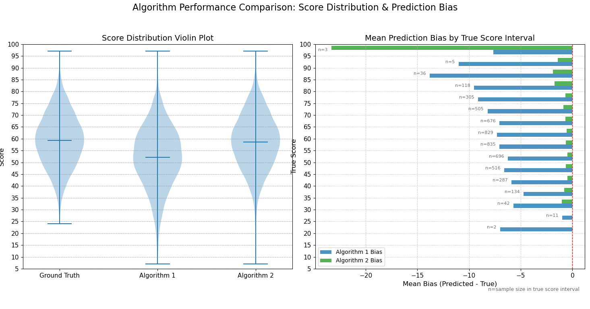
### Left Plot: Score Distribution 

This plot displays the overall distribution of ground truth scores and predicted scores from both algorithms.

- **Shape width**: Represents data density at each score level. Wider sections indicate more data points.
- **Internal box**: The middle horizontal line represents the median, and the box represents the data range from 25% to 75% (interquartile range).

#### Analysis Points:

**Ground Truth:**
- Score distribution is relatively concentrated between 40-80 points, with a median around 59.
- This serves as the benchmark; an ideal algorithm should generate a similar distribution.

**Algorithm 1 (GA):**
- Its distribution shape is similar to ground truth but shifted toward lower scores.
- Its median is significantly lower than ground truth, around 53 points.
- This indicates that Algorithm 1 (GA) systematically underestimates scores, with predictions generally lower than actual values.

**Algorithm 2 (Transformer):**
- Its distribution shape and position highly align with ground truth.
- Its median almost coincides with ground truth's median, both around 59 points.
- This indicates that Algorithm 2 (Transformer)'s predicted scores closely match the actual distribution with no obvious systematic bias.

**Summary:** From the score distribution perspective, Algorithm 2 (Transformer) successfully replicates the distribution characteristics of ground truth, while Algorithm 1 (GA) shows clear underestimation tendencies. However, both predictions contain very few extreme minimum value outliers.

---

### Right Plot: Mean Prediction Bias by True Score Interval

This plot provides deeper bias analysis by dividing data into 5-point intervals based on true scores (Y-axis), then calculating the average difference between algorithm predictions and ground truth within each interval (i.e., mean bias = predicted value - true value).

- **X-axis**: Represents mean bias
  - Negative values: Underestimation (predicted value < true value)
  - 0 value (red dashed line on right): No bias, the ideal state
  - *Note: All biases with ground truth are negative because these are scores obtained using the insertion simulation function `simulate_insertion_tool` (code in [code_path](https://github.com/tcita/card-game-ai/blob/master/AI_algorithm/tool/tool.py#L41)) based on model-predicted operations. This value must be ≤ theoretical optimal score, so algorithms can only underestimate scores, and x-axis values can only be non-positive.*

- **Y-axis**: True score intervals
- **Bars**: Blue represents Algorithm 1 (GA) bias, green represents Algorithm 2 (Transformer) bias
- **n**: Indicates sample count within each score interval; larger sample sizes yield more reliable bias results for that interval

#### Analysis Points:

**Algorithm 1 (GA) (Blue bars):**
- GA's prediction bias generally increases proportionally with score level

**Algorithm 2 (Transformer) (Green bars):**
- Green bars are close to the 0-value line, indicating very small bias
- In most score intervals, Algorithm 2 only slightly underestimates, but in low-score ranges (e.g., 25-30 points) and extremely high-score ranges (e.g., 95-100 points), its bias is relatively severe
- Compared to Algorithm 1 (GA), Algorithm 2 (Transformer) has better bias control

**Summary:** The bias analysis chart confirms the violin plot conclusions. GA exhibits widespread underestimation compared to Transformer, while Algorithm 2's prediction bias is very small.

---

## Overall Conclusion

**Algorithm 2 is significantly superior to Algorithm 1 in prediction accuracy and is the better choice.** Although Algorithm 2's runtime is much longer than Algorithm 1, its prediction results align well with ground truth across all core metrics with smaller errors.

**Common weakness:** Both have suboptimal extreme value predictions. I believe this is due to the proportion of extreme value points at the distribution edges in the training set, and it's possible that certain score ranges with high bias encountered out-of-distribution samples.

---

## Comparison of "Padding" vs "Skipping" (Ablation Study)

Now we return to using the "skipping" method to process the dataset and perform the same statistical analysis.

Since the process is almost identical to "padding," only an overview is provided here.

### Obtaining and Preprocessing Datasets

Obtained `data_GA_skip.json` and `data_transformer_skip.jsonl` datasets and preprocessed them (after skipping samples where move length ≠ 3, approximately 90% of data remains; 5M dataset × 90% is large enough for sufficient training).

Trained models and saved them, using the same evaluation method as the "padding" approach (Algorithm 1 represents GA, Algorithm 2 represents Transformer).

### Table 2: Skip Strategy Results

| Metric                  | Algorithm 1 (GA) | Algorithm 2 (Transformer) | Ground Truth |
|------------------------|------------------|---------------------------|--------------|
| **Average Score**       | 52.51           | 56.24                     | 59.43        |
| **Median Score**        | 53.00           | 58.00                     | 59.00        |
| **Score Std Dev**       | 13.02           | 15.15                     | 11.24        |
| **Minimum Score**       | 4               | 2                         | 23           |
| **Maximum Score**       | 92              | 99                        | 99           |
| **Runtime (seconds)**   | 39.91           | 82.17                     | -            |
| **MSE**                 | 103.87035       | 87.87605                  | -            |

| Bias Analysis (Ground Truth - Predicted Value) | Algorithm 1 (GA) | Algorithm 2 (Transformer) |
|------------------------------------------------|------------------|---------------------------|
| **Mean Bias**                                   | -6.92           | -3.19                     |
| **Median Bias**                                 | -5.00           | 0.00                      |
| **Std Dev Bias**                                | 7.48            | 8.81                      |
| **Minimum Score Bias**                          | -38             | -59                       |
| **Maximum Score Bias**                          | 0               | 0                         |

| Statistical Tests and Effect Size Analysis | Algorithm 1 (GA) | Algorithm 2 (Transformer) |
|--------------------------------------------|------------------|---------------------------|
| **t-statistic**                             | -130.754         | -51.232                   |
| **p-value**                                 | 0.000e+00        | 0.000e+00                 |
| **Statistical Significance**                | Significant (p < 0.05) | Significant (p < 0.05) |
| **Cohen's d**                               | -0.925           | -0.362                    |
| **Effect Size**                             | Large            | Small                     |

---

### Experimental Conclusion

Comparing with Table 1 (using "padding" strategy): After using the "skipping" method to process the dataset, although Algorithm 1 (GA) metrics are not significantly affected, **Algorithm 2 (Transformer) shows clear performance degradation**:
- MSE significantly increased (14.24 → 87.88)
- Average and median scores decreased
- Bias from ground truth clearly increased
- Standard deviation increased
- Effect size analysis changed from "very small" to "small"

### Figure 3 Analysis


Comparing Figure_1.png with Figure_3.png, we can intuitively observe from the plots that Algorithm 2 (Transformer) exhibits significantly worse bias for low scores. Comparing the previous violin plots and bias bar charts, the low-to-medium score range shows noticeably more severe bias.

**My interpretation:** GA is heuristic-based, so the method for calculating scores is defined by us. As for padding the training set with 0s, this may have enabled the model to learn to identify situations where "no matter how cards are played, no points can be scored," thus allowing Transformer to learn additional features. These characteristics play an important role in low-score range predictions (situations where "no matter how cards are played, no points can be scored" are more common in low-score ranges), which significantly impacts results.


---

## Ensemble Model Proposal

Since these two models have different training methods, I hypothesized they focus on different aspects. When Transformer predicts poor results, GA might perform better. Moreover, GA is very fast, so integrating GA into Transformer wouldn't cause much additional time consumption.

To verify this hypothesis, I used this method to simply ensemble Transformer and GA together: For the same pair of A and B, both models predict simultaneously, calculate the true scores for both strategies, and return the higher score between the two.

```python
move1 = Transformer_Strategy(A, B)
score1 = strategy_TrueScore(A, B, move1)

move2 = GA_Strategy(genome, A, B)
score2 = strategy_TrueScore(A, B, move2)

if score1 < score2:
    return move2
else:
    return move1
```

Similarly, let's examine the evaluation results of the current Transformer + GA ensemble model versus the Transformer model (previous Algorithm 2). Re-testing with **20,000 iterations**:

### Table 3: Ensemble Model Results

| Metric                  | Algorithm 1 (GA+Transformer) | Algorithm 2 (Transformer) | Ground Truth |
|------------------------|------------------------------|---------------------------|--------------|
| **Average Score**       | 58.93                        | 58.59                     | 59.25        |
| **Median Score**        | 59.00                        | 59.00                     | 59.00        |
| **Score Std Dev**       | 11.38                        | 11.73                     | 11.24        |
| **Minimum Score**       | 16                           | 5                         | 21           |
| **Maximum Score**       | 98                           | 98                        | 98           |
| **Runtime (seconds)**   | 228.56                       | 139.63                    | -            |
| **MSE**                 | 3.6578                       | 13.2122                   | -            |

| Bias Analysis (Ground Truth - Predicted Value) | Algorithm 1 (GA+Transformer) | Algorithm 2 (Transformer) |
|------------------------------------------------|------------------------------|---------------------------|
| **Mean Bias**                                   | -0.32                        | -0.66                     |
| **Median Bias**                                 | 0.00                         | 0.00                      |
| **Std Dev Bias**                                | 1.88                         | 3.57                      |
| **Minimum Score Bias**                          | -26                          | -52                       |
| **Maximum Score Bias**                          | 0                            | 0                         |

| Statistical Tests and Effect Size Analysis | Algorithm 1 (GA+Transformer) | Algorithm 2 (Transformer) |
|--------------------------------------------|------------------------------|---------------------------|
| **t-statistic**                             | -24.347                      | -26.153                   |
| **p-value**                                 | 4.661e-129                   | 2.824e-148                |
| **Statistical Significance**                | Significant (p < 0.05)       | Significant (p < 0.05)    |
| **Cohen's d**                               | -0.172                       | -0.185                    |
| **Effect Size**                             | Very Small                   | Very Small                |

---

### Analysis:

**Bias:** **Algorithm 1 outperforms Algorithm 2 across all bias metrics**, with smaller mean, standard deviation, and minimum score biases, indicating its predictions are overall closer to ground truth.

**Statistical Tests:**
- Differences between both algorithms' predictions and ground truth are **statistically significant** ($p < 0.05$), meaning these differences are unlikely due to random factors.
- However, **Cohen's d** analysis shows both algorithms have **very small** effect sizes. This indicates that while differences are statistically significant, the magnitude of these differences is extremely small in practical applications.

---

### Conclusion

**The hypothesis is validated.** GA assisted Transformer **546 times** out of 20,000 runs. Although the proportion of "assistance" is extremely low (546/20,000 ≈ 0.027 or 2.7%), improvements are seen across nearly all metrics, with **significant impact on accuracy (MSE reduced by 72%)**. Due to serial execution and calling `strategy_TrueScore`, Transformer + GA ensemble has **63% more runtime** than Transformer alone.

### Figure 2 Analysis
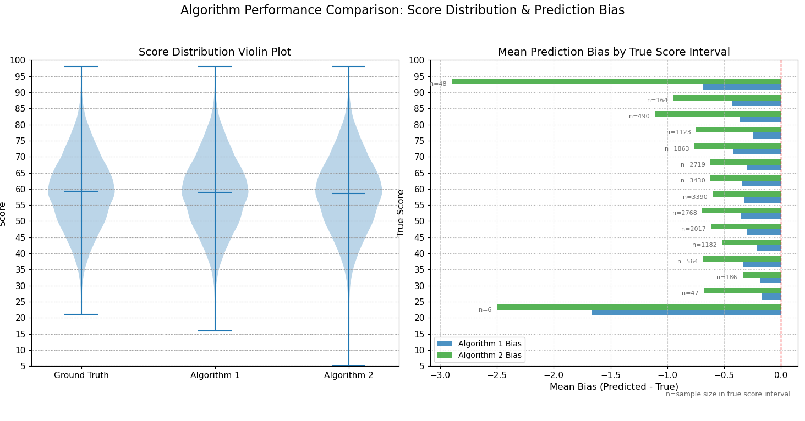
By observing the violin plot and bias bar chart, we can intuitively perceive the improvement in prediction accuracy of our ensemble model.


# Ensemble Model Code Performance Optimization

Now, based on the above discussion, let's try to use the newly obtained Transformer + GA model to challenge the original exhaustive recursive algorithm in terms of running speed (we've already analyzed accuracy, and exhaustive recursion yields the ground truth).

**Important Note:** The batch processing discussion here is based on Transformer + GA's offline computation with large data volumes. However, it is **not suitable for real-time processing scenarios** requiring low latency, immediacy, and small single-request data volumes (such as our game).

## Characteristics of the Ensemble Model

For this Transformer + GA ensemble model:

- **Genetic Algorithm (GA):** Its prediction logic is greedy and serial, not suitable for batch prediction.
- **Transformer Model:** Its model architecture and computation method are parallel, very suitable for GPU batch prediction (this is one of the advantages of neural networks).

## Implementation Strategy

### Transformer Batch Processing
Convert Transformer's prediction to batch processing.

### Parallel Execution with Threading
Use `ThreadPoolExecutor` to launch two threads: one for GA and one for Transformer for parallel prediction.
- GA is **CPU-intensive**
- Transformer is **GPU-intensive**

This approach effectively utilizes hardware performance. Although the code is affected by the GIL (Global Interpreter Lock), it still provides significant speedup:

**When using GPU:**
- Transformer inference tasks are mainly executed by the GPU, while GA tasks are executed by the CPU
- `threading` coordinates these two, achieving true parallel use of GPU and CPU resources, because GPU computation doesn't depend on the GIL

**When using CPU only:**
- Although both tasks run on CPU, because PyTorch and NumPy libraries release the GIL during their core computation parts, the GA thread can still acquire the GIL and get execution opportunities while the Transformer thread waits for its C++ backend to complete computation
- While this isn't perfect hardware parallelism, it's still much faster than serial execution

## Batch Ensemble Model Prediction Function

```python
def Transformer_predict_batch_plus_GA(A_batch, B_batch, genomeforassist, TR_model, 
                                       num_a=6, num_b=3, device='cuda')
(Implementation in https://github.com/tcita/card-game-ai/blob/master/AI_algorithm/Trans.py#L737)
"""
Batch prediction using trained Transformer model (for A=6, B=3).

Parameters:
    A_batch: List of lists, each inner list is an A sequence of length num_a
    B_batch: List of lists, each inner list is a B sequence of length num_b
    model: TransformerMovePredictor model instance
    num_a: Length of A sequence, default is 6
    num_b: Length of B sequence, default is 3
    device: Computing device, default is 'cuda'

Returns:
    List: moves_batch
"""
```

## Timing Function

```python
def execution_time()  (Implementation in https://github.com/tcita/card-game-ai/blob/master/AI_algorithm/Trans.py#L1026)
```

Uses 20,000 `{A, B}` samples to test:
- Recursive algorithm
- Batch-optimized Transformer + GA
- Non-batched Transformer
- Serial GA
- Exhaustive recursion runtime

**Small trick used:** The `black_hole` function modifies a global variable to ensure the interpreter doesn't optimize away unused functions, preventing inaccurate runtime measurements.

```python
def black_hole(value):
    global _BLACK_HOLE_SINK
    _BLACK_HOLE_SINK = value
```

---

## Experimental Results and Analysis

After 20,000 iterations, here are my results (batch_size is 2048, same as training):

| Method | Total Time (seconds) |
|--------|---------------------|
| **Transformer+GA (batch + parallel optimization)** | **42.785322** |
| **Transformer (unoptimized, serial execution)** | 63.076156 |
| **GA** | 48.705127 |
| **recursive_Strategy** | 47.794147 |

---

### Analysis

**Unoptimized Transformer vs GA:**
- Unoptimized Transformer prediction speed is approximately **0.77× of GA** (slower than GA)

**With Batch Processing:**
The situation is completely different. When data scale reaches a certain level in offline computation scenarios, the improvement from batch processing is very significant.

**Simple estimation:** Without optimization, the ensemble Transformer + GA model runtime should be greater than the sum of running them separately:
$$48.7 + 63.1 = 111.8 \text{ seconds}$$

**However**, in this test, the optimized ensemble model has the **shortest runtime**, proving our optimization is **highly effective**.

### Key Findings

1. **Batch processing dramatically improves Transformer performance** - reducing time from 63.08s to contributing to a combined 42.79s
2. **Parallel execution of GPU (Transformer) and CPU (GA) work** enables both to run simultaneously rather than sequentially
3. **The optimized ensemble model (42.79s) is faster than:**
   - Unoptimized Transformer alone (63.08s)
   - GA alone (48.71s)
   - Even competitive with exhaustive recursion (47.79s)
4. **The optimization achieved approximately 2.6× speedup** compared to the naive serial combination (111.8s estimated vs 42.79s actual)

This demonstrates that with proper optimization (batching and parallelization), the ensemble model can achieve both high accuracy and competitive runtime performance, making it practical for large-scale offline processing scenarios.

# Analysis of Modeling Paradigm Conflicts and Inductive Biases in Transformers

<!-- 语言还待打磨,可以更把Conflicts的原因讲的更清晰 -->

I attempted to include the `max_score` from the training set (i.e., the score corresponding to the optimal play strategy, which represents the highest possible score at that moment) in the training process, using A and B as inputs and `max_score` as the target. When examining solely the accuracy of the predicted `max_score`, the results were excellent. The difference between the model's predicted scores and the actual values was generally minimal.

However, through testing, I discovered that the model's high accuracy in predicting `max_score` was only limited to cases where A and B had lengths of 6 and 3, respectively. In other words, the model had not learned the "true" universal method for calculating scores. For instance, when length(A)=9 instead of 6, the prediction results were quite poor.

I also attempted to include `max_score` as an additional auxiliary feature to guide the generation of `best_move`. Unfortunately, this made almost no difference, meaning the model failed to recognize the relationship between `max_score` and `best_move`. Therefore, I abandoned this idea and continued to use only A and B as input features. Since the specific steps of these experiments were essentially the same as the Transformer experiments I demonstrated previously, only with different parameters, I will not elaborate further on the training details and evaluation.

Additionally, it is necessary to examine the permutation invariance issue. One might question: does this problem truly require permutation invariance? My answer is affirmative. Reviewing the game rules, for the same A and B, the maximum score obtainable remains the same regardless of any arbitrary ordering.

## Permutation Invariance Test

Using a sample with A and B that fully meets the requirements, I generated all permutations of B while keeping other data unchanged, combining them with the original sample to expand the test set. I then tested the Transformer model using this test set. If the test results are consistent with the original sample, this indicates the model is permutation-invariant.

Here are the test results from two randomly selected samples:

**Recursive** represents the theoretical maximum score obtained through recursion.

```
A:[11, 13, 3, 10, 12, 6], B: [13, 8, 1], Transformer result: 66, Recursive result: 66
A:[11, 13, 3, 10, 12, 6], B: [13, 1, 8], Transformer result: 66, Recursive result: 66
A:[11, 13, 3, 10, 12, 6], B: [8, 13, 1], Transformer result: 45, Recursive result: 66
A:[11, 13, 3, 10, 12, 6], B: [8, 1, 13], Transformer result: 45, Recursive result: 66
A:[11, 13, 3, 10, 12, 6], B: [1, 13, 8], Transformer result: 38, Recursive result: 66
A:[11, 13, 3, 10, 12, 6], B: [1, 8, 13], Transformer result: 38, Recursive result: 66

A:[6, 5, 9, 11, 10, 13], B: [6, 3, 7], Transformer result: 70, Recursive result: 70
A:[6, 5, 9, 11, 10, 13], B: [6, 7, 3], Transformer result: 70, Recursive result: 70
A:[6, 5, 9, 11, 10, 13], B: [3, 6, 7], Transformer result: 12, Recursive result: 70
A:[6, 5, 9, 11, 10, 13], B: [3, 7, 6], Transformer result: 12, Recursive result: 70
A:[6, 5, 9, 11, 10, 13], B: [7, 6, 3], Transformer result: 12, Recursive result: 70
A:[6, 5, 9, 11, 10, 13], B: [7, 3, 6], Transformer result: 12, Recursive result: 70
```

Comparing the different Transformer predictions within the same sample combination against the constant true theoretical maximum score is sufficient to refute the claim that the Transformer model is permutation-invariant.

## Conclusion

After detailed code review, a clear conclusion can be drawn: this TransformerMovePredictor model is highly sensitive to the element order of input sequence B. For the same hand, different initial permutation orders will lead the model to generate different feature inputs and ultimately different strategy predictions. By design, this model is not "Permutation-Invariant."


## Root Cause Analysis

This order sensitivity stems from two levels: data processing and model architecture:

### Order Dependency at the Feature Engineering Level

The `future_score` feature introduces explicit order dependency when generating feature vectors for each card element.

- **Key feature `future_score_ratio`**: This feature's calculation is based on all subsequent elements after the current element in list B (`remaining_B = B[i + 1:]`). This means that the "future score" feature value associated with an element directly depends on its position in the input sequence.

- **Example**: For hand B = [10, 20, 30], when calculating features for element 10, its "future" hand is [20, 30]. However, for hand B = [30, 20, 10], when calculating features for element 10, its "future" hand is an empty set []. This results in the same card element having completely different feature vectors input to the model under different input orders.

### Order Sensitivity at the Model Architecture Level

The Transformer architecture itself is designed to process ordered sequences, and its core components reinforce order dependency.

- **Positional Encoding**: The model explicitly adds unique positional encoding information to feature vectors at the input layer. Therefore, even if two elements have identical feature vectors, as long as they are at different positions in the input sequence, the initial information received by the model is different.

- **Self-Attention Mechanism**: This mechanism updates each element's representation by computing the interrelationships among all elements in the sequence. The entire computation process is global and depends on both relative and absolute positions of elements. Any change in input order will completely alter the distribution of attention scores, leading to differences in final output.

### Considerations on Current Model's Generalization Feasibility

The conflict between standard Transformer's modeling paradigm and the original problem cannot be ignored. Moreover, at higher data scales, both the current Transformer and GA features may struggle to adapt, especially the `future_score` feature—which is crucial in the current special case—is customized based on the assumption that both A and B are very small in length. It implicitly assumes length(B) ≤ 3.

When A and B are very large:
- If we continue using `future_score`, since it only provides a lookahead for scores when length(B) < 3, this lookahead will have minimal impact on the overall score
- Additionally, obtaining large-scale training sets with high data volume may be very difficult
- The lack of permutation invariance leads to weak robustness

### Potential Solutions and Their Trade-offs

**Solution 1: Test-Time Augmentation (TTA)**
Of course, we can use an approach similar to ensemble GA: compute all permutations of B, then make predictions for each B permutation combined with A, and take the maximum predicted result to mask the permutation invariance problem. One specific method is TTA (Test-Time Augmentation). However, this brings length(B)! times the number of predictions, resulting in much higher runtime.

**Solution 2: Modified Model Architecture**
If we modify the model architecture, we can resolve order sensitivity. For example, using Set Transformer ideas: remove positional encoding and use permutation-invariant aggregation functions, instructing the model to treat B as an unordered set. However, the problem is that B is unordered while A is ordered—this may require a hybrid model architecture.


### Failed Attempts

I conducted several attempts based on these ideas. The main concept was to **transform the handling of the cards-to-be-played group (B cards) from an "ordered sequence" to an "unordered set"**.

Model training code can be found at: [source code](https://github.com/tcita/card-game-ai/blob/master/AI_algorithm/Enhanced_Trans.py)

Subsequent testing proved that although it did solve the permutation invariance problem of group B (the future_score calculation no longer relied on "hard-coding" but instead used a more general dynamic greedy strategy), its accuracy decreased. It performed premature abstraction and information aggregation precisely when individual details needed to be preserved most, thereby losing critical signals necessary for making precise decisions. The previous Transformer's future_score was too idealistic and perfect, while the new hybrid model, in order to adapt to the new data, overlooked that the core of this task is not a pure set processing problem.

Although B itself is unordered, the final decision—which B element to insert into which position in A—is a relational reasoning problem that highly depends on individual-to-individual (B_i vs A_j) and individual-to-order (B_i vs the ordered structure of A) relationships. Additionally, the adjustments made caused it to lose key heuristic optimizations for special cases. We can observe where this new model fails from the attention map:

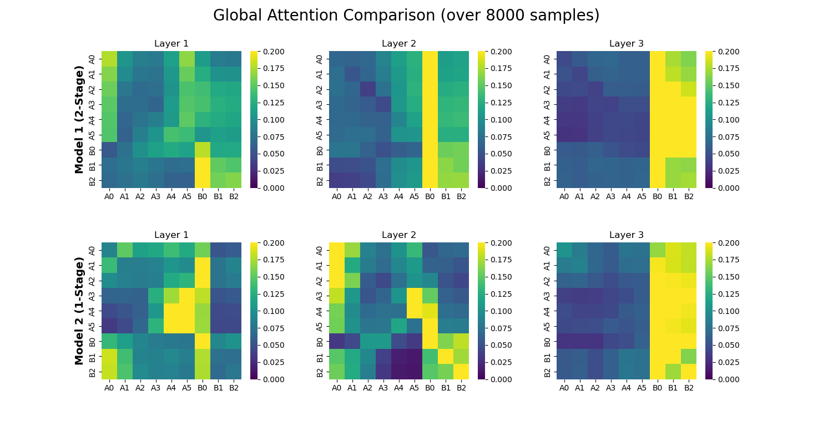

> model1 represents the original model, model2 represents the hybrid model I attempted

From beginning to end, the model treats all input features (A and B) as a whole for processing. Each layer updates the understanding of all features globally, without shifting attention away from any particular part in later stages. This is the behavior of a standard Transformer encoder, which also leads to a certain conflict between the modeling and the original problem. Such a design is problematic.


## Part III: Server Development and Game Architecture

In the game's PVE scenario, the strategy is real-time, and even with a lower-performance serial implementation, the AI's computation time per request is short enough (63/20000=0.00315s=3.15ms). Therefore, we continue to use the CPU-only serial GA+Transformer integrated model, as it is more suitable for building our game's local server.

The server will exchange data with the Unity game (client). The client sends A and B, the server makes predictions based on the received A and B, returns the strategy (best_move), and then returns the prediction results to the client for automated computer player operations.

The web framework used here is Flask.

Code implementation can be found at: [source code](https://github.com/tcita/card-game-ai/blob/master/AI_algorithm/server.py)

Then Docker is used to containerize the server. This packages it with its runtime environment, allowing it to run independently of the original development environment. After testing, the packaged server runs normally.


### Unity Project Architecture

#### Server Containerization and Usage

Unity was chosen as the tool for building the game client mainly because it is a game engine that provides convenience for game development, with relatively simple and easy-to-use functions that are also powerful enough.

Unity Version Control (UVCS/Plastic SCM), specifically designed for Unity projects, was used as the version control tool.

To facilitate image portability, the written server project was containerized using Docker and packaged as gameserver_v1.tar.

**Step-by-step instructions:**

After installing Docker Desktop on Windows:

Complete the project's requirements.txt file

Use `docker init` to create the Dockerfile and make necessary modifications, edit .dockerignore to ignore files not needed for the server project

In the server project root directory on the Windows system:

Build the image:
```
docker build -t gameserver:1.0 .
```

Export the image:
```
docker save -o ./gameserver_v1.tar gameserver:1.0
```

The method to start the server based on the packaged image is:

1. Load the tar format image (only needs to be loaded once during initial deployment; generally no need to load again after the image is built)

```
docker load -i gameserver_v1.tar
```

2. Create and start the container based on the image
```
docker run -p 5000:5000 --name gameserver gameserver:1.0
```

#### Unity Frontend Architecture

Unity's programming paradigm differs significantly from general software development. Unity's C# script code is deeply coupled with Unity's own components. To fully understand the functionality of a piece of code, one must first have a certain understanding of the Unity engine itself.

I developed based on the Unity community framework [2], where the key points at the code level are: understanding the logic and complex inheritance relationships of the framework APIs, and how to use various APIs combined with Unity components for programming to achieve the desired functionality. This is difficult to describe in words and somewhat disconnected from the main theme of this document. Therefore, I present C4 model diagrams of the Unity architecture I designed and implemented to explain this Unity client, focusing our attention on the software architecture:

Using draw.io to create C4 model drafts, then writing DSL scripts and rendering them as PNG format images:

#### C4 Model Architecture Diagrams

<style>
  /* This is CSS styling that tells the PDF renderer how to handle images */
  img {
    page-break-inside: avoid; /* Core rule: prohibit page breaks inside images */
    max-width: 100%;          /* Ensure images don't exceed page width */
    display: block;           /* Make images block-level elements for easier margin setting */
    margin-top: 20px;         /* Leave some space above the image */
    margin-bottom: 20px;      /* Leave some space below the image */
    margin-left: auto;        /* Together with the next line, center the image horizontally */
    margin-right: auto;
  }
</style>

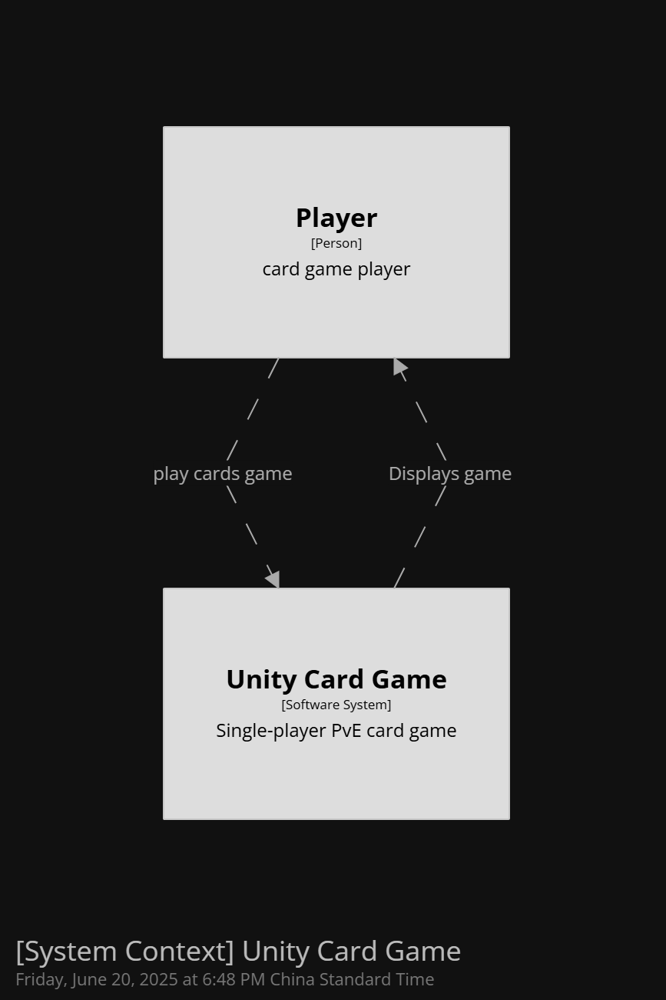

### Context Diagram

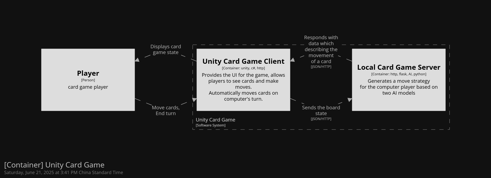

### Container Diagram

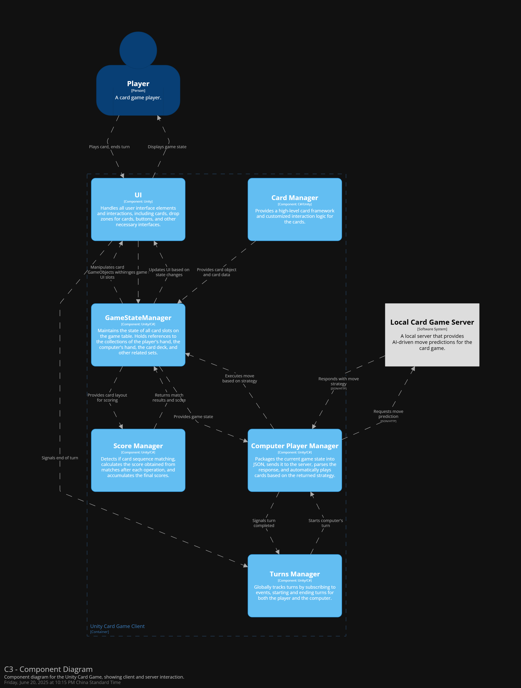

### Component Diagram

Here are some examples of design patterns used in this Unity client:

**Singleton Pattern **
Objects of classes responsible for module functionality (such as TurnsManager, CardManager, etc.) have one and only one global instance, avoiding duplicate resource initialization.

**Adapter Pattern **
Inside the client, the computer's action strategy is an array, but the action strategy obtained after requesting the server is a JSON format object. Here, ServerManager is needed to parse the JSON object for adaptation.

**Observer Pattern **
At the beginning and end of a turn, or after a scoring situation occurs (called a "match" in our project), a publish-subscribe mechanism is used to publish state change signals, notifying all observers subscribed to the event to perform corresponding logical behaviors.

**Prototype Pattern **
In the game, there exists a visual, reusable card prefab component that defines the most basic framework of a card (model, material, scripts, collision box, etc.). Each card in the card game scene is efficiently cloned based on this prefab component and then customized. This prefab is the prototype object for all cards (The Prototype).

**State Pattern **
In the game scene, the operational logic of cards needs to change according to different states.

For example:
- Whether it is the player's hand card (the player cannot move the computer's hand cards)
- Whether it is in the discard pile (cards in the discard pile cannot be operated on anymore)

#### Game Demo Demonstration

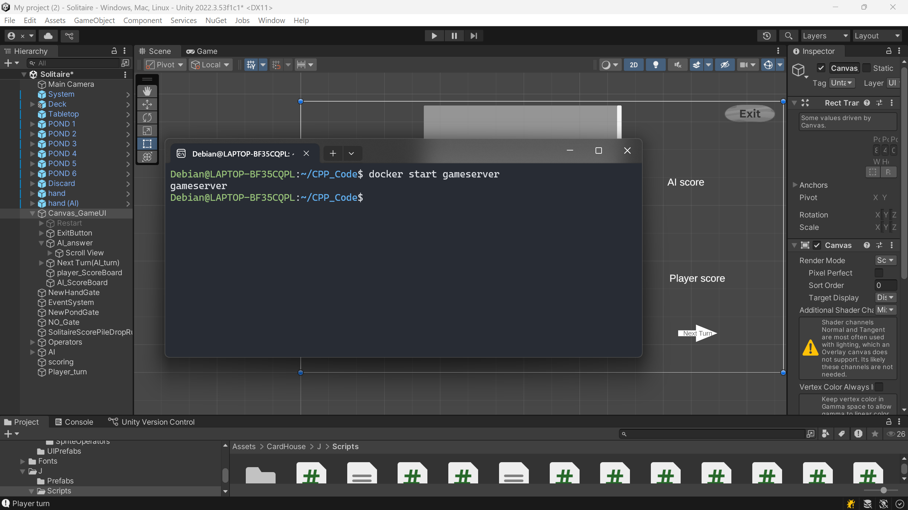

enter `docker start gameserver` in the Debian terminal running on WSL2 to start the server.

***
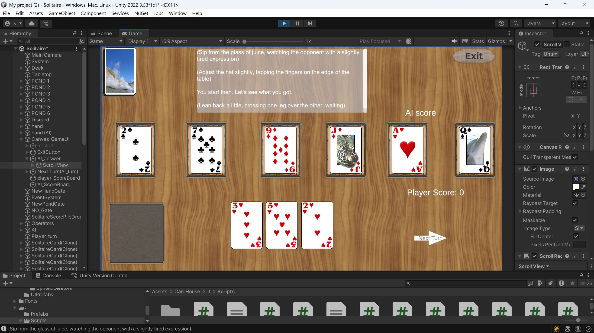

Starting the game in Unity project's development interface, the cards in the middle of the screen are the cards on the field, a total of 6 cards (A in the card game optimal strategy problem).
The 3 cards below are the player's hand cards (B in the card game optimal strategy problem).
(
The text in the transparent dialog box above is randomly generated greetings I called using the Qwen* API online. I set several initial personalities:
{
      "Absent-minded", "Graceful", "Impatient", "Emotionally fragile",
      "Pessimistic", "Gentle", "Competitive", "Vain", "Shy", "Nervous"
      ,"relaxed","anxious"
}
One is randomly selected locally (the reason for using local randomization rather than letting the LLM randomize is that, through my testing, before this document was completed, Qwen had a tendency to favor positive personality choices), used as one of the Prompts, combined with other prompts to have the LLM generate a sentence to greet the player. This time the randomly selected personality was Pessimistic.

>[Qwen]* LLM developed by Alibaba
***
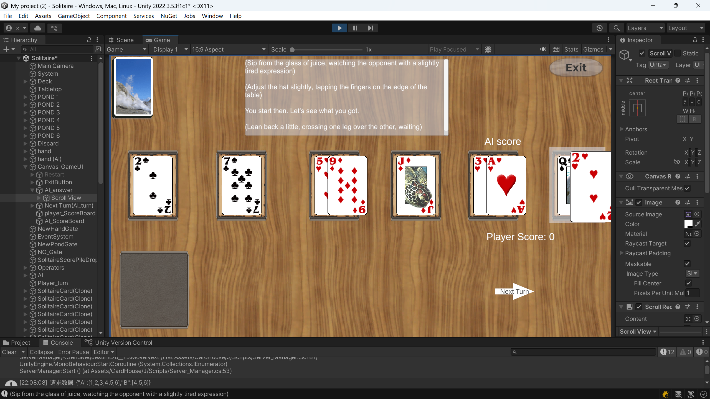

First is the player's turn. I played 3 cards. Note that the first two cards did not cause a match, but the last card's value is the same as the first card on the field, both are 2, so it matches all cards and scores.

The player's score will be updated to the sum of all card values.
>The values of J, Q, K are considered as 11, 12, 13
***
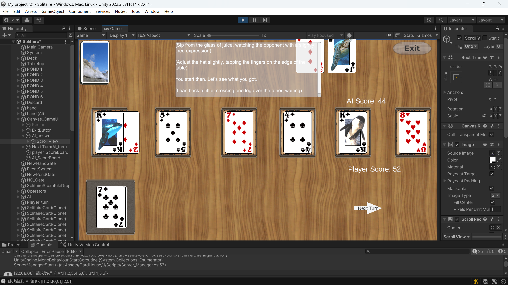

The player's score is updated to 52, the player ends their turn, entering the computer's turn.
The computer's hand is initialized to [K,J,3] (or [13,3,11]), the cards on the field are initialized to [2,5,7,4,K,8] (or [2,5,7,4,13,8])
>Here the computer's hand card sorting method [K,J,3] is based on the order in which the computer received the cards

The computer inserts K from its hand to the front of the cards on the field. It matches and scores, and is eliminated. The cards on the field become [8], the computer scores 44.
***
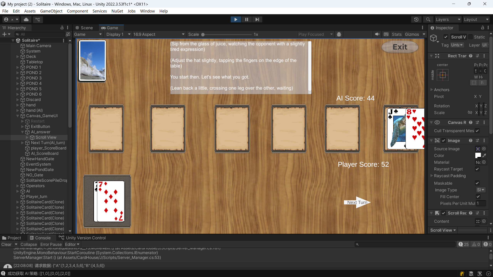
It can no longer score, but the computer follows the strategy to insert the card at the front of the remaining cards on the field.
***
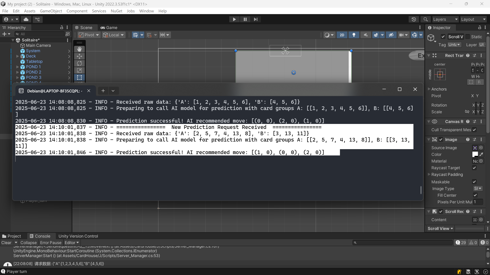
Opening the server log, we can observe that the computer's actual card-playing strategy is consistent with the data sent and received by the server (the output above the highlighted part of the log is the fixed communication check when the server is initialized).


### Appendix:

**Special Tree Structure :**

When thinking about optimization methods, I tried using a tree to intuitively represent this problem to obtain a better algorithm. During this process, I discovered such a tree structure:

A tree of depth k, with root node value 0, all leaves at the k-th level. The value of each non-root node is a positive integer between 1 and n. For any path from root to leaf, node values are strictly increasing. This tree contains and only contains all paths satisfying the above conditions. The question is: how many leaf nodes does this tree have?

Each path from root node to leaf needs to have a number, which is equivalent to P(n, k). The condition of being strictly increasing strictly stipulates that after the numbers are determined, there is one and only one order on the path, which cannot be permuted, so the result is P(n, k)/k!, which is C(n, k). Moreover, each path intuitively shows every case of the combination number.

Consider the multiset problem discussed in algorithm analysis: from the set composed of {A,A,A,A,A,A,B,B,B}, elements are taken out without replacement and all placed in a one-dimensional array. How many different arrays of length 9 can be formed? The solution to this problem is C(9,3)*C(6,6).

For convenient demonstration, we reduce the scale to observe. Assume the multiset is {A,A,A,B,B}.

This corresponds to k=3, n=5. After assigning sequence numbers [1~5] to these elements,

A tree can be generated:
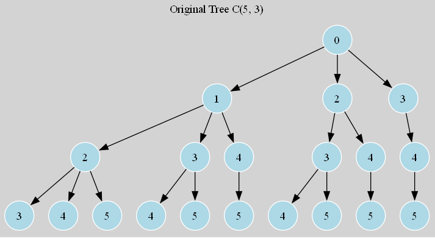

For each path:
Connect an ascending linked list composed of the remaining unselected (n-k) elements to the leaf node (ascending can be extended to any bijection rule).

According to C(n, k) = C(n, n-k), each root-to-leaf path (ignoring the root value 0) corresponds to a non-repeating array possibility, and the array set composed of values on each path corresponds one-to-one with each array in the problem.

Based on the tree's rules, the above diagram can be extended to:
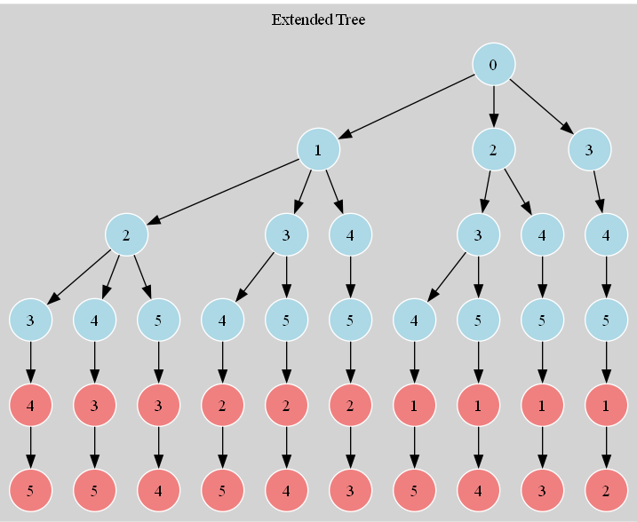

Of course, there is still a certain difference between the current tree structure and the card insertion score maximization problem we are studying. It also includes adding "card values" (1~13) to nodes, distinguishing "type values" of A and B, then adding matching rule operations (after considering matching rules it becomes very complex, requiring the design of many operation functions for this tree; to achieve these goals, the tree structure may need to undergo huge changes), etc. However, due to space limitations, we will not discuss further.

Observing this tree in another way, and because the root of this tree has n-k+1 child nodes
(because the path length from root to leaf needs to be k, and the numbers on nodes ≤n, so the child node values of the tree must be ≤n-k+1, otherwise a path of length k cannot be formed)

Consider each child node of the root:

When the value is 1, the nodes on the path from it to the leaf still have (n-1) choices, and (k-1) more need to be selected, so there are C(n-1,k-1) combinations, meaning this node is the ancestor node of C(n-1,k-1) nodes.
When the value is 2, the nodes on the path from it to the leaf still have (n-2) choices, and (k-2) more need to be selected, so there are C(n-2,k-1) combinations, ......

Child node with value (n-k+1): Still need to select (k-1) numbers from {n-k+2,...,n}, there are C(k-1,k-1)=1 path.

$$
\binom{n-1}{k-1} + \binom{n-2}{k-1} + \dots + \binom{n-k+1}{k-1}
$$
Or
$$
\sum_{i=1}^{n-k+1} \binom{n-i}{k-1}
$$

And this sum equals the total number of leaves, so

$$
\sum_{i=1}^{n-k+1} \binom{n-i}{k-1} = \binom{n}{k}
$$

This is the hockey-stick identity (can be proven by continuously recursively expanding the last term based on Pascal's triangle relationship (n k) = (n-1 k) + (n-1 k-1)). This tree cleverly connects data structures and combinatorial problems.


## Author's Q&A 

**Q: Since the special case discussed in this paper can be completely solved by exhaustive search, why use AI?**

**A:** The article uses extensive content and various technical methods to discuss the time consumption at this scale, proving that at the critical point around this data scale (|A|=6, |B|=3), AI agents are feasible, and after parallel optimization can achieve the speed of exhaustive search, but it is unnecessary. This doesn't mean that using AI at this scale is the optimal solution in application, but rather before the discussion, the range of this critical point was unknown and lacked proof, and the choice and effectiveness of the research tools used were also unknown.

**Q: Why is the scale of the special case so small?**

**A:** The time complexity analysis and search space scale analysis all indicate that exhaustive search is infeasible at large scales. However, the workflow in this paper is feasible with very small-scale data. It's small enough to conveniently and accurately obtain training sets through exhaustive search, verify the accuracy of AI methods, and at this scale it's already large enough to study its characteristics and draw some conclusions. Therefore, in larger-scale situations, these workflows and conclusions also provide some replicable and verifiable ideas for reference.

**Q: What directions are there for further research?**

**A:** As discussed in the article, the final AI model obtained - the hybrid strategy Transformer - in my pursuit of better generalization and robustness, lost optimization based on the special case and created design conflicts, resulting in poor performance. This requires more detailed and in-depth research.

Moreover, as data scale increases, it inevitably brings higher complexity, along with more complex modeling requirements. This is very likely to reveal the limitations and bottlenecks of current approaches, but this is the necessary path to research valuable "paradigms". All attempts in this paper are just a tiny first step at the beginning.

All implementation methods in this paper are based on supervised learning, which is still limited by training sets obtained through exhaustive algorithms or collected through other means, as well as manually defined features. If deep exploration proves that Transformers are fundamentally infeasible, in order to implement more general AI models, we can consider incorporating reinforcement learning mechanisms to allow AI to achieve automatic deep reasoning and planning, making final decisions.

From an engineering perspective, we can also look at the client and take further mixing steps. Without using recursive exhaustive search with such time complexity, we can add a simple custom greedy strategy algorithm to the client. Because although the forward-looking nature of AI algorithms (such as future_score) and the Transformer's ability to capture correlations between elements have greatly improved MSE, it actually conflicts with the greedy strategy. In some cases, it may lower the minimum score of special cases due to being overly conservative. We can use this point to design algorithms and mix server strategies. The cost of greedy algorithms is extremely small, and I think this is a valuable engineering attempt.

However, making good use of AI agent models, this heuristic method, to handle generalized hard combinatorial problems is beyond what I can currently accomplish.

This is my project's source code link: [**...**](https://github.com/tcita/card-game-ai/)

Because the Unity version control system is an invitation-only private system, I cannot directly make it public for everyone to access my Unity client project source files. Its architecture and demo screenshots have been described in detail in the main body of the text.


