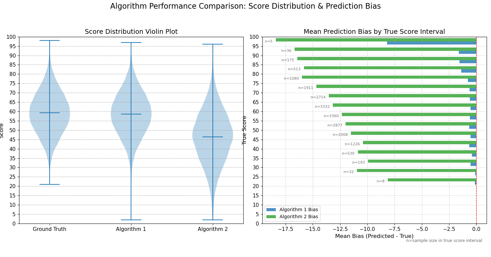
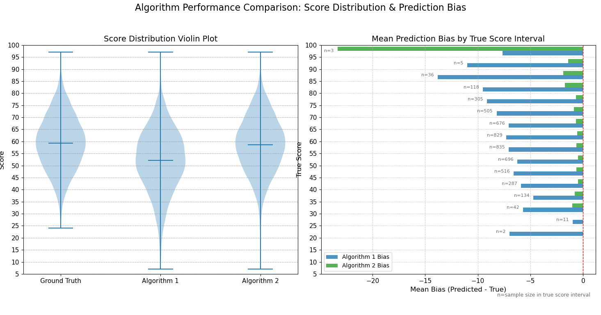
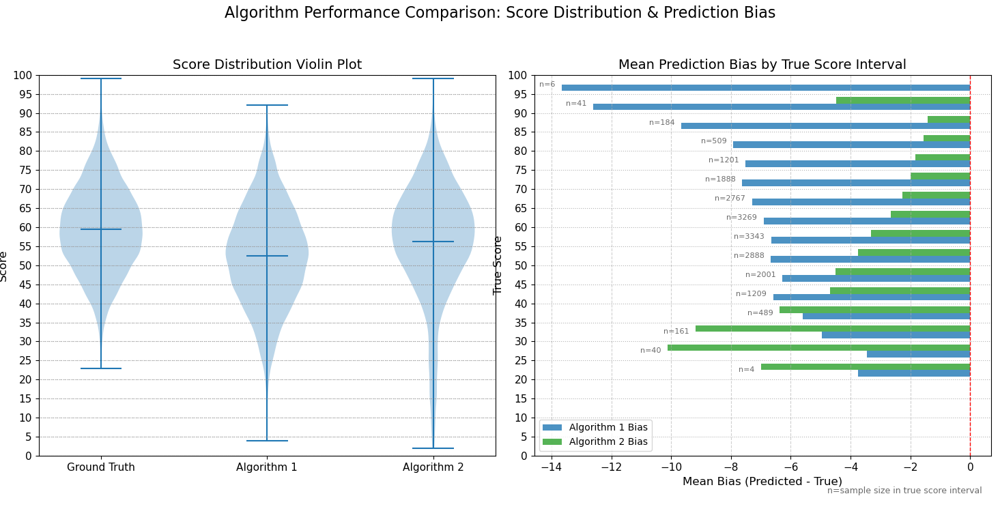

# AI驱动的卡牌游戏---使用ai模型计算 序列插入匹配得分最大化问题

## 概述
这是一款我独立设计并实现的 Unity 引擎开发的自定义规则回合制PVE卡牌游戏，电脑的策略基于一个部署了训练好的ai模型的本地服务器。该游戏的框架基于 [Unity 社区的卡牌框架](https://assetstore.unity.com/packages/tools/game-toolkits/cardhouse-264045) 。

在最开始,我想设计一个有些创新的,并且规则简单,比较依赖运气但是也需要策略的卡牌游戏  所以我设计了这个游戏,将游戏规则抽象为序列插入匹配得分最大化问题. 这个问题的决策空间随着操作步数呈组合爆炸式增长，导致传统的穷举搜索算法在理论上存在严重的可扩展性瓶颈。当问题规模稍有增加，其计算时间便会达到无法接受的程度。

面对这种精确解存在但计算成本过高的困境，本文探索并验证了一种基于AI代理模型（Surrogate Models）的求解通用方法。其核心思想是：利用精确穷举算法在一个可计算的规模内生成高质量的训练样本，然后训练一个计算成本低廉的AI模型来学习其决策行为。

本文的核心工作在于，通过严谨的实验证明了在特定规模下，该范式是成功的——我们构建的集成模型能够以极高的精度复现精确算法的最优策略。这验证了代理模型作为一种计算成本可控的替代方案的潜力。尽管本研究并未直接处理更大规模的问题，但它为解决这类组合优化问题提供了一条可扩展的、工程上可行的技术路径：即通过离线的高昂计算（生成数据）来换取在线的低成本、高质量决策。

游戏规则与“连连看”有点类似，玩家需要通过配对卡牌来消除它们获得得分，到电脑的回合时,电脑会获取当前游戏的局面,将数据传输到本地服务器,得到ai预测的最佳行动后,在给用户展示的客户端执行这些行动,在最后得分高者获胜。具体的游戏规则详见第一部分中的游戏规则,篇文章的重点会放在算法,AI模型和软件架构上


- 相对于一篇严格的学术论文而言 本文更像是一个完成度较高的项目报告，我平衡了深度与广度,在涉及较多技术面的同时做了一些创新和进一步的讨论

## 项目亮点

- **问题建模的抽象与实现**:

- **严谨的算法分析**

- **全面的ai模型评估体系**

- **代理模型的提出和实现**

- **集成模型的批处理和多线程优化**:

- **较复杂的游戏框架的自定义和扩展**

- **端到端的系统构建与实现**

- **讨论了一种能够很好表达组合问题的树结构**

>*注 代码具体实现在code_path中

## 文章结构

本文分为4个主要部分:


### 1.游戏规则以及算法分析
本部分将详细介绍游戏规则以及编程实现，包括：
- **游戏规则**
- **算法分析**：
- **算法优化讨论**：

### 2. AI 技术细节
本部分将详细介绍游戏中 AI 系统的工作原理以及核心函数实现，包括：

- **AI模型的实现**：
- **模型训练**
- **模型评测**
- **集成模型的提出与评测与优化**


### 3. 服务器的搭建与游戏架构(待完成)
本部分将探讨游戏在 Unity 引擎中的开发与实现，重点将放在整个软件的架构上,并展开说明了一些我认为重要的技术实现,包括：

- **AI模型服务器的搭建**

- **游戏的软件框架**：

- **卡牌功能的实现**


### 4.我认为的项目可能的改进方向和前景,以及结语(待完成)

#暂时为草稿:


特殊的树结构:

在思考优化方法时,我尝试了使用树来直观的的表示这个问题,以此得到更好的算法, 期间我发现了这样的树结构 

一棵深度为k的树，根节点值为0，所有叶子在第k层。每个非根节点的值都是1到n之间的正整数。对于任意从根到叶子的路径，节点值严格递增。这棵树包含且仅包含所有满足上述条件的路径  问这棵树有多少个叶子节点 

每一条根节点到叶子的路径都需要有一个数字,这相当于 P(n k) 递增这一条件又严格规定了在数字确定后,路径上的顺序有且仅有一种,不可以排列 ,所以结果是 P(n k)/k!  其实就是C(n k) 而且每一条路径都直观的展示了组合数的每一种情况  

思考在算法分析讨论过的多重集问题{A,A, A,A, A,A, B,B,B}构成的集合中不放回的拿出元素,全部放到一个一维数组里,能构成多少种长度为9的不同的数组 ,这个问题的解是C(9,3)*C(6,6)  

为了方便展示 我们缩小规模来观察 假设多重集是{A,A,A,B,B}

这对应了k=3,n=5时 ,将这些元素设定序号[1~5]后,

可生成树:
(左图)

对于每一条路径
将剩下未被选中的(n-k)个元素组成的升序链表连接到树叶上(这个升序可以为任意的双射规则)

根据C(n, k) = C(n, n-k)  每条根到叶路径(忽略根的值0)都对应了一个不重复的数组可能,并且每条路径的值组成的数组集合一一对应了问题中的每一种数组

依据树的规则,可以表示为
(右图)

当然这样的目前的树结构和我们研究的卡牌插入得分最大化问题还有一定差别 还包括将节点再加入(1~13)的"卡牌点数",区分A和B的"类型值",接着加入匹配规则操作(考虑匹配规则后会很复杂,需要为这棵树加入很多操作函数)等等,但由于篇幅,不再进一步讨论


换一种方式观察这棵树,而且因为这个树的根有n-k+1个子节点
(因为根到叶子的路径长需要为k,且节点上的数字<=n,所以树的子节点的值必须<=n-k+1,否则无法构成长度为k的路径)

考虑每一个根的子节点,

当值为1时,由它到叶子的路径上的节点还有(n-1)种选择,需要再选取(k-1)种 所以有C(n-1,k-1)种组合,也就是这个节点是的C(n-1,k-1)个节点的祖先节点
当值为2时,由它到叶子的路径上的节点还有(n-2)种选择,需要再选取(k-2)种 所以有C(n-2,k-1)种组合,......  

值为(n-k+1)的子节点：还需从{n-k+2,...,n}中选(k-1)个数，有C(k-1,k-1)=1种路径

$$
\binom{n-1}{k-1} + \binom{n-2}{k-1} + \dots + \binom{n-k+1}{k-1}
$$
或者
$$
\sum_{i=1}^{n-k+1} \binom{n-i}{k-1}
$$
    

而这个和会等于总叶子数,所以

$$
\sum_{i=1}^{n-k+1} \binom{n-i}{k-1} = \binom{n}{k}
$$

这也就是hockey-stick恒等式 这棵树巧妙的连接了数据结构和组合问题

        


AI模型:
           

            Transformer和GA都有不同的变体,或者使用更好的特征设计  用它们可能得到更好的模型

实用性:     
            这个游戏设计可能有用  它足够简单,并且包含策略和运气,比如可以整合到大型游戏里作为小游戏 而且这种代理模型的处理方式是可以直接应用到Tile-matching  game 或者  Concentration card game 的  因为在规则上很相似,并且都可以通过穷举得到最佳得分方案  但是由于游戏规模变成了m*n 而不是 1*n 的,所以数据规模会迅速增长


            在离线预测时使用cuda进行批量特征处理 ,使用gpu并行加速,可能可以一定程度代替传统的基于cpu的串行算法


 分布外样本:
        究竟是什么导致了两个模型会在极个别看似没有规律的A，B组合时产生了很大的估计偏差?这或许是ood问题   我使用大量的分布外样本训练出专家模型进行集成,也还是存在预测的偏差 本问题的ood情况已经足够精简与数据化.  我觉得很适合研究


# 第一部分 游戏规则以及算法分析

## 游戏规则以及玩法示例

**开局**

1.  系统创建一个包含52个数字的列表  P ，每个数字从1到13，每个数字严格重复4次（共  13  times 4 = 52  个元素）。
2.  从列表  P  中**随机抽取 6 个不同的元素**，得到列表  A 。
    * **示例：** 假设我们得到  A =  {1, 2, 3, 7, 4, 6 } 。
    * **(补充说明)** 本文具体研究的具体特例的  A  的元素个数固定是6。
3.  再从剩余列表  P  中**随机抽取 3 个允许重复的元素**，得到列表  B 。
    * **示例：** 假设我们得到  B =  {4, 3, 9 } 。
    * **(补充说明)** 本文具体研究的具体特例的  B  的元素个数固定是3。

**可插入位置**

* 列表  A  中的元素之间及其两端是允许插入的位置。
* 对于示例  A =  {1, 2, 3, 7, 4, 6 } ，可插入位置用序号表示是：
    ① 1 ② 2 ③ 3 ④ 7 ⑤ 4 ⑥ 6 ⑦
* 总共有  6 + 1 = 7  个位置。

**回合开始**

* 玩家允许在  B  中选取一张牌插入  A  中的一个可插入位置。
* 牌被选取并插入后，会从  B  中移除，并添加到  A  中。

**示例回合流程**

**第一次出牌**

1.  玩家选择将牌 `3` 从  B  中取出，插入到  A  中的位置 ① (即  A[0]  之前的位置)。
2.   A, B  被更新：
    *  A  变为   {3, 1, 2, 3, 7, 4, 6 } 
    *  B  变为   {4, 9 } 

**匹配规则**

* 观察新插入的牌 (`3`)。在更新后的  A  中，查找数值上与新插入的牌相同的元素。
* **示例：** 新插入的牌是 `3`。在   {3, 1, 2, 3, 7, 4, 6 }  中，`A[3]` 的值也是 `3`，与新加入的 `3` 相匹配。
* **(补充说明)** 在  A  中最多只会有一个元素与新加入的牌匹配，不会出现两个匹配。这是因为初始化时， A  中的元素都是独一无二的。

**得分与移除 (第一次出牌)**

1.  找到匹配后，形成一个序列：从新插入的牌开始，到匹配到的元素结束（包含这两个元素）。
    * **示例：** 新插入的 `3` 在  A[0] ，匹配到的 `3` 在  A[3] 。序列是  A[0]  到  A[3] ，即   {3, 1, 2, 3 } 。
2.  这个匹配的序列将从  A  中被移除。
3.  记录得分：得分为序列中所有元素的数值之和。
    * **示例：** 得分1  = 3 + 1 + 2 + 3 = 10 。
4.   A  会动态更新：
    *  A  移除   {3, 1, 2, 3 }  后，变为   {7, 4, 6 } 。
    *  B  没有改变，仍为   {4, 9 } 。
5.  可插入位置随之改变：对于  A =  {7, 4, 6 } ，可插入位置变成 ① 7 ② 4 ③ 6 ④。

**第二次出牌**

1.  玩家选择将牌 `9` 从  B  中取出，插入到  A  中的位置 ④。
2.   A, B  被更新：
    *  A  变为   {7, 4, 6, 9 } 。
    *  B  变为   {4 } 。
3.  检查匹配：新插入的牌是 `9`。在   {7, 4, 6, 9 }  中，没有其他元素数值为 `9`。
4.  没有匹配发生，所以得分2为 0。
5.   A  和  B  保持当前状态。
6.  可插入位置变成 ① 7 ② 4 ③ 6 ④ 9 ⑤。

**第三次出牌**

1.  玩家选择将最后一张牌 `4` 从  B  中取出，插入到  A  中的位置 ⑤。
2.   A, B  被更新：
    *  A  变为   {7, 4, 6, 9, 4 } 。
    *  B  变为 `{}` (空)。
3.  检查匹配：新插入的牌是 `4`。在   {7, 4, 6, 9, 4 }  中，`A[1]` 的数值也是 `4`，与 `A[4]` 相匹配。
4.  匹配到的序列是  A[1]  到  A[4] ，即   {4, 6, 9, 4 } 。
5.  记录得分：得分3  = 4 + 6 + 9 + 4 = 23 。
6.   A  移除   {4, 6, 9, 4 }  后，变为   {7 } 。
7.   B  已经是空列表 `{}`。

**回合结束**

* 所有玩家（在此示例中是玩家自己）已经出了3次牌， B  中的所有元素都被插入到  A  中。
* 回合结束。

**总得分**

* 总得分为该回合所有得分之和。
* **示例：** 总得分  =  text{得分1} +  text{得分2} +  text{得分3} = 10 + 0 + 23 = 33 。


## 穷举递归算法分析


我们要计算的是给定A,B后的最佳策略

***给定的A,B***:  A是一个长度为m,元素间不可重复的整数列表, 范围是1~13  B是一个长度为n,元素间可重复的整数列表, 范围是1~13 

***策略***: 这里的这个一个 策略 指的是  B中的元素以什么样的顺序插入到A中的哪些位置(也就是说，策略包括两个部分：B 的插入顺序，以及插入到 A 中的位置。)。   

***匹配***：当你从列表 B 中选择一张牌，并将其插入到列表 A 的某个指定位置之后，立即检查：

① 新插入的这张牌的数值，是否与当前列表 A 中已经存在的某一张牌的数值完全相同。
② 如果存在这样一张数值相同的、原本就在 A 中的牌，那么就称之为发生了一次“匹配”。

***匹配序列*** 与 ***移除***： ：

发生匹配时，会确定一个“匹配序列”。这个序列包含
①新插入的那张牌。
②原本就在 A 中且数值相同的那张牌。
③位于这两张牌在列表 A 中位置之间的所有牌。 这个完整的序列将从列表 A 中被移除。

***得分***： 这次操作的得分，等于被移除的“匹配序列”中所有牌的数值之和。


没有发生匹配和得分为0： 如果新插入的牌的数值，在当前列表 A 中找不到任何一张数值相同的、原本就存在的牌，那么没有发生“匹配",此时列表 A 的匹配序列为空,不会移除任何元素，这次操作的得分为 0。


***总得分***: A,B使用此策略后会将B中的元素依次插入到A中  每次插入会产生一个 匹配 的判断 ,产生相应的得分,然后计算3次匹配对应的得分的和,也就是总得分

***最佳策略***: 指的是 能使得总得分最大的策略


首先进行一些数学估计:


时间复杂度分析(不考虑匹配):

对于 B 中的每一个元素，它尝试在当前的 A 的所有可能位置插入，然后递归处理剩余的元素。假设 length(B) = n，length(A) = m，那么在第一步有 n 种元素选择，每种元素有 m+1 个插入位置，总共有 n * (m+1) 种可能。第二步B有 n-1 个元素，插入位置变为 m+2 个，依此类推得到n!*(m+1)*(m+2)*...*(m+n)=n!⋅(m+n)!/m!。所以得到大致的复杂度是 
<!-- O(n!⋅(m+n)!/m!)    -->

$$O\left(n! \cdot \frac{(m+n)!}{m!}\right)$$

这个时间复杂度非常高。

(但由于每次插入后A的长度的改变并不确定, 可能没有匹配导致的长度加一  也可能产生了匹配,移除了2~length(A)个元素   所以这个估计并不是精确的)

## 基于原问题的特定规模展开研究

***接着我们对原问题的一个特定规模(A长度为6,B的长度为3)进行研究,注意全文的研究都是基于此展开的***

### 问题建模

首先我们解决能处理匹配过程并计分的函数 insertion (),  由于A会随着插入以及匹配而改变  所以在调用这个函数时,这里的输入的A的长度不再是初始化的6  而是0~8(因为当A是0~8时才有可能去调用insertion,A不可能小于0且A等于9时 B=[],B不能再选取元素插入),在插入之后,由于匹配,A的长度会变为0~9


定义insertion(A, b, pos)函数 (实现见code_path)

它将元素b插入到列表A的指定位置pos，并处理可能发生的匹配情况。

返回 [得分, 由于匹配移出的长度, 新生成的A的长度, 是否匹配(0或1), 新生的A]


这个问题的关键问题之一在于如何设计数据结构来表示插入策略。

我使用的策略结构是一个形如 3×2 的二维矩阵（或列表），我们称它为 move。这个矩阵的每一行都代表一个插入操作，共两列：

    第一列表示元素在数组 B 中的索引；

    第二列表示将该元素插入到当前数组 A 中的哪个位置。

需要注意的是，这里的“插入位置”是相对于最新的 A 状态而言的，而不是初始的 A

举个例子：

B = [1, 2, 3]
move = [[1, 6], [0, 3], [2, 0]]

这个策略表示：

    第一步：将 B[1]（即元素 2）插入到当前 A 的索引位置 6；

    第二步：将 B[0]（即元素 1）插入到更新后的 A 的索引位置 3；

    第三步：将 B[2]（即元素 3）插入到再次更新后的 A 的索引位置 0。

每一步都在当前版本的 A 上进行操作，每次B[i]的插入都会导致A会由于插入本身和插入后的匹配而更新


所以可以设计递归算法函数:

Recursive_StrategyAndScore(A, B, original_indices=None, move_sequence=None, used_indices=None)(实现见code_path)

返回  理论最大得分,理论最大得分对应的操作


### 结合具体规模分析穷举的数据量

计算穷举当A,B没有给定且不发生任何匹配消除时,所有的将B插入A后的所有可能性(注意这里仅仅是"最终静态组合数")

如果仅考虑将B(长度为3的数组)中的牌插入A(长度为6的数组)里,不考虑A,B上有点数,求解有多少中插入的可能,那么这可以看作是一个多重集排列问题:从{A,A, A,A, A,A, B,B,B}构成的集合中不放回的拿出元素,全部放到一个一维数组里,能构成多少种长度为9的不同的数组?   
所以是

<!-- C(9,6)*C(3,3)=C(9,6) -->

$$\binom{9}{6} \cdot \binom{3}{3} = \binom{9}{6}$$


然后由于现在的数组的牌只有A,B的区别,位置已经定下来,但是 还没有点数 现在给他们加上点数


每个A的值是1~13,且不能重复 所以给A加上点数的所有可能方式:P(13,6)  
每个B的值也是1~13,但是可以重复 给B加上点数的所有可能方式:13^3  


所以这是所有的可能插入得到的最终可能 
 <!-- C(9,3)*P(13,6)*13^3=228,012,744,960  -->
 $$\binom{9}{3} \cdot \frac{13!}{(13-6)!} \cdot 13^3 = 228{,}012{,}744{,}960$$

 假设每个样本占10B  数据超过2000GB  这是一个非常大的数据量   (这是一个估计,就如前面所说,每次插入可能导致A数组变动,从而导致之后的决策发生改变,而且不同顺序的插入是不一样的  

匹配会导致B的插入顺序是需要考虑的 
比如 b1插入1号位,b2 插入2号位,这样的顺序反过来 ,b2 插入2号位,b1插入1号位,由于匹配规则,会产生不同的结果 所以是两种情况 

这里只考虑了不发生匹配的情况,这也同时导致了有些插入可能是不合法的  而且匹配会同时导致A的长度改变, 我们无法直接判断匹配带来的是更多还是更少的情况)

### 基于蒙特卡洛模拟得到更好的数据量估计

为了估计真实的匹配造成的影响,这里使用了基于概率的统计数据分析(蒙特卡洛模拟) 来研究一这特例 :  对于当length(A)=6  length(B)=3 时 

随机生成A,B  length(A)=6  length(B)=3   随机不放回的抽取B中的一张牌,随机插入到A中,重复2次调用simulate_insertion_tool直到B中没有元素,第二次调用是基于上一次改变后的A,B, 
```python
{
        A, B = get_A_and_B_random()

        card = random.choice(B)

        pos=random.randint(0,6)
        
        _, _, new_length1, _, newA = simulate_insertion_tool(A, card, pos)

        all_lengths1.append(new_length1)

#第一次改变后的A的长度期望 
expected_value = sum(all_lengths1) /total_times

        B.remove(card)
        card = random.choice(B)
        pos = random.randint(0, len(newA))

        _, _, new_length2, _, newA = simulate_insertion_tool(newA, card, pos)

        all_lengths2.append(new_length2)

#第二次改变后的A的长度期望 
expected_value = sum(all_lengths2) / total_times

}
```

获取函数的第三个返回值 以上过程重复20M次(total_times=20M) 进行统计, 编写代码运行 以下是我的结果:


总共执行了 20M 次 simulate_insertion_tool 调用。
```python
 length(A1) 分布情况:
   length(A1)= 0: 559058  次, 占比: 2.80%
   length(A1)= 1: 1112357 次, 占比: 5.56%
   length(A1)= 2: 1669068 次, 占比: 8.35%
   length(A1)= 3: 2216588 次, 占比: 11.08%
   length(A1)= 4: 2775405 次, 占比: 13.88%
   length(A1)= 5: 3333920 次, 占比: 16.67%
   length(A1)= 7: 8333604 次, 占比: 41.67%

length(A1) 的期望值: 4.8603≈5

 length(A2)分布情况:
   length(A2)=0: 689171  次, 占比: 3.45%
   length(A2)=1: 1746955 次, 占比: 8.73%
   length(A2)=2: 2511990 次, 占比: 12.56%
   length(A2)=3: 3001901 次, 占比: 15.01%
   length(A2)=4: 3202618 次, 占比: 16.01%
   length(A2)=5: 3129061 次, 占比: 15.65%
   length(A2)=6: 3434722 次, 占比: 17.17%
   length(A2)=8: 2283582 次, 占比: 11.42%

 length(A2) 的期望值: 4.1555≈4
 ```

simulate_insertion_tool在每个循环中只调用两次是因为第一次插入可能固定为length(A)+1=7   并且不用考虑第三次插入后的A的变化,因为此时length(B)等于0,在这之后算法已经停止了

第一次插入有 length(A)+1 个位置，第二次插入有 E[length(A1)]+1 个位置，第三次插入则应基于第二次插入后A的期望长度 E[length(A2)]+1 个位置

基于这些期望 得到估计 决策路径数量为  

 <!-- ( (len(A)+1) * (E[len(A1)]+1) * (E[len(A2)]+1)  ) *P(13,6)*13^3 -->
$$
\left( ( \text{length}(A) + 1 ) \cdot \left( E[\text{length}(A_1)] + 1 \right) \cdot \left( E[\text{length}(A_2)] + 1 \right) \right) \cdot P(13, 6) \cdot 13^3
$$

(7×6×5)/ C(9,3)=2.5  这个结果变成不考虑匹配规则"最终静态组合数"的2.5倍  需要再次强调的是  这里估计的不是A与B的“最终静态组合数”,而是决策的数量   因为这个模拟估计的并不仅仅是单纯的卡牌组合的数据量,而且考虑了匹配规则,也就是考虑了B的插入顺序,因此实际的出牌策略比之前讨论的不考虑匹配的"最终静态组合数"还要大


时间复杂度的通过这个思想也能得到更精确的估计,但由于改变的是数据的规模  所以依然是阶乘的时间复杂度

穷举递归搜索（Recursive_StrategyAndScore）就是为了保证找到最优解而去尝试所有可能，时间复杂度是极高的。而strategy_TrueScore函数则可以快速验证任意一个给定策略的好坏。

这个问题的等价版本是：
```
“给定A，B和一个分数S，是否存在一个策略，使得总得分不小于S？
```

它是NP的 而且有可能是NP-hard的 

>在Travelling salesman problem中，访问一个城市的决定会影响到下一个城市的距离和路径选择。本问题同样的，一次“匹配”操作会彻底改变“地图”（即列表A），影响后续所有“路径”的得分(即最佳出牌的决策)。这样结构的相似性使得问题很可能是NP-Hard的。严格的数学证明需将NP-Complete问题规约到这个问题上,这脱离了本文的范围

这导致了可能的决策空间非常大,所以在编程时很难使用缓存技术来加速,因为缓存难以命中


### 算法优化讨论/代理模型的提出


动态规划:

A 的状态在每次插入后都会改变，并且列表内容本身复杂，而且导致了难以找到重叠子问题,难以作为 DP 状态的键进行存储和查找, A 的动态的状态是问题所在。因此，动态规划 在这个问题的通用形式下很难实现。


剪枝/启发式方法:

基于对于simulate_insertion_tool的匹配规则的理解,的确可以做出启发式方法优化,来跳过一些递归分支, 我使用future_score 这个特征来实现   具体内容在遗传算法的实现中展开


***代理模型（surrogate modeling）***:
在这个过程中，这个Recursive_StrategyAndScore算法生成结果数据，然后将这些数据用作训练集来训练AI模型。训练完成后，AI模型学习到了原始算法的行为模式，可以在允许一定的误差的情况下预测该算法在新输入上的输出结果，而无需实际运行原始算法。 这就是本文着重要讨论的内容


# 第二部分  AI 技术细节

#### 硬件环境

CPU: AMD Ryzen 9 5900HS(8 processing cores, 16 threads)

GPU: NVIDIA GeForce RTX 3050 laptop  (Vram: 4G)

>(注:针对这个问题而言,4G的显存并不是它的瓶颈  虽然它的确影响了我的参数配置的抉择,但是对于本文的模型,硬件是足够的)

#### 模型选择

我选择了transformer和遗传算法作为ai模型 

使用遗传算法的原因其一是这个决策序列空间是巨大的，并且每一步的决策都依赖于上一步的结果。遗传算法是擅长在复杂、高维、非连续或目标函数难以微分的搜索空间中寻找最优解。  其二是它相对容易实现,而且它的计算成本低,可以快速得到结果。

选择使用transformer也同样是决策会相互影响的原因,这个问题的3次出牌策略中,每一次出牌都会产生动态的A,所以导致影响了之后的出牌策略,Transformer 使用自注意力机制（self-attention），能够捕捉序列中任意两个元素之间的关系(比如第一次插入是怎么影响第二次和第三次策略的)。这对于取得最佳得分的出牌策略非常重要 

我使用遗传算法和transformer模型协作得出最后的代理模型(也就是在预测时并行运行,二者都输入生成的预测结果,我们选更好的那个)


### 1.训练集的获取以及预处理
我测试了多种大小的数据集,最终决定用大约10k条数据集训练遗传算法,并使用大约5M条数据训练transformer模型 因为对于遗传算法而言,数据集并没有全部参与训练 ,遗传算法只会从数据集抽样进行遗传和评估,所以这里的数据集只需要够均匀即可,对于transformer而言,数据集的大小的确能提升模型性能,但是考虑到训练的时长和硬件限制,经过测试,我觉得5M条数据集应该足够了,再大的数据集难以操作而且对模型的提升并不明显


需要强调的是,这里有一个显著的区别 遗传算法和transformer模型使用训练集的方法是不同的

让我们再回顾一下训练集样本

样本示例:
{
        "A": [
            10,
            3,
            4,
            2,
            12,
            9
        ],
        "B": [
            3,
            8,
            4
        ],
        "max_score": 55,
        "best_moves": [
            [
                0,
                0
            ],
            [
                1,
                1
            ],
            [
                2,
                5
            ]
        ]
    }

遗传算法的思路是遍历每一个可插入位置,并使用基因组去计算该插入位置的价值  训练集的价值在提供了固定的一批A,B,便于基因的评估和筛选  它本质是启发式方法,还是在遍历穷举 ,然后用自己的一套评分逻辑去评估该策略(将B[i]插入A中的某个位置)的价值,接着使用贪心算法找出价值最高的  它并没有使用到训练集的max_score,和best_moves


transformer模型则是使用了训练集的A,B和best_moves(max_score在训练时没有使用) 它是"观察"大量的A,B,best_moves后,然后学着找出(A,B)|-> best_moves的映射关系 它并没有在穷举,或许它恰好找到的映射关系就等价于之前提到的穷举递归?或者是一个精妙的算法?但这无法判断,因为是几乎一个黑盒,构建出神经网络的很可能极其复杂


数据集生成代码

generate_training_data(num_samples=10000) (实现见code_path)


这里有额外需要注意的一点 

bestmoves的长度未必都是3  因为当B中就算再出牌也不能得分时(比如将B中的3张牌出了两张后,剩下的一张与A无法产生匹配) recursive_StrategyAndScore不会将移动加入到策略中,检查输出的best_moves的长度后,发现这样的情况大概占比num_samples的10%


***所以现在有一个需要抉择的地方 : 对于这些长度不是严格为3的best_move 是应该跳过它们,还是填充它们到3? 跳过的话会丢失重要的内在关系吗?如果填充会反而引入噪声吗?***  这需要结合训练出的模型的预测结果来判断究竟哪个好  经过后续实验验证，我们发现采用填充策略的模型表现更优,具体对比分析详见第二部分的 ***数据集预处理 "填充"和"跳过"*** 讨论

所以我们现默认,数据集经过了填充处理 , 具体分析的细节放在ai模型的评测中再详细讨论

由于A,B是使用deal_cards_tool随机生成的,需要对数据集去重,可以使用python的set完成,接着需要详细检查数据的格式,异常处理 等 (代码详见dedpu.py)


最后得出给遗传算法使用的数据集data_GA.json  样本数为10k 这是一个样本示例:
{
        "A": [
            10,
            3,
            4,
            2,
            12,
            9
        ],
        "B": [
            3,
            8,
            4
        ],
        "max_score": 55,
        "best_moves": [
            [
                0,
                0
            ],
            [
                1,
                1
            ],
            [
                2,
                5
            ]
        ]
    }


给transformer使用的数据集data_TR.json的处理也是一样的,只是由于数据过大,使用了多进程加速获取数据集,以及后续将json格式转换jsonl以支持流式加载    样本数在去重前预设为5M


## 2.1 遗传算法的实现


### 遗传算法框架概述


##### 基因的组成
- `calculate_future_score` :用启发式方法计算未来得分这个特征
6维权重向量，对应6个游戏特征：当前得分、移除长度、新长度、未来得分、新A的元素总和、交集数量。

##### 种群初始化
- 种群规模500个个体
- 70%按启发式范围初始化，30%完全随机
- 引入多样性防止早期收敛


##### 基因组的选择与繁殖
- 精英保留：10%最优个体直接传承
- 锦标赛选择：竞争性选择父代
- 交叉：父代权重加权平均
- 变异：添加高斯噪声，变异率自适应调整

##### 进化策略
使用了 传统的遗传算法 和岛屿模型算法 这两种进化策略 

- `island_model_evolution()`: 岛屿模型，将种群分割为独立岛屿，定期迁移优秀个体
- 动态方法切换： 根据历史表现自适应选择进化方法

##### 适应度评估
- `evaluate_genome()`: 用个体权重执行多轮游戏，返回平均得分
- `GA_Strategy()`: 基于权重计算最优插牌策略，使用特征向量与权重的点积评估每个可能位置


##### 优化机制
- GPU加速：PyTorch张量运算
- 并行评估：多进程处理不同个体
- 批量处理：减少GPU调用开销
- 早停机制：连续无改善时提前终止

##### 训练配置
- 种群大小：500
- 进化代数：20  
- 评估轮数：200轮/个体

##### 输出结果
最优个体的6个权重参数，构成AI的决策策略模型。


##### 特征设计  

根据卡牌的记分方法来决定需要使用的特征


                features = [
                    score,  # 当前策略的子集得分
                    removal_length,  # 匹配的移除长度
                    new_length,  # A由于插入操作得到的新长度
                    future_score,  # 未来得分
                    sum_new_A,  # 匹配后新A的元素总和
                    B_card_proportion,  # B的出牌占B剩余牌的价值比例
                ]


遗传算法的genome 是一个包含6个浮点数的列表。这6个数字代表了评估游戏决策时所用到的6个特征的权重

当然这些特征的值是显然比较大的,需要进行特征缩放

而且由于这些特征都是动态生成的,无法事先使用标准化处理

这里在将所有特征转换为张量后 在线的计算了均值和方差 然后标准化

具体实现见 code_path 中GA_Strategy.py里的 if all_features:...  的做法


#### "future_score"特征
特征里有新意的是future_score
由于B中的牌数量较少(0~3) 所以可以根据这个特点进行启发式算法,  这里的future_score意思是  由于每次要从B中选一张插入A,而且每次的选取,插入都可能造成A的变化,然后导致后续的选取,插入步骤的最优得分策略变化  future_score指每次选取插入这个操作之后,剩余牌可能的得分  这是一个很重要的特征  它动态的评估了未来的卡牌状态  就好像象棋职业玩家会考虑某一步对以后的棋子策略带来的影响一样


其他的特征选取于simulate_insertion_tool的返回值  match_found和removal_length有重合,考虑到模型复杂度,它没有被作为特征


这个计算future_score的启发式函数的思路是这样的,从B中的牌抽取一张插入A时,同时考虑在这次选取插入操作实现之后:

1 当如果 A 和 B 没有任何重复元素,那么future_score是0

2 如果没有剩余的B玩家的牌,那么future_score是0

3 如果B中只剩下一张牌,检查这张牌和A是否有交集 如果有  则调用get_best_insertion_score计算得分作为future_score,如果没有那么future_score是0


以此定义未来得分函数
calculate_future_score(A, remaining_B) (实现见code_path)


### 遗传算法核心函数:


```python

  

island_model_evolution(population, fitnesses, pop_size, tournament_size, mutation_strength,
                           num_rounds, islands=3, migration_rate=0.1,
                           generation=0, max_generations=60)(实现见code_path)
"""
返回由于岛屿模型进化得到的新的种群
"""

```


```python
GA_Strategy(genome, A, B)(实现见code_path)
"""
根据A,B和给定的基因生成策略 (给调用遗传算法提供接口)
计算每一个插入位置的特征张量,并与它和基因张量做点积计算 得到这个位置的"评估值",并按照评估值从大到小排序

返回根据排序后的顺序生成策略
"""

```


```python
evaluate_genome(genome, num_rounds=1000, seed_base=111)(实现见code_path)
"""
基因评估函数
用一批种子生成的A,B来评估基因是否够好 
返回计算fitness的平均值
"""
```

```python
###遗传算法训练主函数  
genetic_algorithm(pop_size, generations, num_rounds, elitism_ratio, tournament_size,
                      evolution_methods,
                      early_stop_generations, early_stop_threshold)(实现见code_path)

根据以上遗传算法有关过程训练,返回得到的最佳基因组
```


```python
#### 训练参数

遗传算法的实际参数 经过测试,这些参数已经能足够好的结果了:

    pop_size=500
    generations=25
    num_rounds=500
    elitism_ratio=0.1
    tournament_size=3
    evolution_methods=['island','standard']

    early_stop_generations=3
    early_stop_threshold=0.01
   
    genome = genetic_algorithm(pop_size,generations, num_rounds, elitism_ratio, tournament_size, evolution_methods, early_stop_generations, early_stop_threshold)  

```

#### 基因分析
接着我们来分析一下得到的最佳基因 以下基于我的一个测试数据

这是一个训练后得到的基因 ,模型在第16代由于早停终止


```
[2.5638819522632654, 0.30592210650063667, -1.1848400755378474, 4.178412919525965, -1.4191214580170772, -0.09006199513519475]


各进化方法性能分析:

island方法: 平均适应度=49.33, 最大适应度=49.90, 改进率=0.14%, 使用次数=6
standard方法: 平均适应度=49.50, 最大适应度=50.30, 改进率=4.27%, 使用次数=9
```
这说明标准遗传算法和岛屿模型进化都起到作用的,

我进行过多次测试,两种方法不一定哪个改进率高,说明对于不同基因组,不同的测试集,适用的模型不同,并且岛屿模型在这个问题里并没有明显的优越性

最终改进率都较低,说明第一代基因表现的已经不错了(这和温启动也有关)

```

基因组特征权重:
当前得分: 2.5639
移除长度: 0.3059
新长度: -1.1848
未来得分: 4.1784
新A元素总和: -1.4191
出牌占B剩余牌的价值比例: -0.0901
```

回到基因本身,分析它的最终特征的权重:

#### 特征1: 当前得分 (2.5639)
这个权重非常高且为正值，表明算法非常重视当前操作能够直接带来的得分

#### 特征2: 该位置的匹配后移除的长度 (0.3059)
这个权重为低正值，表明算法倾向于移除较少的元素。表明算法倾向于避免移除过多的元素。这可能是因为保留更多元素可以为未来的移动提供更多可能性。

#### 特征3: 新长度 (-1.1848)
负值，表明算法倾向于在插入匹配操作后得到较短的新A。这似乎与特征2的权重倾向吻合

(虽然特征2和特征3的值可以通过简单的数学计算得到(新A的长度=旧A的长度-由于匹配被移除的长度) 但是我无法保证ai算法能察觉到这个关系  而且这两个状态是代表了不同的视角 所以我倾向保留 这个特征可能带来性能提升或加速模型收敛)

#### 特征4: 未来得分 (4.1784)
这个权重非常高且为正值，这表明算法非常重视移动对未来可能得分的影响，具有很强的前瞻性。

#### 特征5: 新A的元素总和 (-1.4191)
权重为较高的负值  可能说明 算法不仅仅考虑当前得分 并且保留比较少的得分可能性可能让后续的操作获得

#### 特征6:被移动的牌占B中剩余牌的价值比例(-0.0901)
这个特征表明了算法是倾向于先打出高价值的牌,还是先打出低价值的牌  这次的数据是接近0的权重 但是某些测试中 这个值小于-1   说明此特征或许与其他特征能做到一些平衡


然后要调用接口(GA_strategy)来测试  在给定真实的A,B的情况下,评估我们的遗传算法和得到的基因 但是这一部分会放到后面,和transformer一起评测


### 2.2 transformer模型算法的实现

我使用了标准的transformer模型,训练时会输入A,B,以及best_moves  在预测时,A,B是输入特征, best_move是目标,用于计算损失函数，指导模型优化(监督学习的目标标签)


>*注 :我尝试过将训练集的max_score(即最佳出牌策略的对应得分,也就是此时可能得到的最高分)也加入训练 ,使用A,B作为输入,max_score作为目标  如果单单看预测出的max_score的准确性 结果非常好  ,模型得分与真实值之间的 偏差 是极小的

>但是经过测试,生成的模型的对于max_score高准确度预测仅仅限制于A,B的长度分别为6和3时,也就是说模型并没有学会"真正"的计算得分的通用方法,比如当length(A)=9而不是6时,预测结果会很糟糕   我也尝试过将max_score额外加入,作为辅助特征用来指导best_move的生成  但遗憾的是几乎没有区别,也就是模型无法意识到max_score和best_move之间的关系   所以我放弃了这个想法,依然只使用A,B作为输入特征  因为这些研究的具体步骤其实和我接下来展示的transformer都训练过程几乎一样,只是换了几个参数,所以不再展开详述了


这个transformer的训练,我一开始尝试过较精简的实现  但是出现了收敛过慢,梯度爆炸,无法灵活的手动停止训练等等问题  所以除了早停和梯度裁剪之外,我加入了学习率预热,余弦退火,优雅退出*/信号处理,来在不破坏性能的前提下加速训练


>*:(优雅退出在最开始探索训练参数大概范围时有很大的帮助,比如loss足够小了我就可以手动停止训练,继续训练不但费时,而且有梯度爆炸的风险 此时获取够好的临时模型再分析,可以用于推断更好的参数范围  虽然在最佳训练参数基本确定后就不需要手动停止,优雅退出也没什么作用了)


### transformer模型框架概述


 数据准备与特征工程
```python
    prepare_data_transformer(sample, num_a=6, num_b=3) 函数:
        关键的数据预处理和特征构建步骤。
        将原始的 A、B 序列和对应的 best_moves 转换为模型训练所需的格式。

        特征工程 (input_dim=6): 为A和B序列中的每个元素创建6个特征。

  

        输出：input_sequence (形状 (9, 6)) 和对应的 order_target、pos_target 标签。
```

 

训练主流程

```python 


        总控模型训练过程。
        初始化: 模型 (TransformerMovePredictor)、AdamW 优化器。
        损失函数:
            order_criterion (nn.CrossEntropyLoss): 用于B序列顺序预测。
            pos_criterion (nn.MSELoss): 用于B序列元素位置预测。
        学习率策略:
            lr_warmup: 训练初期学习率线性预热。
            CosineAnnealingLR: 预热后使用余弦退火策略调整学习率。
        训练循环:
            数据打乱与批处理。
            调用 prepare_data_transformer 处理每个批次的数据。
            前向传播、计算总损失 (顺序损失 + 位置损失)。
            反向传播、梯度裁剪、优化器更新参数。
        早停机制: 若连续多个 epoch 损失无明显改善，则提前终止训练，并保存最佳模型。
        模型保存: 训练结束或中断时，保存模型状态字典到 .pth 文件。
    signal_handler(...): 允许通过 Ctrl+C 安全中断训练并保存模型。
```

 模型预测与后处理

```python
    Transformer_predict(A, B, model) 函数:
               
     预测并返回最佳策略列表, 预测得分
```


## 特征工程策略

### A序列特征 (目标序列)
```
对于A的某个元素a(数字)而言:

[a占A的元素总和的比例, 是否是极值, a标准化后的值, a标准化后的值, a归一化后的值, A与B交集大小占A元素数的比例]
```
标准化后的值: 体现a数值与A的均值之间的差距

归一化后的值:  0-1之间 直接体现a的数值


### B序列特征 (插入序列)  
对于B的某个元素b而言:
```
[b占B的元素总和的比例,  未来得分与(A中元素的和+B中元素的和)的比,  b在A是否有交集, b在A中的相对位置（b与A没有交集则为-0.1）,  B中重复元素占所有B元素数的比例,是否是极值]
```


输出结果

    训练完成后，生成一个 .pth 文件,包含训练好的 TransformerMovePredictor类型的权重参数。可用于后续的策略预测。

这和GA的动态特征计算不同,这里的特征只对初始的A,B计算一次 这是一个一次性（One-Shot）预测


### transformer核心函数(大多数是transformer的标准实现):

PositionalEncoding类 (实现见code_path)
将输入的词嵌入向量与从缓冲区中取出的、长度匹配的位置编码向量相加，再返回dropout层的处理结果,而为模型注入关键的序列顺序信息 

TransformerMovePredictor类 (实现见code_path)
训练好的模型就是一个TransformerMovePredictor类的实例,训练会改变它的所有神经网络层的权重和偏置,然后使用两个预测头,返回预测B中元素的操作顺序 和 代表每个 B 元素预测要插入的A的哪个位置


prepare_data_transformer(sample: dict, num_a=6, num_b=3) (实现见code_path)
    负责数据预处理和特征工程
    将原始的 A、B 序列和对应的 best_moves 添加特征后,一起打包转换为模型训练所需的格式并返回。

       

Transformer_predict(A, B, model, num_a=6, num_b=3) (实现见code_path)

    使用训练好的 Transformer 模型进行预测 (针对 A=6, B=3)。
    
    返回值: (最佳策略列表, 预测得分)
    这里使用了一个启发式的判断 如果A和B没有交集，且B中没有重复元素  说明无法得分 这时候不需要进行预测,直接返回默认移动策略(事实上训练模型时，已经跳过了A,B没有交集的样本)  
    
    A和B没有交集无法得分很好理解 对于AB没有交集,且B中如果有重复元素 b1=b2,那么b1与b2可以分别插到A中,匹配规则依然成立,甚至如果b1插入A的第一个位置,b2插入最后一个位置 能获得sum(A)+sum(B)的得分


训练主函数:

train_model(train_data, epochs, batch_size, model_path="transformer.pth",
                num_a=6, num_b=3, warmup_epochs, lr_max, lr_min,
                patience, min_delta)  (实现见code_path)


以下是实际调用的参数(patience=2看似激进,但是它经过测试是合适的值)


    train_model(train_data, epochs=100, batch_size=2048, model_path="transformer_move_predictor.pth",
                num_a=6, num_b=3, warmup_epochs=5, lr_max=0.0005, lr_min=0.0000001,
                patience=2, min_delta=0.01)

在Epoch =12, LR: 0.0000001 时,由于早停终止训练 Average Loss约为 0.04

transformer生成的pth格式模型有很强的黑箱性质 所以这里我们不直接分析它


现在我们完成了遗传算法和transformer 的训练  接着我们要来比较这两个模型得到的结果    


### 评估流程介绍

我是这样评估两个模型的:


整个评估流程由核心函数 Compare_TwoModel(model, other_model, rounds) (实现见code_path)  驱动，可以分解为以下几个关键步骤：

1. 初始化与循环测试

    设定测试轮数 (rounds): 函数接收一个 rounds 参数，决定了要进行多少轮独立的测试 这里的测试次数是20000
    循环生成测试用例: 在每一轮循环中，通过 deal_cards_tool() 函数 (实现见code_path)  生成一组新的测试数据 A 和 B。每一轮的数据都是随机独立的，这保证了模型评估的泛化能力。

2. 模型预测与性能记录

对于每一轮生成的 A 和 B：

    调用模型获取策略:
        TestModel_with_given_A_B(model, A, B) 函数 (实现见code_path) 被分别用来测试 genome 模型和 Transformer 模型。
        在这个函数内部，每个模型会根据当前的 A 和 B 状态，预测出一个三步操作的最佳策略 move。这个 move 定义了应该先出 B 中的哪张牌，以及插入到 A 中的哪个位置。
    计算真实得分:
        模型返回的仅仅是它认为最好的策略（move）。 而不是使用模型自己预测的分数。
        
        使用 strategy_TrueScore(A, B, move) 函数 (实现见code_path) ，这是依据move计算分数的函数,根据模型返回的 move，一步一步地模拟整个出牌过程，并计算出这个策略能够得到的 真实总分。
    记录运行时间: TestModel_with_given_A_B 函数 会精确记录每个模型从接收数据到返回策略所花费的时间，用于评估模型的计算效率。

3. 获取“真实值”（Ground Truth）

    在每一轮中，代码还会调用之前提到过的 recursive_StrategyAndScore() 函数通过 穷举递归搜索 的方式，计算出当前 A 和 B 组合下能够得到的 理论最高分（true_score） 和达成该分数的对应的 最优策略（true_move）。

    以可能达到的最佳情况来评估两个模型

4. 数据汇总与分析

当所有 rounds 完成后，代码收集了三组核心数据：genome模型的得分列表、Transformer模型的得分列表，以及每一轮的理论最高分列表。接下来进行详细的数据分析：


    描述性统计 (compute_statistics):
        对每个模型得分列表和真实值列表，计算并打印出基础统计数据：
            平均值 (mean): 模型的平均性能。
            中位数 (median): 排除极端值影响后的典型性能。
            标准差 (std_dev): 模型性能的稳定性。标准差越小，说明模型性能越稳定。
            最大/最小值 (min/max): 模型的性能上下限。

    均方误差 (MSE):
        计算每个模型的得分与真实最高分之间的均方误差。MSE 能很好地度量模型预测的偏差大小，值越小说明模型结果越接近最优解。

    推断性统计检验 (compute_statistical_tests):
    
    分析模型得分与真实值之间的 偏差 (Bias)。
        配对 t-检验 (Paired t-test):
            用于检验“模型的平均得分”与“真实值的平均分”之间的差异是否 统计上显著。
            p-value 是核心指标。如果 p < 0.05，则认为模型得分与真实值之间的差异是显著的，而不是由随机因素造成的。
        效应量分析 (Cohen's d):
            t-检验只告诉我们差异是否“显著”，但没有说明这个差异有多“大”。
            Cohen's d 用来衡量差异的 实际大小或影响程度（极小、较小、中等、较大）。

可视化分析

1. 小提琴图 (Violin Plot)

    目的: 展示三组数据（真实值、算法1得分、算法2得分）的 完整分布情况。


2. 偏差条形图 (Bias Bar Chart) 

    目的: 观察模型在不同得分分数段的偏差规律 和每个分数段的样本数 
    
    
    
    设计偏差偏差条形图,将纵轴的刻度与小提琴图对齐,借助小提琴图能直观的展示了预测分数的分布情况的特性, 很容易直观的看到落在某一个分数段的预测数据在所有预测数据的分布情况,并且了解这一分数段的平均偏差
  


## 数据集预处理 "填充"和"跳过"

现在我们可以回到对于训练集中长度不是严格为3的best_move的处理问题  (这是由穷举递归的  比如操作了第二步后,第三步再怎么出牌都无法得分,这时候返回的best_move为的长度为2  而不是3 训练集中长度不是严格为3的best_move的情况经过测试大概占10% )

获取训练集 代码

def generate_training_data(num_samples=10000):
    dataset = []

    for i in range(num_samples):


        #初始化A, B
        A, B = deal_cards_tool()    

        max_score, best_moves = recursive_StrategyAndScore(A, B)


#保证best_move这个二维数组的3个子数组的中第一个元素是互异的 (因为只能操作3次,每次只能是0 1 2其中之一,且每次操作的序号是唯一的)
        whole = [0, 1, 2]
        current_rows = set(move[0] for move in best_moves)

        remaining = [i for i in whole if i not in current_rows]
"""
这里使用的是"填充"实现

如果使用"跳过"的策略  可以改成  if len(best_moves) != 3: continue
"""
        for i in remaining:
            if len(best_moves) < 3:
                best_moves.append([i, 0])


        dataset.append({"A": A, "B": B, "max_score": max_score, "best_moves": best_moves})

    with open("data.json", "w") as f:
        json.dump(dataset, f, indent=4)


generate_training_data(num_samples=10000)


接着分别使用填充/跳过的方法训练模型,并比较

以下数据基于我的实验结果


##  基于数据集预处理使用"填充"的讨论


我们使用这个函数为遗传算法和transformer分别生成训练集

data_GA_fill.json 和  data_transformer_fill.json

去重处理

data_GA_fill.json找不到重复的样本 


data_transformer_fill.json
--- 去重结果 ---
原始记录数: 5000000
去重后记录数: 4989455
移除的重复记录数: 10545   重复率约为0.21%  这是极小的  也验证了之前算法部分讨论的"决策空间巨大"和难以设计缓存的问题

由于5M的数据比较大  所以这里我转换成了jsonl格式，有助于提升效率


这里算法1代表遗传算法模型 算法2代表Transformer模型

运行比较函数,测试轮数为5000

得出以下统计数据


统计数据对比分析表


**测试配置：** 20000轮测试  
**比较对象：** 算法1(GA) vs 算法2(transformer) vs 真实值

---

# 算法性能对比
表1.
| 指标                  | 算法1 (GA)       | 算法2 (Transformer) | 真实值          |
|-----------------------|------------------|---------------------|-----------------|
| **平均得分**          | 52.52           | 58.71              | 59.41          |
| **中位数得分**        | 53.00           | 59.00              | 59.00          |
| **得分标准差**        | 12.88           | 11.76              | 11.27          |
| **最低得分**          | 4               | 2                  | 23             |
| **最高得分**          | 95              | 96                 | 96             |
| **运行时间 (秒)**     | 38.38           | 80.71              | -              |
| **均方误差 (MSE)**    | 102.3389        | 14.23675           | -              |

| 偏差分析 (真实值 - 预测值) | 算法1 (GA)       | 算法2 (Transformer) |
|----------------------------|------------------|---------------------|
| **均值偏差**               | -6.89           | -0.70              |
| **中位数偏差**             | -5.00           | 0.00               |
| **标准差偏差**             | 7.40            | 3.71               |
| **最低得分偏差**           | -42             | -53                |
| **最高得分偏差**           | 0               | 0                  |

| 统计检验与效应量分析        | 算法1 (GA)       | 算法2 (Transformer) |
|----------------------------|------------------|---------------------|
| **t 统计量**               | -131.689         | -26.784            |
| **p 值**                   | 0.000e+00        | 2.679e-155         |
| **统计显著性**             | 显著 (p < 0.05)  | 显著 (p < 0.05)    |
| **Cohen's d**              | -0.931           | -0.189             |
| **影响程度**               | 较大             | 极小               |

*所有偏差均按照真实值相应数据减去预测值相应数据的方式计算

综合性能分析 

从实验数据来看，Transformer (算法2)  在多个关键指标上显著优于 GA (算法1) ，尤其是在预测精度和偏差控制方面表现更为出色

1. 预测精度与误差  

    均方误差 (MSE) Transformer 的 MSE 为 14.23 ，远低于 GA 的 102.33 ，表明 Transformer 的预测结果更接近真实值，具有更高的精度。
    偏差分析进一步支持了这一点：Transformer 的均值偏差仅为 -0.70 ，而 GA 的均值偏差高达 -6.89 。此外，Transformer 的中位数偏差为 0.00 ，说明其预测值的分布中心与真实值完全一致，而 GA 的中位数偏差为 -5.00 ，存在明显的系统性偏差。
     

2. 运行效率  

    在运行时间方面，GA 的平均运行时间为 38.38 秒 ，而 Transformer 的运行时间为 80.71 秒 运行时间比是 1:2.07  GA的运行速度远高于 Transformer
     

3. 统计显著性与效应量  

    配对 t 检验结果显示，两种算法的预测值与真实值之间的差异均具有统计显著性（p < 0.05）。然而，效应量分析（Cohen's d）揭示了两者的实际影响程度：GA 的 Cohen's d 为 -0.931 ，表示其预测值与真实值之间存在较大偏差；而 Transformer 的 Cohen's d 仅为 -0.189 ，表明其预测值与真实值之间的偏差极小，几乎可以忽略不计。
     

4. 极端值处理  

    在最低得分的预测上，两种算法均存在一定偏差，尤其是 Transformer 的最低得分偏差达到了 -53 ，比 GA 的 -42  更大。这可能表明 Transformer 在极端值的预测上仍需改进。不过，最高得分的预测偏差均为 0 ，说明两种算法在高分段的预测能力相当。
     





左图：分数分布小提琴图 (Score Distribution Violin Plot)

这个图表展示了真实分数以及两种算法预测分数的整体分布情况。

    形状宽度：表示数据在该分数上的密集程度。越宽的地方，数据点越多。

    内部箱形：中间的横线是中位数，箱体代表了25%到75%的数据范围（四分位距）。

分析要点：

    真实数据 (Ground Truth)：分数的分布相对集中在40到80分之间，中位数大约在59分。这是一个基准，理想的算法应该生成与之相似的分布。

    算法1 (GA)：

        其分布形状与真实数据相似，但整体低分方向偏移。

        它的中位数明显低于真实数据，大约在53分左右。

        这表明算法1(GA)系统性地低估了分数，其预测结果普遍低于真实值。

    算法2 (Transformer)：

        其分布形状和位置与真实数据高度吻合。

        它的中位数与真实数据的中位数几乎重合，都在59分附近。

        这表明算法2(Transformer)的预测分数在整体分布上与真实情况非常接近，没有明显的系统性偏差。

小结： 从分数分布来看，算法2(Transformer)很好的地复现了真实数据的分布特征，而算法1(GA)存在明显的低估倾向。 但二者的预测都存在非常少量的最低分极端值


右图：按真实分数区间的平均预测偏差 (Mean Prediction Bias by True Score Interval)

这个图表更深入地分析了偏差，它将数据按真实的得分（Y轴）划分成多个5分的区间，然后计算在每个区间内，算法预测值与真实值的平均差异（即平均偏差 = 预测值 - 真实值）。

    X轴：表示平均偏差。

        负值：表示低估（预测值 < 真实值）。        

        0值（右侧的红色虚线）：代表无偏差，是理想状态。

        *注 :与真实值的偏差都是负的是因为这是按照模型预测的操作,使用插入模拟函数 simulate_insertion_tool(代码见code_path) 获得的得分,这个值必然＜=理论最佳得分,所以算法只可能低估得分,x轴的值只可能是非正数

    Y轴：真实的得分区间。

    条形：蓝色代表算法1(GA)的偏差，绿色代表算法2(Transformer)的偏差。

    n：表示每个分数区间内的样本数量，样本量越大，该区间的偏差结果越可靠。

分析要点：

    算法1(GA) (蓝色条形)：

        GA的预测偏差情况随着分数的提升大体上成正比关系

        

    算法2(Transformer) (绿色条形)：

        绿色条都接近0值线，表明其偏差很小。

        在大部分分数区间，算法2只有轻微的低估,但在低分段（如25-30分）和极高分段（如95-100分）中，其偏差相对严重


        与算法1(GA)相比，算法2(Transformer)的偏差控制得较好

小结： 偏差分析图证实了小提琴图的结论。GA相对于Transformer存在普遍的低估问题，而算法2的预测偏差很小。


总览与核心结论

算法2在预测准确性上显著优于算法1，是更优的选择。 尽管算法2的运行时间远长于算法1，但其预测结果在各项核心指标上都与真实值较吻合，误差较小。


它们有共同的缺点,对于极值的预测并不非常好  我觉得这是训练集数据分布边缘的极值点的比例导致的 ,并且不排除某些分数段偏高是遇到了分布外样本 


现在我们要回到使用"跳过"方法来处理数据集 ,进行同样的数据统计


由于和"填充"的流程几乎完全相同,这里只做概述

## 比较"填充"与"跳过"对模型性能的影响

获取data_GA_skip.json 和  data_transformer_skip.jsonl数据集,并预处理(跳过move的长度≠3的样本后还剩下大概90%的数据,这里的5M数据集*90%已经够大,足以充分训练)

训练模型并保存 使用和"填充"方法相同的评测方法  得到 (算法1代表遗传算法  算法2代表transformer)

表2.
| 指标                  | 算法1 (GA)       | 算法2 (Transformer) | 真实值          |
|-----------------------|------------------|---------------------|-----------------|
| **平均得分**          | 52.51            | 56.24               | 59.43           |
| **中位数得分**        | 53.00            | 58.00               | 59.00           |
| **得分标准差**        | 13.02            | 15.15               | 11.24           |
| **最低得分**          | 4                | 2                   | 23              |
| **最高得分**          | 92               | 99                  | 99              |
| **运行时间 (秒)**     | 39.91            | 82.17               | -               |
| **均方误差 (MSE)**    | 103.87035        | 87.87605            | -               |

| 偏差分析 (真实值 - 预测值) | 算法1 (GA)       | 算法2 (Transformer) |
|----------------------------|------------------|---------------------|
| **均值偏差**               | -6.92            | -3.19               |
| **中位数偏差**             | -5.00            | 0.00                |
| **标准差偏差**             | 7.48             | 8.81                |
| **最低得分偏差**           | -38              | -59                 |
| **最高得分偏差**           | 0                | 0                   |

| 统计检验与效应量分析        | 算法1 (GA)       | 算法2 (Transformer) |
|----------------------------|------------------|---------------------|
| **t 统计量**               | -130.754         | -51.232             |
| **p 值**                   | 0.000e+00        | 0.000e+00           |
| **统计显著性**             | 显著 (p < 0.05)  | 显著 (p < 0.05)     |
| **Cohen's d**              | -0.925           | -0.362              |
| **影响程度**               | 较大             | 较小                |


对比使用"填充"策略的数据表1,得出实验结论: 使用"跳过"方式处理数据集后, 虽然算法1(遗传算法)各项数据受影响不大  但是算法2(transformer)的MSE明显提高了(14.24->87.88),平均得分和中位数得分降低,与真实值的偏差明变大,标准差降升高,效应量分析也从极小变成了较小



对比Figure_1.png,可以从图直观的观察到算法2(transformer)对于低分,比较之前的小提琴图与偏差条形图,中低分端产生了明显的更严重的偏差

我觉得这和遗传算法是基于启发的 所以怎么得出计算分数的方法是我们规定的  至于对训练集填充了0  可能让模型学会了识别这类"无论如何再怎么出牌都无法得分"情况,因此让transformer学习到了额外的特征,这些特性对低分段的预测有着重要作用("无论如何再怎么出牌都无法得分"的情况在低分段分布较多)  所以对结果产生了显著的影响


## 集成模型的提出

由于这两个模型是训练方法存在差异的,我猜想它们的关注点不同,当transformer预测出较差的结果,遗传算法或许比它好  而且遗传算法很快,集成遗传算法到Transformer并不会导致太多的额外时间消耗

所以为了验证这个猜想,我使用了这样一个方法 将Transformer和GA简单的集成在一起, 对于同一组A,B  这两个模型同时预测，计算这两种策略对应的真实得分,然后返回更二者中更大的得分

    move1=Transformer_Strategy(A,B)
    
    score1=strategy_TrueScore(A,B,move1)

    move2=GA_Strategy(genome,A, B)

    score2=strategy_TrueScore(A,B,move2)
    
    if score1<score2:

        return move2
    else:
        return move1

同样的我们来看现在的transformer+GA 集成模型与 Transformer模型(之前的算法2)的评测结果 重新测试 迭代次数:20000


| 指标                  | 算法1 (GA+Transformer)       | 算法2 (Transformer) | 真实值          |
|-----------------------|------------------|---------------------|-----------------|
| **平均得分**          | 58.93            | 58.59               | 59.25           |
| **中位数得分**        | 59.00            | 59.00               | 59.00           |
| **得分标准差**        | 11.38            | 11.73               | 11.24           |
| **最低得分**          | 16               | 5                   | 21              |
| **最高得分**          | 98               | 98                  | 98              |
| **运行时间 (秒)**     | 228.56           | 139.63              | -               |
| **均方误差 (MSE)**    | 3.6578           | 13.2122             | -               |

| 偏差分析 (真实值 - 预测值) | 算法1 (GA+Transformer)       | 算法2 (Transformer) |
|----------------------------|------------------|---------------------|
| **均值偏差**               | -0.32            | -0.66               |
| **中位数偏差**             | 0.00             | 0.00                |
| **标准差偏差**             | 1.88             | 3.57                |
| **最低得分偏差**           | -26              | -52                 |
| **最高得分偏差**           | 0                | 0                   |

| 统计检验与效应量分析        | 算法1 (GA+Transformer)       | 算法2 (Transformer) |
|----------------------------|------------------|---------------------|
| **t 统计量**               | -24.347          | -26.153             |
| **p 值**                   | 4.661e-129       | 2.824e-148          |
| **统计显著性**             | 显著 (p < 0.05)  | 显著 (p < 0.05)     |
| **Cohen's d**              | -0.172           | -0.185              |
| **影响程度**               | 极小             | 极小                |


**分析:**
* **偏差**: **算法1在各项偏差指标上均优于算法2**，其均值、标准差和最低得分的偏差都更小，说明其预测结果整体上更贴近真实数据。
* **统计检验**:
    * 两种算法的预测值与真实值之间的差异在统计上都是**显著的** (p < 0.05)，意味着这种差异不太可能由随机因素造成。
    * 然而，**Cohen's d** 分析显示，两种算法的效应量都**极小**。这说明虽然差异在统计上显著，但在实际应用中，这种差异的幅度非常微小。


比较结果,猜想是成立的  GA在20000次运行中辅助了transforme546次 虽然"辅助"的次数占比极低(546/20000≈0.027)，但是在各向指标几乎均有提升,精度(MSE)带来了显著影响(降低了72%), 由于串行和调用了strategy_TrueScore, Transformer集成 GA+Transformer后多了63% 的运行时间


通过观察小提琴图和偏差条形图能直观的感受到我们的集成模型是在预测准确度上的提升


## 集成模型的代码性能优化


现在我们来比较基于以上讨论 试着用得到的新得到的transformer+GA 模型在运行速度上去挑战原始的穷举递归算法(准确度我们之前已经分析了 并且穷举递归得到的就是真实值) 

这里有很重要的一个注意点  这里的批处理讨论基于transformer+GA的离线计算且数据量大的情况  但是在需要低延迟,即时性,单次请求数据量小的即时处理场景(比如我们的游戏)是不适用的

对于这个Transformer+GA的集成模型 (Ensemble Model) 

遗传算法 (GA)：其预测逻辑是贪婪且串行的，不适合进行批处理预测。

Transformer 模型：其模型架构和计算方式是并行的，非常适合进行使用GPU批处理预测(这也是神经网络的优点之一)。

### 实现思路
将Transformer的预测改为批处理 

并使用ThreadPoolExecutor 启动两个线程，一个用于 GA，一个用于 Transforme 遗传算法的与其并行预测,GA是CPU密集的,transformer是GPU密集的,这样做很好的利用了硬件性能, 虽然代码会收到GIL(全局解释器锁)的影响 但是它依然能很好的提速

当使用 GPU 时：Transformer 推理任务主要由 GPU 执行，而 GA 任务由 CPU 执行。threading 协调了这两者，实现了 GPU 和 CPU 资源的真正并行使用，因为 GPU 计算不依赖于 GIL。

当仅使用 CPU 时：虽然两个任务都在 CPU 上，但由于 PyTorch 和 NumPy 库 在其核心计算部分会释放 GIL，GA 线程仍然可以在 Transformer 线程等待其 C++ 后端完成计算时获取GIL,获得执行机会。这虽然不是完美的硬件并行，但仍然比串行执行要快得多。


#批处理集成模型预测函数

def Transformer_predict_batch_plus_GA(A_batch, B_batch,genomeforassist, TR_model, num_a=6, num_b=3, device='cuda')
(实现见code_path)
    """
    批量使用训练好的 Transformer 模型进行预测 (针对 A=6, B=3)。

    参数:
        A_batch: 列表的列表，每个内部列表是一个A序列，长度为num_a
        B_batch: 列表的列表，每个内部列表是一个B序列，长度为num_b
        model: TransformerMovePredictor模型实例
        num_a: A序列的长度，默认为6
        num_b: B序列的长度，默认为3
        device: 计算设备，默认为'cuda'

    返回:
        列表: moves_batch
    """
    


def execution_time() (实现见code_path)

使用20000个{A,B}样本测试递归算法,比较实现了批处理的Transformer+GA 未使用批处理的Transformer,串行的GA,穷举递归的运行时间


这里使用了一个小技巧,使用"black_hole"函数修改一个全局变量来保证解释器不会优化未使用的函数。 防止计算运行时间时不准确

def black_hole(value):


    global _BLACK_HOLE_SINK

    _BLACK_HOLE_SINK = value


### 实验结果与分析

在20000次迭代后  这是我的结果(这里的batch_size和训练时一样,是2048):

Total time for Transformer+GA(批处理和并行优化):      42.785322 seconds


Total time for Transformer(未优化,串行执行):      63.076156 seconds

Total time for GA: 48.705127 seconds

Total time for recursive_Strategy: 47.794147 seconds


未优化的Transformer预测与GA比较时,速度大概是GA的0.77%

但是如果使用了批处理 情况就完全不同了 

在数据规模到了一定程度后且离线计算的情况下,使用批处理带来的提升是非常明显的,简单的估计,如果未优化的情况,集成Transformer和GA的模型的运行时间应该大于二者分别运行的和:

48.7+63.1= 111.8 s 

但是这里的测试中实现的优化过的集成模型运行时间反而是最短的,证明了我们的优化是很有效的


## 第三部分  服务器搭建与游戏架构


因为游戏中PVE场景,策略是即时性的,而且就算是性能较低的串行实现,AI的计算单次请求的时间足够短了(63/20000=0.00315s=3.15ms),我们还是选择只使用cpu的串行GA+transformer集成模型,因为它更适合我们的游戏,并使用它们构建服务器

服务器会与unity游戏(客户端)进行数据交互,客户端传入A,B  服务器会根据传入的A,B进行预测,返回策略(best_move),然后返回预测结果给客户端进行自动操作


这里使用的web框架是flask

代码实现见 server.py(code_path)


然后使用docker对server容器化,这样做能将它和它的运行环境打包起来,让它脱离原本的开发环境也能运行
经过测试打包后的server能正常运行


### unity项目架构

选择unity作为构建游戏客户端的工具主要是因为它是一个游戏引擎,提供了游戏开发的便捷,功能相对简单易用,也足够强大.

使用了专门为unity项目设计的 Unity Version Control (UVCS) 作为版本控制工具

