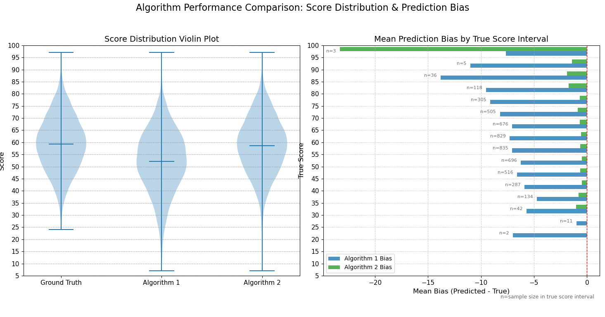

# AI驱动的卡牌游戏---使用ai模型计算 序列插入匹配得分最大化问题

## 概述
这是一款我独立设计并实现的 Unity 引擎开发的自定义规则回合制PVE卡牌游戏，电脑的策略基于一个部署了训练好的ai模型的本地服务器。该游戏的框架基于 [Unity 社区的卡牌框架](https://assetstore.unity.com/packages/tools/game-toolkits/cardhouse-264045) 。

- 在最开始,我想设计一个有些创新的,并且规则简单,比较依赖运气但是也需要策略的卡牌游戏  所以我设计了这个游戏,将游戏规则抽象为算法问题,然后编程实现它   游戏规则与“连连看”或者"消消乐"类似，玩家需要通过配对卡牌来消除它们获得得分，但玩法上进行了创新。具体的游戏规则详见第一部分中的游戏规则,篇文章的重点会放在算法,AI模型和软件架构上

- 相对于一篇严格的学术论文而言 本文更像是一个完成度较高的项目报告，我平衡了深度与广度,在涉及较多技术面的同时做了一些创新和进一步的讨论

## 技术亮点
- **算法分析**：将游戏的最大得分问题抽象为算法问题,并进行了详细的分析 ,以此说明代理模型的重要性

- **AI驱动**：电脑的出牌策略由基于我编写和训练的 transformer 模型和 基于遗传算法的启发式方法 模型 数据的特征和启发方法均结合问题经过精心设计,训练的模型经过严谨的优化和测试,最后获得比较准确而且快速的预测模型。

- **比较复杂的游戏框架**：游戏的实现基于 Unity 引擎，使用c#语言开发,该游戏的基础框架是基于 Unity 社区的卡牌框架其中的 空当接龙 示例，经过大规模自定义和扩展。

- **广泛的技术栈**：除了以上提到的算法设计和分析,C#,python语言编程,软件架构设计,AI方面的机器学习/深度学习(Transformer架构),数据处理与特征工程,模型部署与优化外,还有涉及到服务器编程,网络编程(游戏通过 HTTP 协议与本地 Python 服务器进行实时通讯，进行策略计算) 以及少许前端(游戏ui),


## 文章结构

本文分为4个主要部分:


### 1.游戏规则以及算法分析
本部分将详细介绍游戏规则以及编程实现，包括：
- **游戏规则**
- **算法分析**：
- **算法优化讨论**：

### 2. AI 技术细节
本部分将详细介绍游戏中 AI 系统的工作原理以及核心函数实现，包括：

- **AI模型的选择**：
- **模型编程实现以及优化**
- **模型训练**
- **模型评测**
- **集成模型的提出与评测**


### 3. 服务器的搭建与游戏架构(待完成)
本部分将探讨游戏在 Unity 引擎中的开发与实现，重点将放在整个软件的架构上,并展开说明了一些我认为重要的技术实现,包括：

- **AI模型服务器的搭建**

- **游戏的软件框架**：

- **卡牌功能的实现**


### 4.我认为的项目可能的改进方向和前景,以及结语(待完成)

#暂时为草稿:


算法优化:

失败的缓存,真的失败吗?如果其实缓存是可以实现的呢?


AI模型:
            有更好的特征设计吗?  

            Transformer和GA都有不同的变体  用它们能得到更好的模型吗?

实用性:     
            这个游戏设计可能有用  它足够简单,并且包含策略和运气,比如可以整合到大型游戏里作为小游戏

           这个算法的代理模型可能有用,因为算法是针对这个游戏设计的,通用的算法处理方式可能效果并不好


           在预测时使用cuda进行批量特征处理  比递归快的多,假如它够快,使用gpu加速,可能一定程度代替传统的递归算法(基于cpu)吗 


更好的算法:
    文中提过的特殊树结构变体 虽然最后依然无法代替代理模型 因为它们的使用场景不同  但是我觉得相对于暴力递归再优化,或者采用了没这么合适的数据结构的算法等等,它更能优雅的处理这个问题  如果结合更好的算法到代理模型中作为启发式方法呢?

 分布外样本:
        究竟是什么导致了两个模型会在极个别A，B组合时产生了很大的估计偏差? 我试了但是看不出规律,甚至使用大量的分布外样本训练出专家模型进行集成,也还是存在预测的偏差  那么能这些样本直接找出规律吗 ? 如果不能 ,为什么?


# 第一部分 游戏规则以及算法分析

## 游戏规则以及玩法示例

**开局**

1.  系统创建一个包含52个数字的列表 $P$，每个数字从1到13，每个数字严格重复4次（共 $13 \times 4 = 52$ 个元素）。
2.  从列表 $P$ 中**随机抽取 6 个不同的元素**，得到列表 $A$。
    * **示例：** 假设我们得到 $A = \{1, 2, 3, 7, 4, 6\}$。
    * **(补充说明)** 这里的 $A$ 的元素个数固定是6。
3.  再从剩余列表 $P$ 中**随机抽取 3 个允许重复的元素**，得到列表 $B$。
    * **示例：** 假设我们得到 $B = \{4, 3, 9\}$。
    * **(补充说明)** 这里的 $B$ 的元素个数固定是3。

**可插入位置**

* 列表 $A$ 中的元素之间及其两端是允许插入的位置。
* 对于示例 $A = \{1, 2, 3, 7, 4, 6\}$，可插入位置用序号表示是：
    ① 1 ② 2 ③ 3 ④ 7 ⑤ 4 ⑥ 6 ⑦
* 总共有 $6 + 1 = 7$ 个位置。

**回合开始**

* 玩家允许在 $B$ 中选取一张牌插入 $A$ 中的一个可插入位置。
* 牌被选取并插入后，会从 $B$ 中移除，并添加到 $A$ 中。

**示例回合流程**

**第一次出牌**

1.  玩家选择将牌 `3` 从 $B$ 中取出，插入到 $A$ 中的位置 ① (即 $A[0]$ 之前的位置)。
2.  $A, B$ 被更新：
    * $A$ 变为 $\{3, 1, 2, 3, 7, 4, 6\}$
    * $B$ 变为 $\{4, 9\}$

**匹配规则**

* 观察新插入的牌 (`3`)。在更新后的 $A$ 中，查找数值上与新插入的牌相同的元素。
* **示例：** 新插入的牌是 `3`。在 $\{3, 1, 2, 3, 7, 4, 6\}$ 中，`A[3]` 的值也是 `3`，与新加入的 `3` 相匹配。
* **(补充说明)** 在 $A$ 中最多只会有一个元素与新加入的牌匹配，不会出现两个匹配。这是因为初始化时，$A$ 中的元素都是独一无二的。

**得分与移除 (第一次出牌)**

1.  找到匹配后，形成一个序列：从新插入的牌开始，到匹配到的元素结束（包含这两个元素）。
    * **示例：** 新插入的 `3` 在 $A[0]$，匹配到的 `3` 在 $A[3]$。序列是 $A[0]$ 到 $A[3]$，即 $\{3, 1, 2, 3\}$。
2.  这个匹配的序列将从 $A$ 中被移除。
3.  记录得分：得分为序列中所有元素的数值之和。
    * **示例：** 得分1 $= 3 + 1 + 2 + 3 = 10$。
4.  $A$ 会动态更新：
    * $A$ 移除 $\{3, 1, 2, 3\}$ 后，变为 $\{7, 4, 6\}$。
    * $B$ 没有改变，仍为 $\{4, 9\}$。
5.  可插入位置随之改变：对于 $A = \{7, 4, 6\}$，可插入位置变成 ① 7 ② 4 ③ 6 ④。

**第二次出牌**

1.  玩家选择将牌 `9` 从 $B$ 中取出，插入到 $A$ 中的位置 ④。
2.  $A, B$ 被更新：
    * $A$ 变为 $\{7, 4, 6, 9\}$。
    * $B$ 变为 $\{4\}$。
3.  检查匹配：新插入的牌是 `9`。在 $\{7, 4, 6, 9\}$ 中，没有其他元素数值为 `9`。
4.  没有匹配发生，所以得分2为 0。
5.  $A$ 和 $B$ 保持当前状态。
6.  可插入位置变成 ① 7 ② 4 ③ 6 ④ 9 ⑤。

**第三次出牌**

1.  玩家选择将最后一张牌 `4` 从 $B$ 中取出，插入到 $A$ 中的位置 ⑤。
2.  $A, B$ 被更新：
    * $A$ 变为 $\{7, 4, 6, 9, 4\}$。
    * $B$ 变为 `{}` (空)。
3.  检查匹配：新插入的牌是 `4`。在 $\{7, 4, 6, 9, 4\}$ 中，`A[1]` 的数值也是 `4`，与 `A[4]` 相匹配。
4.  匹配到的序列是 $A[1]$ 到 $A[4]$，即 $\{4, 6, 9, 4\}$。
5.  记录得分：得分3 $= 4 + 6 + 9 + 4 = 23$。
6.  $A$ 移除 $\{4, 6, 9, 4\}$ 后，变为 $\{7\}$。
7.  $B$ 已经是空列表 `{}`。

**回合结束**

* 所有玩家（在此示例中是玩家自己）已经出了3次牌，$B$ 中的所有元素都被插入到 $A$ 中。
* 回合结束。

**总得分**

* 总得分为该回合所有得分之和。
* **示例：** 总得分 $= \text{得分1} + \text{得分2} + \text{得分3} = 10 + 0 + 23 = 33$。


#### 算法分析


我们要计算的是给定A,B后的最佳策略

给定的A,B:  A是一个长度为6,元素间不可重复的整数列表, 范围是1~13  B是一个长度为3,元素间可重复的整数列表, 范围是1~13 

策略: 这里的这个一个 策略 指的是  B中的元素以什么样的顺序插入到A中的哪些位置(也就是说，策略包括两个部分：B 的插入顺序，以及插入到 A 中的位置。)。   

匹配：当你从列表 B 中选择一张牌，并将其插入到列表 A 的某个指定位置之后，立即检查：

① 新插入的这张牌的数值，是否与当前列表 A 中已经存在的某一张牌的数值完全相同。
② 如果存在这样一张数值相同的、原本就在 A 中的牌，那么就称之为发生了一次“匹配”。

匹配序列 与 移除： ：

发生匹配时，会确定一个“匹配序列”。这个序列包含
①新插入的那张牌。
②原本就在 A 中且数值相同的那张牌。
③位于这两张牌在列表 A 中位置之间的所有牌。 这个完整的序列将从列表 A 中被移除。

得分： 这次操作的得分，等于被移除的“匹配序列”中所有牌的数值之和。


没有发生匹配和得分为0： 如果新插入的牌的数值，在当前列表 A 中找不到任何一张数值相同的、原本就存在的牌，那么没有发生“匹配",此时列表 A 的匹配序列为空,不会移除任何元素，这次操作的得分为 0。


总得分: A,B使用此策略后会将B中的元素依次插入到A中  每次插入会产生一个 匹配 的判断 ,产生相应的得分,然后计算3次匹配对应的得分的和,也就是总得分

最佳策略: 指的是 能使得总得分最大的策略


首先我们解决能处理匹配过程并计分的函数 insertion (),  由于A会随着插入以及匹配而改变  所以在调用这个函数时,这里的输入的A的长度不再是初始化的6  而是0~8(因为当A是0~8时才有可能去调用insertion,A不可能小于0且A等于9时 B=[],B不能再选取元素插入),在插入之后,由于匹配,A的长度会变为0~9


def insertion(A, b, pos):

    """
    将元素b插入到列表A的指定位置pos，并处理可能发生的匹配情况。
    
    参数:
        A: list - 当前的牌列表(动态变化)
        b: int - 要插入的元素(来自B列表)
        pos: int - b要插入到A中的位置索引
        
    返回值:
        tuple - 包含5个元素:
            1. int: 本次操作产生的得分
            2. int: 被移除的匹配序列长度
            3. int: 操作后A的长度
            4. int: 是否产生匹配(1代表True，0代表False)
            5. list: 操作后的A列表
    """
    # 创建A的副本避免修改原始列表
    copy_A = A.copy()
     
    # 当A为空时,直接往A中插入b,这时候不产生匹配
    if len(copy_A) == 0:
        copy_A.append(b)

        return 0, 0, 1, 0, copy_A
    
    try:
        # 使用列表的insert函数插入b到A的pos位置
        copy_A.insert(pos, b)
        
        # 向左右分别寻找b是否与当前列表A中已经存在的数值相同
        
        left_idx, right_idx = None, None
        
        # 从插入位置pos的左侧向左遍历列表copy_A，寻找与插入值b相等的最近的元素的索引
        for i in range(pos - 1, -1, -1):
            if copy_A[i] == b:
                left_idx = i
                break
         
        # 从插入位置pos的右侧向右遍历列表copy_A，寻找与插入值b相等的最近的元素的索引
        for j in range(pos + 1, len(copy_A)):
            if copy_A[j] == b:
                right_idx = j
                break
        
        # 无论向左还是向右都找不到匹配
        if left_idx is None and right_idx is None:

            return 0, 0, len(copy_A), 0, copy_A
        
        # 计算插入位置pos与匹配元素的索引(left_idx, right_idx)之间的距离
        # 如果没有匹配的元素，则将距离设置为正无穷大
        left_distance = pos - left_idx if left_idx is not None else float('inf')
        right_distance = right_idx - pos if right_idx is not None else float('inf')
        
        # 确定匹配发生在哪一侧（左侧或右侧）获取匹配序列的起始和结束索引
        if left_distance < right_distance:
           
            start, end = left_idx, pos
        elif right_distance < left_distance:
            
            start, end = pos, right_idx
        else:
            # 两侧距离相等但都不是无穷大（即两侧都有匹配) 的情况不会出现,这是由A在初始化时元素不可重复保证的
            # 如果左右距离都是无穷大，说明没有匹配 根据 IEEE 754 浮点数标准，所有正无穷大 (float('inf')) 被视为相等
            return 0, 0, len(copy_A), 0, copy_A
        
        # 通过索引获取匹配序列
        removal_interval = copy_A[start:end + 1]
        # 计分
        score = sum(removal_interval)
        # 将A中的匹配序列进行移除
        new_A = copy_A[:start] + copy_A[end + 1:]
        

        return score, len(removal_interval), len(new_A), 1, new_A
    

    #异常处理 尤其是 IndexError 
    except Exception as e:
       ...


这个问题的关键问题之一在于如何设计数据结构来表示插入策略。

我使用的策略结构是一个形如 3×2 的二维矩阵（或列表），我们称它为 move。这个矩阵的每一行都代表一个插入操作，共两列：

    第一列表示元素在数组 B 中的索引；

    第二列表示将该元素插入到当前数组 A 中的哪个位置。

需要注意的是，这里的“插入位置”是相对于最新的 A 状态而言的，而不是初始的 A

举个例子：

B = [1, 2, 3]
move = [[1, 6], [0, 3], [2, 0]]

这个策略表示：

    第一步：将 B[1]（即元素 2）插入到当前 A 的索引位置 6；

    第二步：将 B[0]（即元素 1）插入到更新后的 A 的索引位置 3；

    第三步：将 B[2]（即元素 3）插入到再次更新后的 A 的索引位置 0。

每一步都在当前版本的 A 上进行操作，每次B[i]的插入都会导致A会由于插入本身和插入后的匹配而更新


所以可以设计递归算法:


def Recursive_StrategyAndScore(A, B, original_indices=None, move_sequence=None, used_indices=None):

"""
A: 目标列表，B 中的元素将被插入到这里。

B: 包含待插入元素的列表。

original_indices : 字典: 使用 B中的元素值做字典的键, 元素的值对应的索引做字典的值

move_sequence : 用于构建move序列的列表。每次移动记录为一个列表 [原始B中的索引, 在A中的插入位置]。它在递归过程中构建。

used_indices : 这是一个字典 ，用于跟踪 original_indices 中每个值的索引被使用了多少次。用来保证B中的元素的每个元素都使用过一次,且只使用过一次

"""
    if move_sequence is None:
        move_sequence = []

    if original_indices is None:

    # 初始化original_indices字典，默认值是 list
        original_indices = defaultdict(list)

        #将B中的元素值和对应的索引添加到 original_indices 中
        for idx, value in enumerate(B):
            original_indices[value].append(idx)
            
    if used_indices is None:
    # 初始化used_indices字典，默认值是 int
        used_indices = defaultdict(int) 

#递归的终止条件 
    if not B:
        return 0, move_sequence 

    max_score = 0
    best_moves = []

#开始逐个操作B中的元素
    for i, b in enumerate(B):
        # 拷贝used_indices
        current_used = copy(used_indices)


   #original_indices中[b]记录的是b在B中的的全部索引  len(original_indices[b])是b的重复次数
        if current_used[b] < len(original_indices[b]):
            index_b = original_indices[b][current_used[b]]
            current_used[b] += 1  # 递增当前元素的计数
#遍历A中的所有元素,返回被改变的A和得分
            for a in range(0, len(A) + 1):
                insertscore, _, _, _, AA = simulate_insertion_tool(A, b, a)
                
                #使用切片排除被考察过的B中的元素
                B_new = B[:i] + B[i+1:]

                # 递归调用，传递新的A,新的B,使用过的B中的元素
                score, moves = Recursive_StrategyAndScore(
                    AA, B_new, original_indices,
                    move_sequence ,
                    current_used  # 使用拷贝后的used_indices
                )

            #更新最高分和对应的移动序列
                new_score = score + insertscore
                if new_score > max_score:
                    max_score = new_score
                    # 确保返回正确的操作顺序,新的插入操作 (index_b, a) 是在 moves 的前面，而不是后面
                    best_moves =   [[index_b, a]]+moves

    return max_score, best_moves


首先进行一些数学估计:


时间复杂度分析:

对于 B 中的每一个元素，它尝试在当前的 A 的所有可能位置插入，然后递归处理剩余的元素。假设 |B| = n，|A| = m，那么在第一步有 n 种元素选择，每种元素有 m+1 个插入位置，总共有 n * (m+1) 种可能。第二步B有 n-1 个元素，插入位置变为 m+2 个，依此类推得到n!*(m+1)*(m+2)*...*(m+n)=n!⋅(m+n)!/m!。所以得到大致的复杂度是 O(n!⋅(m+n)!/m!) 量级，非常高。(但由于每次插入后A的长度的改变并不确定, 可能没有匹配导致的长度加一  也可能产生了匹配,移除了2~len(A)个元素   所以这个估计并不是精确的)


结合具体的输入数据分析穷举的数据量:

计算穷举当A,B没有给定且不发生任何匹配消除时,所有的将B插入A后的所有可能性(注意这里仅仅是"最终静态组合数")

如果仅考虑将B(长度为3的数组)中的牌插入A(长度为6的数组)里,不考虑A,B上有点数,求解有多少中插入的可能,那么这可以看作是一个多重集排列问题:从{A,A, A,A, A,A, B,B,B}构成的集合中不放回的拿出元素,全部放到一个一维数组里,能构成多少种长度为9的不同的数组?   
所以是C(9,6)*C(3,3)=C(9,6)


然后由于现在的数组的牌只有A,B的区别,位置已经定下来,但是 还没有点数 现在给他们加上点数


每个A的值是1~13,且不能重复 所以给A加上点数的所有可能方式:P(13,6)  
每个B的值也是1~13,但是可以重复 给B加上点数的所有可能方式:13^3  


所以这是所有的可能插入得到的最终可能  C(9,3)*P(13,6)*13^3=228,012,744,960 

 假设每个样本占10B  数据超过2000GB  这是一个非常大的数据量   (这是一个估计,就如前面所说,每次插入可能导致A数组变动,从而导致之后的决策发生改变,而且不同顺序的插入是不一样的  

匹配会导致B的插入顺序是需要考虑的 
比如 b1插入1号位,b2 插入2号位,这样的顺序反过来 ,b2 插入2号位,b1插入1号位,由于匹配规则,会产生不同的结果 所以是两种情况 

这里只考虑了不发生匹配的情况,这也同时导致了有些插入可能是不合法的  而且匹配会同时导致A的长度改变, 我们无法直接判断匹配带来的是更多还是更少的情况)


为了估计真实的匹配造成的影响,这里使用了基于概率的统计数据分析(蒙特卡洛模拟) 来研究一个特例 :  对于当len(A)=6  len(B)=3 时 

随机生成A,B  len(A)=6  len(B)=3   随机不放回的抽取B中的一张牌,随机插入到A中,重复2次调用simulate_insertion_tool直到B中没有元素,第二次调用是基于上一次改变后的A,B, 

{
        A, B = get_A_and_B_random()

        card = random.choice(B)

        pos=random.randint(0,6)
        
        _, _, new_length1, _, newA = simulate_insertion_tool(A, card, pos)

        all_lengths1.append(new_length1)

第一次改变后的A的长度期望 expected_value = sum(all_lengths1) /total_times

        B.remove(card)
        card = random.choice(B)
        pos = random.randint(0, len(newA))

        _, _, new_length2, _, newA = simulate_insertion_tool(newA, card, pos)

        all_lengths2.append(new_length2)

第二次改变后的A的长度期望 expected_value = sum(all_lengths2) / total_times

}


获取函数的第三个返回值 以上过程重复20M次(total_times=20M) 进行统计, 编写代码运行 以下是我的结果:


总共执行了 20M 次 simulate_insertion_tool 调用。

 len(A1) 分布情况:
   len(A1)( 0: 559058  次, 占比: 2.80%
   len(A1)( 1: 1112357 次, 占比: 5.56%
   len(A1)( 2: 1669068 次, 占比: 8.35%
   len(A1)( 3: 2216588 次, 占比: 11.08%
   len(A1)( 4: 2775405 次, 占比: 13.88%
   len(A1)( 5: 3333920 次, 占比: 16.67%
   len(A1)( 7: 8333604 次, 占比: 41.67%

len(A1) 的期望值: 4.8603≈5

 len(A2)分布情况:
   len(A2) 0: 689171  次, 占比: 3.45%
   len(A2) 1: 1746955 次, 占比: 8.73%
   len(A2) 2: 2511990 次, 占比: 12.56%
   len(A2) 3: 3001901 次, 占比: 15.01%
   len(A2) 4: 3202618 次, 占比: 16.01%
   len(A2) 5: 3129061 次, 占比: 15.65%
   len(A2) 6: 3434722 次, 占比: 17.17%
   len(A2) 8: 2283582 次, 占比: 11.42%

 len(A2) 的期望值: 4.1555≈4

simulate_insertion_tool在每个循环中只调用两次是因为第一次插入可能固定为len(A)+1=7   并且不用考虑第三次插入后的A的变化,因为此时len(B)等于0,在这之后算法已经停止了

第一次插入有 len(A)+1 个位置，第二次插入有 E[len(A1)]+1 个位置，第三次插入则应基于第二次插入后A的期望长度 E[len(A2)]+1 个位置

基于这些期望 得到估计 决策路径数量为   ( (len(A)+1) * (E[len(A1)]+1) * (E[len(A2)]+1)  ) *P(13,6)*13^3 

(7×6×5)/ C(9,3)=2.5  这个结果变成不考虑匹配规则"最终静态组合数"的2.5倍  需要再次强调的是  这里估计的不是A与B的“最终静态组合数”,而是决策的数量   因为这个模拟估计的并不仅仅是单纯的卡牌组合的数据量,而且考虑了匹配规则,也就是考虑了B的插入顺序,因此实际的出牌策略比之前讨论的不考虑匹配的"最终静态组合数"还要大


时间复杂度的通过这个思想也能得到更精确的估计,但由于改变的是数据的规模  所以依然是阶乘的时间复杂度


这导致了可能的决策空间非常大,所以在编程时很难使用缓存技术来加速,因为缓存难以命中


优化尝试:


动态规划:

A 的状态在每次插入后都会改变，并且列表内容本身复杂，而且导致了难以找到重叠子问题,难以作为 DP 状态的键进行存储和查找, A 的动态的状态是问题所在。因此，动态规划 在这个问题的通用形式下很难实现。

*注:在思考优化方法时,我尝试了使用树来直观的的表示这个问题,以此得到更好的算法, 期间我发现了这样的树结构 

一棵所有叶子节点都在同一深度k的树。树根保存值0 其他的每个节点保存一个小于等于n的正整数 沿着任意一条树根到叶子的路径上的节点数字都是递增的 问这棵树有多少个叶子节点 结果其实就是C(n k)  (ps:而且因为这个树的根有n-k+1个子节点,还可以使用这个树的结构推导出曲棍球棒恒等式)

可以用它很好的表达组合问题

但由于如果直接对应到原问题  树高是动态变化的(由于匹配)  而这个结构的树高是固定的 所以不适合直接带入此树  因为这棵树直观的连接了组合问题与数据结构,或许它的变体能够用于直观的处理原问题 但是由于篇幅限制,这里不做过多讨论


剪枝/启发式方法:

基于对于simulate_insertion_tool的匹配规则的理解,的确可以做出启发式方法优化,来跳过一些递归分支, 我使用future_score 这个特征来实现   具体内容在遗传算法的实现中展开


代理模型（surrogate modeling）:
在这个过程中，这个Recursive_StrategyAndScore算法生成结果数据，然后将这些数据用作训练集来训练AI模型。训练完成后，AI模型学习到了原始算法的行为模式，可以在允许一定的误差的情况下预测该算法在新输入上的输出结果，而无需实际运行原始算法。 这就是本文着重要讨论的内容


# 第二部分  AI 技术细节

python版本 3.12.9

使用Anaconda配置了cuda环境

CPU: AMD Ryzen 9 5900HS(8 processing cores, 16 threads)
GPU: NVIDIA GeForce RTX 3050 laptop  (Vram: 4G)
(注:针对这个问题而言,4G的显存并不是它的瓶颈  虽然它的确影响了我的参数配置的抉择,但是对于本文的模型,硬件是足够的)


我选择了transformer和遗传算法作为ai模型 

使用遗传算法的原因其一是这个决策序列空间是巨大的，并且每一步的决策都依赖于上一步的结果。遗传算法是擅长在复杂、高维、非连续或目标函数难以微分的搜索空间中寻找最优解。  其二是它相对容易实现,而且它的计算成本低,可以快速得到结果。

选择使用transformer也同样是决策会相互影响的原因,这个问题的3次出牌策略中,每一次出牌都会产生动态的A,所以导致影响了之后的出牌策略,Transformer 使用自注意力机制（self-attention），能够捕捉序列中任意两个元素之间的关系(比如第一次插入是怎么影响第二次和第三次策略的)。这对于取得最佳得分的出牌策略非常重要 

我使用遗传算法和transformer模型协作得出最后的代理模型(也就是在预测时并行运行,二者都输入生成的预测结果,我们选更好的那个)


### 1.训练集的获取以及预处理
我测试了多种大小的数据集,最终决定用大约10k条数据集训练遗传算法,并使用大约5M条数据训练transformer模型 因为对于遗传算法而言,数据集并没有全部参与训练 ,遗传算法只会从数据集抽样进行遗传和评估,所以这里的数据集只需要够均匀即可,对于transformer而言,数据集的大小的确能提升模型性能,但是考虑到训练的时长和硬件限制,经过测试,我觉得5M条数据集应该足够了,再大的数据集难以操作而且对模型的提升并不明显


需要强调的是,这里有一个显著的区别 遗传算法和transformer模型使用训练集的方法是不同的

让我们再回顾一下训练集样本

样本示例:
{
        "A": [
            10,
            3,
            4,
            2,
            12,
            9
        ],
        "B": [
            3,
            8,
            4
        ],
        "max_score": 55,
        "best_moves": [
            [
                0,
                0
            ],
            [
                1,
                1
            ],
            [
                2,
                5
            ]
        ]
    }

遗传算法的思路是遍历每一个可插入位置,并使用基因组去计算该插入位置的价值  训练集的价值在提供了固定的一批A,B,便于基因的评估和筛选  它本质是启发式方法,还是在遍历穷举 ,然后用自己的一套评分逻辑去评估该策略(将B[i]插入A中的某个位置)的价值,接着使用贪心算法找出价值最高的  它并没有使用到训练集的max_score,和best_moves


transformer模型则是使用了训练集的A,B和best_moves(max_score在训练时没有使用 但是我们会在其他地方用到) 它是"观察"大量的A,B,best_moves后,然后学着找出(A,B)|-> best_moves的映射关系 它并没有在穷举,或许它恰好找到的映射关系就等价于之前提到的暴力递归?又或者找到了我说的能表达组合问题的树的变体?当然很大可能是其他算法,但这无法判断,因为是几乎一个黑盒,构建出神经网络的很可能极其复杂


数据集生成代码:


def generate_training_data(num_samples=10000):
    dataset = []

    for i in range(num_samples):


#deal_cards_tool()是在外部定义的函数  随机初始化了A,B ,并确保了A,B有交集 这里将A,B没有交集(怎么出牌都无法得分的情况)视为噪声排除,不需要参与训练

        A, B = deal_cards_tool()  # 初始A, B   A, B 都是 list<int>

#递归生成最优的策略和得分
        max_score, best_moves = recursive_StrategyAndScore(A, B)
       
#这里由于策略move=[[i,a],[j,b],[k,c]]的格式,且i,j,k是严格属于[0,1,2]且互不重复的,因为B中的索引只有0,1,2,如果违反这个约束,策略将没有意义
        whole = [0, 1, 2]
        current_rows = set(move[0] for move in best_moves)

        remaining = [i for i in whole if i not in current_rows]

        for i in remaining:
            if len(best_moves) < 3:
                best_moves.append([i, 0])


        dataset.append({"A": A, "B": B, "max_score": max_score, "best_moves": best_moves})

#保存至json文件
   ...


generate_training_data(num_samples=10000)


这里有额外需要注意的一点 

bestmoves的长度未必都是3  因为当B中就算再出牌也不能得分时(比如将B中的3张牌出了两张后,剩下的一张与A无法产生匹配) recursive_StrategyAndScore不会将移动加入到策略中,检查输出的best_moves的长度后,发现这样的情况大概占比num_samples的10%


所以现在有一个需要抉择的地方  对于这些长度不是严格为3的best_move 是应该跳过它们,还是填充它们到3? 跳过的话会丢失重要的内在关系吗?如果填充会反而引入噪声吗?  这需要结合训练出的模型的预测结果来判断究竟哪个好  我经过测试得出,填充更优

所以我们现默认,数据集经过了填充处理 ,但是为什么?  这一部分的细节放在ai模型的评测中再详细讨论

由于A,B是使用deal_cards_tool随机生成的,需要对数据集去重,可以使用python的set完成,接着需要详细检查数据的格式,异常处理 等 (代码详见dedpu.py)

最后得出给遗传算法使用的数据集data_GA.json  样本数为10k 这是一个样本示例:
{
        "A": [
            10,
            3,
            4,
            2,
            12,
            9
        ],
        "B": [
            3,
            8,
            4
        ],
        "max_score": 55,
        "best_moves": [
            [
                0,
                0
            ],
            [
                1,
                1
            ],
            [
                2,
                5
            ]
        ]
    }


给transformer使用的数据集data_TR.json的处理也是一样的,只是由于数据过大,使用了多进程加速获取数据集,以及后续将json格式转换jsonl以支持流式加载 (详见 Get_trainingset_huge.py)   样本数在去重前预设为5M


### 2.1 遗传算法的实现


# 遗传算法框架概述


## 基因的组成
- `calculate_future_score` :用启发式方法计算未来得分这个特征
6维权重向量，对应6个游戏特征：当前得分、移除长度、新长度、未来得分、新A的元素总和、交集数量。

## 种群初始化
- 种群规模500个个体
- 70%按启发式范围初始化，30%完全随机
- 引入多样性防止早期收敛


## 基因组的选择与繁殖
- 精英保留：10%最优个体直接传承
- 锦标赛选择：竞争性选择父代
- 交叉：父代权重加权平均
- 变异：添加高斯噪声，变异率自适应调整

## 进化策略
使用了 传统的遗传算法 和岛屿模型算法 这两种进化策略 

- `island_model_evolution()`: 岛屿模型，将种群分割为独立岛屿，定期迁移优秀个体
- 动态方法切换： 根据历史表现自适应选择进化方法

## 适应度评估
- `evaluate_genome()`: 用个体权重执行多轮游戏，返回平均得分
- `GA_Strategy()`: 基于权重计算最优插牌策略，使用特征向量与权重的点积评估每个可能位置


## 优化机制
- GPU加速：PyTorch张量运算
- 并行评估：多进程处理不同个体
- 批量处理：减少GPU调用开销
- 早停机制：连续无改善时提前终止

## 训练配置
- 种群大小：500
- 进化代数：20  
- 评估轮数：200轮/个体

## 输出结果
最优个体的6个权重参数，构成AI的决策策略模型。


特征设计  根据卡牌的记分方法来决定需要使用的特征


                features = [
                    score,  # 当前策略的子集得分
                    removal_length,  # 匹配的移除长度
                    new_length,  # A由于插入操作得到的新长度
                    future_score,  # 未来得分
                    sum_new_A,  # 匹配后新A的元素总和
                    B_card_proportion,  # B的出牌占B剩余牌的价值比例
                ]


遗传算法的genome 是一个包含6个浮点数的列表。这6个数字代表了评估游戏决策时所用到的6个特征的权重


这里有新意的是future_score
由于B中的牌数量较少(0~3) 所以可以根据这个特点进行启发式算法,  这里的future_score意思是  由于每次要从B中选一张插入A,而且每次的选取,插入都可能造成A的变化,然后导致后续的选取,插入步骤的最优得分策略变化  future_score指每次选取插入这个操作之后,剩余牌可能的得分  这是一个很重要的特征  它动态的评估了未来的卡牌状态  就好像国际象棋玩家会考虑某一步对以后的棋子策略带来的影响一样


其他的特征选取于simulate_insertion_tool的返回值  match_found和removal_length有重合,考虑到模型复杂度,它没有被作为特征


这个计算future_score的启发式函数的思路是这样的,从B中的牌抽取一张插入A时,同时考虑在这次选取插入操作实现之后:

1 当如果 A 和 B 没有任何重复元素,那么future_score是0

2 如果没有剩余的B玩家的牌,那么future_score是0

3 如果B中只剩下一张牌,检查这张牌和A是否有交集 如果有  则调用get_best_insertion_score计算得分作为future_score,如果没有那么future_score是0


def calculate_future_score(A, remaining_B):
  
    future_score = 0  # 初始化未来得分
    if len(remaining_B) == 0:
        return future_score  # 如果没有剩余的B玩家的牌，返回0
    if not set(A) & set(remaining_B):  # 如果 A 和 B 没有任何重复元素
        return future_score
    # 复制A玩家的牌以便模拟
    simulated_B = remaining_B.copy()

    if len(simulated_B) == 1:
        card_of_B = simulated_B[0]  # 获取最后一张B玩家的牌
        matched = card_of_B  in A  # 判断是否能匹配
        if not matched:
            return future_score  # 如果不能匹配，返回0
        else:
            _, score = get_best_insertion_score(A, card_of_B)
            return score


遗传算法核心函数的实现


岛屿模型(Multi-Population Genetic Algorithm)  

def island_model_evolution(population, fitnesses, pop_size, tournament_size, mutation_strength,
                           num_rounds, islands=4, migration_rate=0.1,
                           generation=0, max_generations=60):
    """
    实现岛屿模型进化，将总人口分成几个独立'岛屿'，定期交换个体

    参数：
    - population: 当前种群
    - fitnesses: 当前种群的适应度值
    - pop_size: 总人口规模
    - tournament_size: 锦标赛选择规模
    - mutation_strength: 变异强度
    - islands: 岛屿数量

    - migration_rate: 每次迁移的个体比例
    - generation: 当前代数
    - max_generations: 最大代数

    返回：
    - new_population: 进化后的新种群
    - new_fitnesses: 新种群的适应度
    """


    #计算运行进度
    # progress_ratio需要＞0
    progress_ratio = generation / max_generations   if max_generations > 0 else 0.5
    # 动态增加迁移率
    adaptive_migration_rate = migration_rate * (1.0 + progress_ratio)  # 迁移率逐渐增加到原来的2倍

    # 计算每个岛屿的容纳的种群数量和迁移数量
    island_size = pop_size // islands # 向下取整
    #迁移数量 向0取整
    migration_size = int(island_size * adaptive_migration_rate)

    # 将总种群分割成岛屿
    island_populations = []
    island_fitnesses = []

    # 将总种群按岛屿进行分割
    # island_populations 在整个算法中仅作为输入数据源 初始化后不做修改
    for i in range(islands):
        # 计算第i个岛屿在总种群中的起始,结束索引
        start_idx = i * island_size
        # 将剩下的人口放入最后一个岛
        end_idx = start_idx + island_size if i < islands - 1 else pop_size
        island_populations.append(population[start_idx:end_idx])
        island_fitnesses.append(fitnesses[start_idx:end_idx])

    # 每个岛屿独立进化
    #二维列表 每个岛屿进化后产生的新子种群
    new_island_populations = []

    # 二维列表 在某个岛上的某个个体的适应度 [岛索引][个体索引]
    new_island_fitnesses = []


    # 岛内进化
    for i in range(islands):

        # 选择精英

        # 按照该岛的子种群在island_fitnesses[i]列表中对应的适应度值从（降序）排列
        sorted_indices = sorted(range(len(island_fitnesses[i])),
                              key=lambda k: island_fitnesses[i][k], reverse=True)
#前10%作为精英
        elitism_count = int(0.1 * len(island_populations[i]))
#从降序排列的子种群切片生成精英列表
        elites = [island_populations[i][idx] for idx in sorted_indices[:elitism_count]]

        # 锦标赛选择  从排除精英的种群中选取父代  这一定程度上缓解了足够优秀的个体在精英选择中被遗漏的情况
        selected = []
        for _ in range(len(island_populations[i]) - elitism_count):
            #在非精英中随机选择tournament_size个 个体
            candidates = random.sample(range(len(island_populations[i])), tournament_size)
            #选出具有最大的适应度的个体,它胜出了
            winner_idx = max(candidates, key=lambda idx: island_fitnesses[i][idx])
            #加入筛选出的种群,作为父代
            selected.append(island_populations[i][winner_idx])


        #精英个体被直接复制到下一代
        next_population = elites.copy()

        while len(next_population) < len(island_populations[i]):
            # 随机两个作为父代
            parent1, parent2 = random.sample(selected, 2)
            # 交叉
            #     以 70% 的概率，取 (p1 + p2) / 2（即两个父代的平均值）
            #     以 30% 的概率，直接取 p1。
            #     将上述逻辑应用于每一对 (p1, p2)，并生成一个新的列表 child
            child = [(p1 + p2) / 2 if random.random() < 0.7 else p1
                    for p1, p2 in zip(parent1, parent2)]

            # 变异
            # mutation_strength = 0.7
            # 对子代的每个基因，都加上高斯分布中采样的随机数。这会引入小的随机扰动。(变异)
            child = [gene + random.gauss(0, mutation_strength) for gene in child]
            next_population.append(child)

        new_island_populations.append(next_population)

    # 评估新岛屿种群适应度
    new_island_fitnesses = [evaluate_genomes_return_fitness(pop, num_rounds)
                            for pop in new_island_populations]

    # 迁移过程 (每代都迁移)

    for i in range(islands):
        # 按适应度降序排列当前岛屿中的个体。
        sorted_indices = sorted(range(len(new_island_fitnesses[i])),
                              key=lambda k: new_island_fitnesses[i][k], reverse=True)
        # 选择适应度最高的 'migration_size' 个 个体
        migrants_indices = sorted_indices[:migration_size]
        migrants = [new_island_populations[i][idx] for idx in migrants_indices]

        # 用模运算实现环形拓扑,将个体迁移到下一个岛屿
        target_island = (i + 1) % islands

        # 在目标岛屿中，替换最差的个体
        # 适应度升序排序
        target_sorted_indices = sorted(range(len(new_island_fitnesses[target_island])),
                                     key=lambda k: new_island_fitnesses[target_island][k])
        #  # 遍历从源岛屿选出的优秀迁移个体 'migrants' 列表。
        for j, migrant in enumerate(migrants):
            if j < len(target_sorted_indices):
                replace_idx = target_sorted_indices[j]
                # 替换掉目标岛屿中的较差个体
                new_island_populations[target_island][replace_idx] = migrant

    # 重新评估迁移后的适应度
    new_island_fitnesses = [evaluate_genomes_return_fitness(pop, num_rounds)
                            for pop in new_island_populations]

    # 合并所有岛屿种群
    new_population = []
    new_fitnesses = []
    # 配对迭代
    for pop, fit in zip(new_island_populations, new_island_fitnesses):
        # 将当前岛屿所有个体添加到 'new_population' 总列表中。
        new_population.extend(pop)
        new_fitnesses.extend(fit)

    # 如果合并后的种群大小超过了原始种群大小，截断到原始大小
    if len(new_population) > pop_size:
        combined = list(zip(new_population, new_fitnesses))
        sorted_combined = sorted(combined, key=lambda x: x[1], reverse=True)
        new_population = [x[0] for x in sorted_combined[:pop_size]]
        new_fitnesses = [x[1] for x in sorted_combined[:pop_size]]

    return new_population, new_fitnesses


#根据A,B和给定的基因生成策略 (给调用遗传算法提供接口)

def GA_Strategy(genome, A, B):
    """
    计算每一个插入位置的特征张量,并与它和基因张量做点积计算 得到这个位置的"评估值",并按照评估值从大到小排序

    参数：
    - genome: 基因组权重 (NumPy数组或PyTorch张量)
    - A: A玩家的牌
    - B: B玩家的牌

    返回：
    - strategy: 最佳策略
    """

    # 检查CUDA可用性并设置设备
    device = torch.device('cuda' if torch.cuda.is_available() else 'cpu')

    # 检查genome类型并转换为torch张量
    if isinstance(genome, torch.Tensor):
        genome_tensor = genome.to(device)
    else:
        genome_tensor = torch.tensor(genome, dtype=torch.float32, device=device)


    # 根据给定的基因 批量计算所有B牌的所有可能插入位置的 特征
    def compute_card_values_batch(A_copy, B, genome_tensor):
        card_values = []

        #特征计算
    
        A_set = set(A_copy)

        #使用嵌套循环进行插入模拟  每一个插入位置都会计算6个特征
        for i, card in enumerate(B):
            remaining_B = [B[j] for j in range(len(B)) if j != i]
           
       
            B_card_proportion  = card/sum(remaining_B)

            # 插入位置以及特征集合
            all_features = []
            all_positions = []

            for pos in range(len(A_copy) + 1):
                #特征计算
                score, removal_length, new_length, _, new_A = simulate_insertion_tool(A_copy, card, pos)
                future_score = calculate_future_score(new_A, remaining_B)

                sum_new_A=sum(new_A),  # 匹配后新A的元素总和
                features = [
                    score,  # 当前得分
                    removal_length,  # 移除长度
                    new_length,  # 新长度
                    future_score,  # 未来得分
                    sum_new_A,  # 匹配后新A的元素总和
                    B_card_proportion,  # B的出牌占B剩余牌的价值比例
                ]

                all_features.append(features)

                all_positions.append(pos)
                # all_scores.append(score)
                # all_new_As.append(new_A)

            # 将所有特征转换为张量并一次性在GPU上计算
            if all_features:
                features_tensor = torch.tensor(all_features, dtype=torch.float32, device=device)


                # 特征张量和目前的基因张量计算点积。对于每一个可能的插入位置，
                # 其对应的特征向量会与genome_tensor 进行点积运算 也就是给每个特征加权：
                # 评估值 = (feature1 * genome_tensor的第一个元素) + (feature2 * genome_tensor的第二个元素) + ... + (feature6 * genome_tensor的第六个元素)
                values = torch.matmul(features_tensor, genome_tensor)

                # 用于返回输入张量中最大元素的索引
                best_idx = torch.argmax(values).item()
                #该索引对应的值(最大的评估值)
                best_value = values[best_idx].item()
                #最大评估值的对应插入位置(最优插入)
                best_pos = all_positions[best_idx]


                card_values.append((i, best_value, best_pos))

        return card_values

    # 计算卡值
    card_values = compute_card_values_batch(A.copy(), B, genome_tensor)

    # 根据评估值对卡进行排序 x[1] 就是 best_value ，即每张牌的最佳评估值
    card_values.sort(key=lambda x: x[1], reverse=True)

    # 根据排序后的顺序生成策略   注意这一步  因为它是依据评估值进行排序的,所以是贪心算法
    strategy = [(card_idx, pos) for card_idx, _, pos in card_values]

    return strategy


#用一批种子生成的A,B来评估基因是否够好 返回计算fitness的平均值  (类似于通过计算损失函数来评估ai模型)

#这个函数在实际调用时使用了多进程加速

#种子是为了使用相同的A,B进行评估 避免引入其他变量 seed_base是第一个种子  它会递增
def evaluate_genome(genome, num_rounds=1000, seed_base=111):


    import calculate_score_by_strategy

    # 检查并设置 GPU 可用性
    device = torch.device('cuda' if torch.cuda.is_available() else 'cpu')


    # 将基因组转换为 GPU 张量
    # genome_tensor = torch.tensor(genome, dtype=torch.float32, device=device)

    # GPU批处理大小
    batch_size = 1024

    # 预分配结果数组
    #torch.zeros 创建一个所有元素都初始化为 0 的张量(这里是一维张量,也就是向量)  长度是num_rounds,数据类型是float32,张量将被分配在计算设备 device 上
    total_scores = torch.zeros(num_rounds, dtype=torch.float32, device=device)

    # 分批处理评估任务 步长为 batch_size
    for batch_start in range(0, num_rounds, batch_size):

#计算实际的batch_size
        batch_end = min(batch_start + batch_size, num_rounds)
        batch_size_actual = batch_end - batch_start


        # 为当前批次生成所有A和B
        batch_A = []
        batch_B = []
        for _ in range(batch_size_actual):

        #使用种子生成A和B,填充进batch 注意每个基因受过num_rounds次评估 这一批种子会随着批次的索引增加  每个基因对应的用于评估的种子集合都是相同的
            A, B = deal_cards(seed=seed_base + batch_start + _)
            batch_A.append(A)
            batch_B.append(B)

        # 并行评估批次使用GPU
        batch_scores = torch.zeros(batch_size_actual, dtype=torch.float32, device=device)

        for j in range(batch_size_actual):

#GA_Strategy 当前基因转换为对应的策略
            strategy = GA_Strategy(genome, batch_A[j], batch_B[j])

            #计算策略对应的得分
            batch_scores[j] = calculate_score_by_strategy(batch_A[j], batch_B[j], strategy)

        # 复制批次得分到总得分
        total_scores[batch_start:batch_end] = batch_scores

    # 计算最终平均分(平均)
    mean_score = torch.mean(total_scores).item()

   

    return mean_score  # 返回平均得分


#遗传算法训练主函数

def genetic_algorithm(pop_size, generations, num_rounds, elitism_ratio, tournament_size,
                      evolution_methods,
                      early_stop_generations, early_stop_threshold):
    """
    参数：
    - pop_size: 种群大小
    - generations: 最大进化代数
    - num_rounds: 评估每个基因组的回合数
    - elitism_ratio: 精英比例
    - tournament_size: 锦标赛选择规模

    - evolution_methods: 可用的进化方法列表
    - method_probs: 各进化方法的使用概率
    - early_stop_generations: 早停的连续代数
    - early_stop_threshold: 早停的改善阈值

    返回：
    - best_genome: 最佳基因组
    """
    
    population = []
    for _ in range(pop_size):
        genome = []
       

        """
        基于先验知识的种群初始化策略("温启动")


        这里使用了一个优化手段,回顾基因的features = [
            score,  # 当前策略的子集得分
            removal_length,  # 匹配的移除长度
            new_length,  # A由于插入操作得到的新长度
            future_score,  # 未来得分
            sum_new_A,  # 匹配后新A的元素总和
            B_card_proportion,  # B的出牌占B剩余牌的价值比例
        ]
        经过足够多的测试后 ，可以得出以下结论：
        score,future_score  且score和future_score权重一般>1.5,影响较大
        """
        
        if random.random() < 0.7:  # 70%的个体按原方式初始化
            for i in range(6):
                if i == 0 or i == 3 :
                    genome.append(random.uniform(1.5, 2.5))
               
                else:
                    genome.append(random.uniform(-0.5, 0.5))
        else:  # 30%的个体完全随机初始化
            for i in range(6):
                # 用[-2,2]随机浮点数
                genome.append(random.uniform(-2, 2))
        population.append(genome)

    best_fitness_history, avg_fitness_history = [], []  # 初始化历史最佳适应度和平均适应度列表
    best_genome, best_fitness = None, -float('inf')  # 初始化最佳基因组和最佳适应度
    elitism_count = int(elitism_ratio * pop_size)  # 计算精英数量
    method_history = []  # 记录每代使用的进化方法

    # 早停相关变量
    early_stop_counter = 0
    last_best_fitness = -float('inf')

    for gen in range(generations):  # 迭代每个世代
        fitnesses = evaluate_genomes_return_fitness(population, num_rounds)  # 评估种群适应度
        gen_best, gen_avg = max(fitnesses), np.mean(fitnesses)  # 获取当前世代的最佳适应度和平均适应度
        best_fitness_history.append(gen_best)  # 记录最佳适应度
        avg_fitness_history.append(gen_avg)  # 记录平均适应度

        # 早停检查
        improvement = gen_best - last_best_fitness

        # 修复除法错误 确保 last_best_fitness 不是无效值
        if last_best_fitness != -float('inf') and abs(last_best_fitness) > 1e-10:
            relative_improvement = improvement / abs(last_best_fitness)
        else:
            # 第一代或last_best_fitness接近0或无穷时，使用绝对改善判断
            relative_improvement = 1.0 if improvement > early_stop_threshold else 0.0

        if relative_improvement <= early_stop_threshold:
            early_stop_counter += 1

            #早停触发
            if early_stop_counter >= early_stop_generations:
                
                break
        else:
            early_stop_counter = 0  # 重置计数器

        last_best_fitness = gen_best

        if gen_best > best_fitness:  # 更新最佳基因组和适应度
            best_fitness, best_genome = gen_best, population[fitnesses.index(gen_best)]

      
        sorted_population = [x for _, x in
                             sorted(zip(fitnesses, population), key=lambda pair: pair[0], reverse=True)]  # 按适应度排序种群
        elites = sorted_population[:elitism_count]  # 选择精英

        selected = [population[max(random.sample(range(pop_size), tournament_size), key=lambda i: fitnesses[i])] 
        
        for _ in range(pop_size - elitism_count)]  # 通过锦标赛选择剩余的基因组

        next_population = elites.copy()  # 初始化下一代种群
        while len(next_population) < pop_size:  # 生成下一代
            parent1, parent2 = random.sample(selected, 2)  # 选择两个父本
            child = [(p1 + p2) / 2 if random.random() < 0.7 else p1 for p1, p2 in zip(parent1, parent2)]  # 交叉产生子代
            mutation_rate = max(0.1, 0.3 - (gen / generations) * 0.2)  # 计算变异率
            if early_stop_counter > 0:
                mutation_rate += 0.1 * early_stop_counter  # 每停滞一代增加10%的变异率
            mutation_rate = min(mutation_rate, 0.8)  # 但变异率不超过80%
            child = [gene + random.gauss(0, 0.5) if random.random() < mutation_rate else gene for gene in child]  # 变异
            next_population.append(child)  # 添加子代到下一代种群

        # 自适应进化方法选择 
       #如果改进率＞0则沿用方法 否则选择另一个方法  最初的进化方法使用的是岛屿模型 

        if len(best_fitness_history) > 1:
            improvement = best_fitness_history[-1] - best_fitness_history[-2]
            if improvement > 0:
                method = method_history[-1]
                
            else:
                method = method_history[-1]
                # 找到 现在方法 的索引
                index_of_method_now = evolution_methods.index(method)

                # 如果改进率 <= 0，使用另一个方法(这里针对只使用两种进化方法,如果需要使用多种进化方法,
                #可以在某一种进化方法进化率不佳时,改为基于概率来随机选择下一代的另一个进化方法)

                method = evolution_methods[1 - index_of_method_now]
                #method = np.random.choice(evolution_methods)
              
        else:
            method = evolution_methods[0]
      
            
        method_history.append(method)

        #使用标准遗传算法
        if method == 'standard':
            pass  

        # 将种群分成多个子群体，独立进化后进行迁移的岛屿模型进化算法
        elif method == 'island':
            next_population, _ = island_model_evolution(next_population, fitnesses, pop_size, tournament_size, 0.7, num_rounds, generation=gen, max_generations=generations)
      
        population = next_population  # 更新种群

    return best_genome  # 返回最佳基因组


遗传算法的实际参数 经过测试,此模型收敛的比较快,这些参数已经能足够好的结果了:

    pop_size=500
    generations=20
    num_rounds=500
    elitism_ratio=0.1
    tournament_size=3
    evolution_methods=['island','standard']

    early_stop_generations=3
    early_stop_threshold=0.01
   
    genome = genetic_algorithm(pop_size,generations, num_rounds, elitism_ratio, tournament_size, evolution_methods, early_stop_generations, early_stop_threshold)  


接着我们来分析一下得到的最佳基因 以下基于我的一个测试数据

这是一个训练后得到的基因 


 [3.163065172139399, -0.14557460614255324, -0.32195732929042986, 2.000628650461858, 1.0360760579341703, -1.4134171163813596]


各进化方法性能分析:
island方法: 平均适应度=48.31, 最大适应度=48.38, 改进率=0.27%, 使用次数=3

standard方法: 未被使用
这说明岛屿模型进化是有起到作用的,进化率一直>0,这导致传统遗传算法未使用;

最终改进率较低,说明第一代基因表现的已经不错了

这个模型的最佳基因在连续3代低于早停阈值,被早停机制终止,收敛的很快(这与温启动也有关)


基因组特征权重:
当前得分: 3.1631
移除长度: -0.1456
新长度: -0.3220
未来得分: 2.0006
新A元素总和: 1.0361
出牌占B剩余牌的价值比例: -1.4134

回到基因本身,分析它的最终特征的权重:

### 特征1: 当前得分 (3.1631)
这个权重非常高且为正值，表明算法非常重视当前操作能够直接带来的得分

### 特征2: 该位置的匹配后移除的长度 (-0.1456)
这个权重为负值，表明算法倾向于移除较少的元素。表明算法倾向于避免移除过多的元素。这可能是因为保留更多元素可以为未来的移动提供更多可能性。

### 特征3: 新长度 (-0.3220)
负值，表明算法倾向于在插入匹配操作后得到较短的新A。这似乎与特征2的权重倾向吻合

(虽然特征2和特征3的值可以通过简单的数学计算得到(新A的长度=旧A的长度-由于匹配被移除的长度) 但是我无法保证ai算法能察觉到这个关系  而且这两个状态是代表了不同的视角 所以我倾向保留 这个特征可能带来性能提升或加速模型收敛)

### 特征4: 未来得分 (2.0006)
这个权重也很高且为正值，仅次于当前得分。这表明算法非常重视移动对未来可能得分的影响，具有很强的前瞻性。

### 特征5: 新A的元素总和 (1.0361)
权重为较高的正值  可能说明 算法不仅仅考虑当前得分 也希望保留一些得分可能让后续的操作获得

### 特征6:B的出牌占B剩余牌的价值比例(-1.4134)
这个特征表明了算法是倾向于先打出高价值的牌,还是先打出低价值的牌  权重是较高的负值 说明算法倾向先打出B牌中价值较低的牌


然后要调用接口(GA_strategy)来测试  在给定真实的A,B的情况下,评估我们的遗传算法和得到的基因 但是这一部分会放到后面,和transformer一起评测


### 2.2 transformer模型算法的实现

我使用了标准的transformer模型,训练时会输入A,B,以及best_moves  在预测时,A,B是输入特征, best_move是目标,用于计算损失函数，指导模型优化(监督学习的目标标签)

"""
*注 :我尝试过将训练集的max_score(即最佳出牌策略的对应得分,也就是此时可能得到的最高分)也加入训练 ,使用A,B作为输入,max_score作为目标  如果单单看预测出的max_score的准确性 结果非常好  ,模型得分与真实值之间的 偏差 是极小的

但是经过测试,生成的模型的对于max_score高准确度预测仅仅限制于A,B的长度分别为6和3时,也就是说模型并没有学会"真正"的计算得分的通用方法,比如当len(A)=9而不是6时,预测结果会很糟糕   我也尝试过将max_score额外加入,作为辅助特征用来指导best_move的生成  但遗憾的是几乎没有区别,也就是模型无法意识到max_score和best_move之间的关系   所以我放弃了这个想法,依然只使用A,B作为输入特征  因为这些研究的具体步骤其实和我接下来展示的transformer都训练过程几乎一样,只是换了几个参数,所以不再展开详述了
"""

这个transformer的训练收敛的就不像遗传算法那样快了 我一开始尝试过较精简的实现  但是出现了收敛过慢,梯度爆炸,无法灵活的手动停止训练等等问题  所以除了早停之外,我加入了学习率预热,余弦退火,优雅退出(信号处理),来在不破坏性能的前提下加速训练


transformer模型框架概述

 模型架构与核心组件

    PositionalEncoding 类:
        采用 sin/cos 函数生成位置编码,为 Transformer 输入序列中的每个元素添加位置信息  来解决注意力机制的顺序无关性 (Permutation Invariance)

    TransformerMovePredictor 类:
        核心预测模型。基于 Transformer Encoder 架构。
        输入: 接收 A 序列 (长度6) 和 B 序列 (长度3) 融合后的序列，每个元素包含6个特征。
        结构:
            input_embed: 线性层，将6维特征映射到模型维度 d_model。
            type_embed: 嵌入层，区分元素来源是 A 序列还是 B 序列。
            pos_encoder: 上述 PositionalEncoding 实例。
            transformer_encoder: 多层 Transformer 编码器，通过自注意力机制捕捉序列内部依赖。
            order_head: 线性输出层，根据 B 序列的编码特征预测其处理顺序 (分类任务)。
            pos_head: 线性输出层，根据 B 序列的编码特征预测其放置位置 (回归任务)。

 数据准备与特征工程

    prepare_data_transformer(sample, num_a=6, num_b=3) 函数:
        关键的数据预处理和特征构建步骤。
        将原始的 A、B 序列和对应的 best_moves 转换为模型训练所需的格式。

        特征工程 (input_dim=6): 为A和B序列中的每个元素创建6个特征。

    对于A中的元素 val (在A中的索引为 i):
        val: 原始值。
        val / A_sum: 元素值占A序列总和的比例。
        is_in_intersection: 该元素是否存在于A和B的交集中 (1.0 or 0.0)。
        i / num_a: 元素在A序列内部的相对位置。
        val / A_sum: 再次使用元素值占A序列总和的比例 
        intersection_size / num_b: A和B交集的大小与B序列长度的比例。

    对于B中的元素 val (在B中的索引为 i):
        val: 原始值。
        future_score_ratio: 根据当前元素之后的剩余B元素（B[i+1:]）和A序列，使用 calculate_future_score 计算一个“未来得分”，然后将其规格化。这和遗传算法使用的本质是一样的
        is_in_A: 该B元素是否存在于A序列中 (1.0 or 0.0)。
        relative_pos_if_in_A: 如果该B元素在A中，其在A中的相对位置；否则为-0.1（一个特殊值表示不在）。
        B_duplicates / num_b: B序列中重复元素的数量占B序列长度的比例。
        intersection_size / num_b: 同A部分的该特征。

        输出：input_sequence (形状 (9, 6)) 和对应的 order_target、pos_target 标签。

 模型训练流程

    train_model(...) 函数:
        总控模型训练过程。
        初始化: 模型 (TransformerMovePredictor)、AdamW 优化器。
        损失函数:
            order_criterion (nn.CrossEntropyLoss): 用于B序列顺序预测。
            pos_criterion (nn.MSELoss): 用于B序列元素位置预测。
        学习率策略:
            lr_warmup: 训练初期学习率线性预热。
            CosineAnnealingLR: 预热后使用余弦退火策略调整学习率。
        训练循环:
            数据打乱与批处理。
            调用 prepare_data_transformer 处理每个批次的数据。
            前向传播、计算总损失 (顺序损失 + 位置损失)。
            反向传播、梯度裁剪、优化器更新参数。
        早停机制: 若连续多个 epoch 损失无明显改善，则提前终止训练，并保存最佳模型。
        模型保存: 训练结束或中断时，保存模型状态字典到 .pth 文件。
    signal_handler(...): 允许通过 Ctrl+C 安全中断训练并保存模型。

 模型预测与后处理

    Transformer_predict(A, B, model, ...) 函数:
               
        # Transformer序列插入预测模型

## 技术架构
- **模型类型**: TransformerMovePredictor (自定义Transformer变体)
- **输入规格**: 固定长度序列 A[6] + B[3]
- **输出格式**: 双头预测 (顺序logits + 位置回归)
- **特征维度**: 6维增强特征向量

## 特征工程策略

### A序列特征 (目标序列)
```
[原始值, 值比例, 交集标记, 相对位置, 相对大小, 交集比例]
```

### B序列特征 (插入序列)  
```
[原始值, 未来得分比例, 存在标记, A中位置, 重复率, 交集比例]
```

## 要点
1. **未来得分预测**: 基于剩余序列的前瞻性评估
2. **位置约束动态调整**: 插入位置随步骤递增 `pos ∈ [0, len(A)+step]`
3. **交集感知特征**: 充分利用序列间的重叠信息
4. **快速路径优化**: 无交集且无重复时直接返回默认策略


输出结果

    训练完成后，生成一个 .pth 文件,包含训练好的 TransformerMovePredictor 模型的权重参数。这个文件可用于后续的策略预测。


### transformer核心函数实现(大多数是transformer的标准实现):

class PositionalEncoding(nn.Module):
    # 确保 max_len >= num_a + num_b (6 + 3 = 9)

"""
    __init__ 方法初始化了位置编码模块。

    d_model: 表示模型的维度（即嵌入向量的维度）。
    dropout: Dropout 的概率，默认为 0.1。Dropout 是一种正则化技术，用于防止过拟合。
    max_len: 最大序列长度，表示可以支持的最大位置数

"""

    def __init__(self, d_model, dropout=0.1, max_len=20):  # 增加 max_len 以确保安全
        super(PositionalEncoding, self).__init__()
        self.dropout = nn.Dropout(p=dropout)
        #张量初始化
        pe = torch.zeros(max_len, d_model)

        #创建一个包含位置索引的一维张量,并调整为形状是(max_len * 1)的二维张量
        position = torch.arange(0, max_len, dtype=torch.float).unsqueeze(1)
        
       

 """       
        PE(pos,2i)​=   sin(​pos/ 10000^(2i/d_model​) )
        PE(pos,2i+1)​= cos(​pos/ 10000^(2i/d_model​) )
        正弦位置编码（Sinusoidal Positional Encoding）在尽可能确保PE(pos)是唯一的同时,也实现了从 pos 到 pos+k 的变换是线性的(可以通过和变换矩阵做乘法完成)
"""
        div_term = torch.exp(torch.arange(0, d_model, 2).float() * (-math.log(10000.0) / d_model))
        pe[:, 0::2] = torch.sin(position * div_term)
        pe[:, 1::2] = torch.cos(position * div_term)
        pe = pe.unsqueeze(0)

        #将计算好的位置编码 pe 注册为模型的缓冲区 作为模型的一部分 但不会被视为模型参数进行梯度更新和优化
        self.register_buffer('pe', pe)

#将输入的词嵌入向量与从缓冲区中取出的、长度匹配的位置编码向量相加，再返回dropout层的处理结果,而为模型注入关键的序列顺序信息 
    def forward(self, x):
        x = x + self.pe[:, :x.size(1)]
        return self.dropout(x)


class TransformerMovePredictor(nn.Module):
   

    def __init__(self, input_dim=6, d_model=128, nhead=8, num_encoder_layers=3,
                 dim_feedforward=512, dropout=0.1, num_a=6, num_b=3):  # 修改input_dim为6
        super(TransformerMovePredictor, self).__init__()
        

        self.num_a = num_a
        self.num_b = num_b

        # 序列长度计算(6+3=9)
        self.seq_len = num_a + num_b 
        self.d_model = d_model

        #输入嵌入层：将6维的A的维度通过线性变换层投影到128维
        self.input_embed = nn.Linear(input_dim, d_model)

        # 类型嵌入：区分A类型(0)和B类型(1)  0 for A, 1 for B
        self.type_embed = nn.Embedding(2, d_model) 

        # 调用位置编码
        self.pos_encoder = PositionalEncoding(d_model, dropout, max_len=self.seq_len + 5)
        
        #Transformer编码器
        encoder_layer = nn.TransformerEncoderLayer(d_model=d_model, nhead=nhead,
                                                   dim_feedforward=dim_feedforward, dropout=dropout,
                                                   batch_first=True)
        self.transformer_encoder = nn.TransformerEncoder(encoder_layer, num_layers=num_encoder_layers)

      #预测顺序和位置预测头
        self.order_head = nn.Linear(num_b * d_model, num_b * num_b)
        self.pos_head = nn.Linear(num_b * d_model, num_b)

        self.init_weights()

#均匀分布初始化权重
    def init_weights(self):
        initrange = 0.1
        self.input_embed.weight.data.uniform_(-initrange, initrange)
        self.input_embed.bias.data.zero_()
        self.type_embed.weight.data.uniform_(-initrange, initrange)
        self.order_head.weight.data.uniform_(-initrange, initrange)
        self.order_head.bias.data.zero_()
        self.pos_head.weight.data.uniform_(-initrange, initrange)
        self.pos_head.bias.data.zero_()

    def forward(self, src, src_mask=None, src_key_padding_mask=None):

    #期望输入至少是三维的
        if src.dim() == 2:
            src = src.unsqueeze(-1)  # (batch, seq_len, 1)

        input_embedded = self.input_embed(src) * math.sqrt(self.d_model)

        #类型嵌入
        type_ids = torch.cat([torch.zeros(self.num_a, dtype=torch.long),
                              torch.ones(self.num_b, dtype=torch.long)], dim=0).to(src.device)
        type_ids = type_ids.unsqueeze(0).expand(src.size(0), -1)  # (batch_size, seq_len)
        type_embedded = self.type_embed(type_ids)


        #合并嵌入与位置编码
        embedded = input_embedded + type_embedded
        embedded = self.pos_encoder(embedded)

        #调用编码器
        memory = self.transformer_encoder(embedded, mask=src_mask, src_key_padding_mask=src_key_padding_mask)
        # memory shape: (batch_size, seq_len=9, d_model)


 #特征提取与处理
        # 提取 B 对应的输出特征 (最后 num_b=3 个)
        # 使用 self.num_a (现在是6) 作为索引起点
        b_features = memory[:, self.num_a:]  # (batch_size, num_b=3, d_model)

#将提取出的 B 类特征 b_features 展平（flatten）
       
        b_features_flat = b_features.reshape(b_features.size(0), -1)  # (batch_size, num_b * d_model)

#self.order_head: 这是一个线性层，其输出维度是 num_b * num_b。它负责预测B中元素的操作顺序。
        order_logits_flat = self.order_head(b_features_flat)

        #将排序头的扁平化输出 order_logits_flat 重新塑形为一个矩阵
        order_logits = order_logits_flat.view(-1, self.num_b, self.num_b) 


#self.pos_head: 这是另一个独立的线性层，输出维度为 num_b。它负责为每个 B 元素预测要插入的A的哪个位置
        pos_preds = self.pos_head(b_features_flat)  

        return order_logits, pos_preds


def prepare_data_transformer(sample: dict, num_a=6, num_b=3):
    """
    数据预处理：构建输入序列和目标输出，添加修改后的特征工程。
    """


    A = sample["A"]
    B = sample["B"]
    best_moves = sample["best_moves"]

    if len(A) != num_a or len(B) != num_b:
        
        return None, None, None

    # 新增特征计算
    A_sum = sum(A)  # A序列的和


    # 计算B序列中重复的元素数
    B_counter = {}
    for val in B:
        B_counter[val] = B_counter.get(val, 0) + 1
    B_duplicates = sum(count - 1 for count in B_counter.values())  # 重复的元素数

    # 交集特征
    intersection = set(A) & set(B)
    intersection_size = len(intersection)

    # 位置特征
    positions_in_A = {}
    for i, a_val in enumerate(A):
        positions_in_A[a_val] = i

    # 创建增强的输入序列
    enhanced_sequence = []

    # 处理A序列
    for i, val in enumerate(A):
        is_in_intersection = 1.0 if val in intersection else 0.0
        relative_position = i / num_a
        relative_size = val / A_sum if A_sum != 0 else 0  # 使用与总和的比例代替相对大小
        intersection_ratio = intersection_size / num_b

        enhanced_sequence.append([
            val,  # 原始值
            val / A_sum if A_sum != 0 else 0,  # 值占A总和的比例
            is_in_intersection,  # 是否在交集中
            relative_position,  # 相对位置
            relative_size,  # 相对大小（占总和的比例）
            intersection_ratio  # 交集大小比例
        ])

    # 处理B序列
    for i, val in enumerate(B):
        is_in_A = 1.0 if val in A else 0.0
        position_in_A = positions_in_A.get(val, -1)
        relative_position_in_A = position_in_A / num_a if position_in_A >= 0 else -0.1
        # relative_size = val / B_sum if B_sum != 0 else 0  # 使用与总和的比例

        # 计算未来得分特征
        # 假设当前B[i]已经被处理，计算剩余B的未来得分
        remaining_B = B[i + 1:] if i < len(B) - 1 else []
        future_score = calculate_future_score(A, remaining_B)
        future_score_ratio = future_score / (sum(A) + sum(B)) if (sum(A) + sum(B)) > 0 else 0

        enhanced_sequence.append([
            val,  # 原始值
            # val / B_sum if B_sum != 0 else 0,  # 值占B总和的比例
            future_score_ratio,  # 新增：未来得分比例

            is_in_A,  # 是否在A中
            relative_position_in_A,  # 在A中的相对位置（如果存在）
            B_duplicates / num_b,  # B中重复元素的比例

            intersection_ratio  # 交集大小比例
        ])

    # 将序列转换为numpy数组
    input_sequence = np.array(enhanced_sequence, dtype=np.float32)

    order_target = np.array([move[0] for move in best_moves], dtype=np.int64)
    pos_target = np.array([move[1] for move in best_moves], dtype=np.float32)

    if len(set(order_target)) != num_b:
            return None, None, None


    result = (input_sequence, order_target, pos_target)


    return result


def Transformer_predict(A, B, model, num_a=6, num_b=3):
    """
    使用训练好的 Transformer 模型进行预测 (针对 A=6, B=3)。
    
    参数说明:
    A: 长度为6的序列 - 目标序列，代表游戏中的目标位置或状态
    B: 长度为3的序列 - 待插入序列，代表需要放置的元素
    model: 训练好的TransformerMovePredictor模型实例
    num_a: A序列的预期长度，默认为6
    num_b: B序列的预期长度，默认为3
    
    返回值:
    tuple: (最佳策略列表, 预测得分)
    """
    try:
        # ==================== 特殊情况快速处理 ====================
        # 如果A和B没有交集，且B中没有重复元素，使用默认策略
        # Special case: if A and B have no intersection and B has no duplicates, use default strategy
        if not set(A) & set(B) and len(B) == len(set(B)):
           
            # 返回简单的顺序插入策略：[[索引0,位置0], [索引1,位置0], [索引2,位置0]]
            return [[0, 0], [1, 0], [2, 0]], 0

        # ==================== 模型类型验证 ====================
        # 确保传入的模型是正确的类型
        # Ensure the passed model is of correct type
        if not isinstance(model, TransformerMovePredictor):
            raise ValueError(f"需要 TransformerMovePredictor 实例, 但得到 {type(model)}")

        # 设置模型为评估模式，关闭dropout等训练时的随机性
        # Set model to evaluation mode, disable dropout and other training randomness
        model.eval()

        # ==================== 输入长度验证 ====================
        # 验证输入序列长度是否符合预期
        # Validate input sequence lengths
        if len(A) != num_a or len(B) != num_b:
            raise ValueError(f"DNNpredict 期望输入 A 长度为 {num_a}, B 长度为 {num_b}, 但收到 A:{len(A)}, B:{len(B)}")

        # ==================== 特征工程 - 基础统计特征 ====================
        # 1. 计算A序列的总和，用于后续的归一化
        # Calculate sum of sequence A for normalization
        A_sum = sum(A)
        # B_sum = sum(B)  # B序列总和暂时未使用

        # 2. 统计B序列中重复元素的数量
        # Count duplicate elements in sequence B
        B_counter = {}  # 用字典统计每个元素出现的次数
        for val in B:
            B_counter[val] = B_counter.get(val, 0) + 1
        # 计算重复元素总数：每个元素的重复次数-1之和
        # Calculate total duplicates: sum of (count-1) for each element
        B_duplicates = sum(count - 1 for count in B_counter.values())

        # 3. 计算A和B的交集特征
        # Calculate intersection features between A and B
        intersection = set(A) & set(B)  # 求交集
        intersection_size = len(intersection)  # 交集大小

        # 4. 建立A序列中每个值对应位置的映射
        # Create position mapping for values in sequence A
        positions_in_A = {}
        for i, a_val in enumerate(A):
            positions_in_A[a_val] = i  # 记录每个值在A中的位置索引

        # ==================== 特征工程 - 构建增强输入序列 ====================
        enhanced_sequence = []  # 用于存储增强后的特征序列

        # -------------------- 处理A序列的特征 --------------------
        # Process features for sequence A
        for i, val in enumerate(A):
            # 判断当前值是否在交集中
            # Check if current value is in intersection
            is_in_intersection = 1.0 if val in intersection else 0.0
            
            # 计算相对位置：当前位置/总长度
            # Calculate relative position: current_index / total_length
            relative_position = i / num_a
            
            # 计算相对大小：当前值/总和
            # Calculate relative size: current_value / total_sum
            relative_size = val / A_sum if A_sum != 0 else 0
            
            # 交集比例：交集大小/B序列长度
            # Intersection ratio: intersection_size / B_sequence_length
            intersection_ratio = intersection_size / num_b

            # 为A序列的每个元素构建6维特征向量
            # Build 6-dimensional feature vector for each element in A
            enhanced_sequence.append([
                val,                    # 特征1：原始值 (original value)
                val / A_sum if A_sum != 0 else 0,  # 特征2：值占A总和的比例 (value ratio in A)
                is_in_intersection,     # 特征3：是否在交集中 (whether in intersection)
                relative_position,      # 特征4：相对位置 (relative position)
                relative_size,          # 特征5：相对大小 (relative size)
                intersection_ratio      # 特征6：交集大小比例 (intersection ratio)
            ])

        # -------------------- 处理B序列的特征 --------------------
        # Process features for sequence B
        for i, val in enumerate(B):
            # 判断B中的值是否存在于A中
            # Check if value in B exists in A
            is_in_A = 1.0 if val in A else 0.0
            
            # 获取该值在A中的位置（如果存在）
            # Get position of this value in A (if exists)
            position_in_A = positions_in_A.get(val, -1)  # 不存在则返回-1
            
            # 计算在A中的相对位置
            # Calculate relative position in A
            relative_position_in_A = position_in_A / num_a if position_in_A >= 0 else -0.1
            
            # 计算未来得分特征：基于当前位置之后剩余的B序列
            # Calculate future score feature based on remaining B sequence
            remaining_B = B[i + 1:] if i < len(B) - 1 else []  # 获取当前位置后的剩余序列
            future_score = calculate_future_score(A, remaining_B)  # 计算未来可能得分
            
            # 归一化未来得分
            # Normalize future score
            future_score_ratio = future_score / (sum(A) + sum(B)) if (sum(A) + sum(B)) > 0 else 0
            
            # 为B序列的每个元素构建6维特征向量
            # Build 6-dimensional feature vector for each element in B
            enhanced_sequence.append([
                val,                        # 特征1：原始值 (original value)
                future_score_ratio,         # 特征2：未来得分比例 (future score ratio)
                is_in_A,                   # 特征3：是否在A中 (whether in A)
                relative_position_in_A,     # 特征4：在A中的相对位置 (relative position in A)
                B_duplicates / num_b,       # 特征5：B中重复元素的比例 (duplicate ratio in B)
                intersection_ratio          # 特征6：交集大小比例 (intersection ratio)
            ])

        # ==================== 模型推理 ====================
        # 将增强特征序列转换为numpy数组，然后转为PyTorch张量
        # Convert enhanced feature sequence to numpy array, then to PyTorch tensor
        input_sequence = np.array(enhanced_sequence, dtype=np.float32)
        input_tensor = torch.FloatTensor(input_sequence).unsqueeze(0).to(device)  # 添加batch维度并移至GPU

        # 使用torch.no_grad()关闭梯度计算，提高推理效率
        # Use torch.no_grad() to disable gradient computation for efficiency
        with torch.no_grad():
            # 模型前向传播，获取顺序逻辑值和位置预测
            # Forward pass: get order logits and position predictions
            order_logits, pos_preds = model(input_tensor)

        # ==================== 结果处理 ====================
        # 从顺序逻辑值中采样得到预测的插入顺序
       
        pred_order_indices = sample_order(order_logits).squeeze(0).cpu().numpy()
        
        # 获取位置预测结果
       
        pred_moves_raw = pos_preds.squeeze(0).cpu().numpy()

        # 限制位置预测在有效范围内
  
        pos_range_base = len(A)  # 基础位置范围
        # 对每个位置预测进行裁剪：范围从0到(基础范围+当前步骤)
        # Clip each position prediction: range from 0 to (base_range + current_step)
        pred_moves_clipped = [int(np.clip(p, 0, pos_range_base + k)) for k, p in enumerate(pred_moves_raw)]

        # 组合最终的移动策略：[顺序索引, 插入位置]
        
        best_moves = [[int(pred_order_indices[k]), pred_moves_clipped[k]] for k in range(num_b)]

        # ==================== 策略验证和得分计算 ====================
        # 提取最终的插入顺序和位置
        # Extract final insertion order and positions
        final_order = [move[0] for move in best_moves]      # 插入顺序
        final_moves = [move[1] for move in best_moves]      # 插入位置

      
        result = (best_moves, pred_score)
        return result
        
    except Exception as e:
        # ==================== 异常处理(略) ====================
       ...

        # 构建默认策略：按顺序插入，每个都插入到位置1
       
        default_strategy = [[i, 1] for i in range(len(B))]
       
        # 计算默认策略的得分
       
        
        default_score = calculate_score_by_strategy(A, B, default_strategy)
        return default_strategy, default_score


训练主函数:

def train_model(train_data, epochs=300, batch_size=64, model_path="transformer.pth",
                num_a=6, num_b=3, warmup_epochs=10, lr_max=0.0001, lr_min=0.0000005,
                patience=10, min_delta=0.01):
    """
    训练Transformer模型的主函数
    
    参数说明:
    - train_data: 训练数据集
    - epochs: 训练轮数，默认300轮
    - batch_size: 批次大小，默认64
    - model_path: 模型保存路径
    - num_a, num_b: 模型特定参数
    - warmup_epochs: 学习率预热轮数，默认10轮
    - lr_max: 最大学习率，默认0.0001
    - lr_min: 最小学习率，默认0.0000005
    - patience: 早停耐心值，默认10轮
    - min_delta: 早停的最小改善阈值，默认0.01
    """
    
    # ==================== GPU硬件信息检查 ====================
    ...

    # 全局停止训练标志
    global stop_training

    # ==================== Transformer模型超参数配置 ====================
    d_model = 256           # 模型维度 (model dimension)
    nhead = 4              # 多头注意力头数 (number of attention heads)
    num_encoder_layers = 3  # 编码器层数 (number of encoder layers)
    dim_feedforward = 512   # 前馈网络维度 (feedforward network dimension)
    dropout = 0.1          # Dropout比率，用于防止过拟合

    # ==================== 模型初始化 ====================
    # 创建TransformerMovePredictor模型实例
    # input_dim=6: 输入特征维度为6
    model = TransformerMovePredictor(input_dim=6, d_model=d_model, nhead=nhead,
                                     num_encoder_layers=num_encoder_layers,
                                     dim_feedforward=dim_feedforward, dropout=dropout,
                                     num_a=num_a, num_b=num_b).to(device)

    # ==================== 优化器和损失函数配置 ====================
    # 使用AdamW优化器，包含权重衰减正则化
    optimizer = optim.AdamW(model.parameters(), lr=lr_max, weight_decay=0.01)

    # 定义损失函数
    order_criterion = nn.CrossEntropyLoss().to(device)  # 用于分类任务的交叉熵损失
    pos_criterion = nn.MSELoss().to(device)             # 用于回归任务的均方误差损失

    # 设置模型为训练模式
    model.train()

    # ==================== 学习率调度器配置 ====================
    # 余弦退火学习率调度器 (Cosine Annealing)
    # T_max: 余弦退火的周期长度（总轮数减去预热轮数）
    # eta_min: 学习率的最小值
    scheduler_cosine = CosineAnnealingLR(optimizer, T_max=epochs - warmup_epochs, eta_min=lr_min)

    # ==================== 早停机制变量初始化 ====================
    best_loss = float('inf')  # 记录最佳损失值，初始化为无穷大
    patience_counter = 0      # 耐心计数器，记录连续无改善的轮数
    best_model_state = None   # 保存最佳模型的状态字典

    try:
        # ==================== 主训练循环 ====================
        for epoch in range(epochs):
            # 检查是否需要停止训练
            if stop_training:
                break

            # 初始化当前轮次的统计变量
            total_loss = 0.0  # 累计损失
            batch_count = 0   # 批次计数
            
            # 随机打乱训练数据，增加训练的随机性
            np.random.shuffle(train_data)

            # ==================== 批次训练循环 ====================
            for i in range(0, len(train_data), batch_size):
                # 检查是否需要停止训练
                if stop_training:
                    break

                # 获取当前批次的数据
                batch = train_data[i:i + batch_size]
                inputs, order_targets, pos_targets = [], [], []

                # ==================== 数据预处理 ====================
                # 遍历批次中的每个样本
                for sample in batch:
                    # 准备Transformer输入数据
                    input_seq, order_tgt, pos_tgt = prepare_data_transformer(sample, num_a=num_a, num_b=num_b)
                    if input_seq is None:
                        continue  # 跳过无效样本
                    inputs.append(input_seq)
                    order_targets.append(order_tgt)
                    pos_targets.append(pos_tgt)

                # 如果当前批次没有有效数据，跳过
                if not inputs:
                    continue

                # ==================== 数据转换为张量 ====================
                # 转换为PyTorch张量并移动到GPU
                inputs = torch.FloatTensor(np.array(inputs)).to(device)
                order_targets = torch.LongTensor(np.array(order_targets)).to(device)
                pos_targets = torch.FloatTensor(np.array(pos_targets)).to(device)

                # ==================== 学习率调度 ====================
                # 学习率预热阶段 (Warmup Phase)
                if epoch < warmup_epochs:
                    # 使用线性预热策略
                    new_lr = lr_warmup(epoch, lr_max, warmup_epochs)
                else:
                    # 预热结束后使用余弦退火调度
                    new_lr = scheduler_cosine.get_lr()[0]

                # 更新优化器中所有参数组的学习率
                for param_group in optimizer.param_groups:
                    param_group['lr'] = new_lr

                # ==================== 前向传播 ====================
                optimizer.zero_grad()  # 清零梯度
                order_logits, pos_preds = model(inputs)  # 模型前向传播

                # ==================== 损失计算 ====================
                # 计算分类任务损失（顺序预测）
                order_loss = order_criterion(order_logits, order_targets)
                # 计算回归任务损失（位置预测）
                pos_loss = pos_criterion(pos_preds, pos_targets)
                # 总损失为两个任务损失之和
                loss = order_loss + pos_loss

                # ==================== 反向传播和参数更新 ====================
                loss.backward()  # 反向传播计算梯度
                # 梯度裁剪，防止梯度爆炸
                torch.nn.utils.clip_grad_norm_(model.parameters(), max_norm=1.0)
                optimizer.step()  # 更新模型参数

                # 累计损失和批次计数
                total_loss += loss.item()
                batch_count += 1

                # ==================== 训练进度日志 ====================
                # 每10个批次打印一次训练状态
               ...

            # ==================== 轮次结束后的学习率更新 ====================
            # 如果已过预热阶段，执行余弦退火调度
            if epoch >= warmup_epochs:
                scheduler_cosine.step()

            # ==================== 轮次统计和日志 ====================
            # 计算当前轮次的平均损失
            avg_loss = total_loss / batch_count if batch_count > 0 else total_loss
       

            # ==================== 早停检查机制 ====================
            # 检查是否有显著改善（损失下降超过最小阈值）
            if avg_loss < best_loss - min_delta:
                # 发现新的最佳模型
                best_loss = avg_loss
                patience_counter = 0  # 重置耐心计数器
                # 深拷贝保存当前最佳模型状态
                best_model_state = model.state_dict().copy()
         
            else:
                # 没有显著改善
                patience_counter += 1
              
                # 检查是否触发早停条件
                if patience_counter >= patience:
                  
                    # 恢复到训练过程中的最佳模型状态
                    if best_model_state is not None:
                        model.load_state_dict(best_model_state)
                    break  # 结束训练循环

    # ==================== 异常处理 ====================
    except KeyboardInterrupt:
        # 捕获键盘中断（Ctrl+C）
        ...

    except Exception as e:
        # 捕获其他所有异常
        ...

    finally:
        # ==================== 模型保存 ====================
        # 无论训练如何结束，都确保模型被保存
        try:
            # 如果触发了早停并且有最佳模型状态，使用最佳模型
            if patience_counter >= patience and best_model_state is not None:
                model.load_state_dict(best_model_state)
             

            # 保存模型状态字典到指定路径
            torch.save(model.state_dict(), model_path)
         
            
        except Exception as save_error:
           ...

    # 返回训练完成的模型
    return model


以下是实际调用的参数(patience=2看似激进,但是它经过测试是合适的值)


    train_model(train_data, epochs=100, batch_size=2048, model_path="transformer_move_predictor.pth",
                num_a=6, num_b=3, warmup_epochs=5, lr_max=0.0005, lr_min=0.0000001,
                patience=2, min_delta=0.01)

在Epoch =11, LR: 0.0000001 时,由于早停终止训练 Average Loss为 0.0374

transformer生成的pth格式模型有很强的黑箱性质 所以这里我们不直接分析它


现在我们完成了遗传算法和transformer 的训练  接着我们要来比较得到的结果    


我是这样评估两个模型的:

评估流程详解

整个评估流程由核心函数 Compare_TwoModel 驱动，可以分解为以下几个关键步骤：
1. 初始化与循环测试

    设定测试轮数 (rounds): 函数接收一个 rounds 参数，决定了要进行多少轮独立的测试。大量的测试轮数可以确保评估结果的统计稳定性，避免偶然性。
    循环生成测试用例: 在每一轮循环中，通过 deal_cards_tool() 函数生成一组新的测试数据 A 和 B。这可以理解为“牌局的初始手牌（A）”和“需要依次打出的牌（B）”。每一轮的数据都是随机独立的，这保证了模型评估的泛化能力。

2. 模型预测与性能记录

对于每一轮生成的 A 和 B：

    调用模型获取策略:
        TestModel_with_given_A_B(model, A, B) 函数被分别用来测试 genome 模型和 Transformer 模型。
        在这个函数内部，每个模型（如 genome(A, B)）会根据当前的 A 和 B 状态，预测出一个三步操作的最佳策略 move。这个 move 定义了应该先出 B 中的哪张牌，以及插入到 A 中的哪个位置。
    计算真实得分:
        模型返回的仅仅是它认为最好的策略（move）。代码 而不是使用模型自己预测的分数。
        
        使用 strategy_TrueScore(A, B, move) 函数，这是依据move计算分数的函数,根据模型返回的 move，一步一步地模拟整个出牌过程，并计算出这个策略能够得到的 真实总分。
    记录运行时间: TestModel_with_given_A_B 函数会精确记录每个模型从接收数据到返回策略所花费的时间，用于评估模型的计算效率。

3. 获取“真实值”（Ground Truth）

    在每一轮中，代码还会调用 recursive(A, B) 函数。
    这个函数内部使用 recursive_StrategyAndScore，通过 暴力递归搜索 的方式，计算出当前 A 和 B 组合下能够得到的 理论最高分（true_score） 和达成该分数的对应的 最优策略（true_move）。

    以可能达到的最佳情况来评估两个模型

4. 数据汇总与分析

当所有 rounds 完成后，代码收集了三组核心数据：genome模型的得分列表、Transformer模型的得分列表，以及每一轮的理论最高分列表。接下来进行详细的数据分析：

    描述性统计 (compute_statistics):
        对每个模型得分列表和真实值列表，计算并打印出基础统计数据：
            平均值 (mean): 模型的平均性能。
            中位数 (median): 排除极端值影响后的典型性能。
            标准差 (std_dev): 模型性能的稳定性。标准差越小，说明模型性能越稳定。
            最大/最小值 (min/max): 模型的性能上下限。

    均方误差 (MSE):
        计算每个模型的得分与真实最高分之间的均方误差。MSE 能很好地度量模型预测的偏差大小，值越小说明模型结果越接近最优解。

    推断性统计检验 (compute_statistical_tests):
    
    分析模型得分与真实值之间的 偏差 (Bias)。
        配对 t-检验 (Paired t-test):
            用于检验“模型的平均得分”与“真实值的平均分”之间的差异是否 统计上显著。
            p-value 是核心指标。如果 p < 0.05，则认为模型得分与真实值之间的差异是显著的，而不是由随机因素造成的。
        效应量分析 (Cohen's d):
            t-检验只告诉我们差异是否“显著”，但没有说明这个差异有多“大”。
            Cohen's d 用来衡量差异的 实际大小或影响程度（极小、较小、中等、较大）。这使得评估更具实践意义。

可视化分析

1. 小提琴图 (Violin Plot)

    目的: 展示三组数据（真实值、算法1得分、算法2得分）的 完整分布情况。


2. 偏差条形图 (Bias Bar Chart)

    目的: 模型的偏差是否与问题难度（即真实值的高低）有关。
  


现在我们可以回到对于训练集中长度不是严格为3的best_move的处理问题  (这是由递归穷举导致的  比如操作了第二步后,第三步再怎么出牌都无法得分,这时候返回的best_move为的长度为2  而不是3 训练集中长度不是严格为3的best_move的情况经过测试大概占10% )

获取训练集 代码

def generate_training_data(num_samples=10000):
    dataset = []

    for i in range(num_samples):


        #初始化A, B
        A, B = deal_cards_tool()    

        max_score, best_moves = recursive_StrategyAndScore(A, B)


#保证best_move这个二维数组的3个子数组的中第一个元素是互异的 (因为只能操作3次,每次只能是0 1 2其中之一,且每次操作的序号是唯一的)
        whole = [0, 1, 2]
        current_rows = set(move[0] for move in best_moves)

        remaining = [i for i in whole if i not in current_rows]
"""
这里使用的是"填充"实现

如果使用"跳过"的策略  可以改成  if len(best_moves) != 3: continue
"""
        for i in remaining:
            if len(best_moves) < 3:
                best_moves.append([i, 0])


        dataset.append({"A": A, "B": B, "max_score": max_score, "best_moves": best_moves})

    with open("data.json", "w") as f:
        json.dump(dataset, f, indent=4)


generate_training_data(num_samples=10000)


接着分别使用填充/跳过的方法训练模型,并比较

以下数据基于我的实验结果


## 使用填充:


我们使用这个函数为遗传算法和transformer分别生成训练集

data_GA_fill.json 和  data_transformer_fill.json

去重处理


data_GA_fill.json找不到重复的样本 


data_transformer_fill.json
--- 去重结果 ---
原始记录数: 5000000
去重后记录数: 4989455
移除的重复记录数: 10545   重复率约为0.21%  这是极小的  也验证了之前算法部分讨论的"决策空间巨大"和难以设计缓存的问题

由于5M的数据比较大  所以这里我转换成了jsonl格式，有助于提升效率

运行比较函数,测试轮数为5000 

算法1是GA 模型 算法2是transformer 模型:


统计信息计算完成，准备输出...
【算法1】
  平均得分      : 52.19
  中位数得分    : 53.00
  得分标准差    : 12.80
  最低得分      : 7
  最高得分      : 97

【算法2】
  平均得分      : 58.66
  中位数得分    : 59.00
  得分标准差    : 11.70
  最低得分      : 7
  最高得分      : 97

【真实值】
  平均得分      : 59.34
  中位数得分    : 59.00
  得分标准差    : 11.24
  最低得分      : 24
  最高得分      : 97

【运行时间】
    算法1运行时间: 10.28244400024414
    算法2运行时间: 200.1817271709442
    
【均方误差（MSE）】
算法1与真实值的均方误差: 111.1778
【均方误差（MSE）】
算法2与真实值的均方误差: 15.1642
--------------------

【算法1与真实值的偏差分析】

*所有偏差均按照真实值相应数据减去预测值相应数据的方式计算
  均值偏差      : -7.14
  中位数偏差     : -5.00
  标准差偏差    : 7.76
  最低得分偏差      : -57
  最高得分偏差      : 0

【配对 t 检验】
  t 统计量      : -65.095
  p 值          : 0.000e+00
  统计显著性    : 显著 (p < 0.05)

【效应量分析 (Cohen's d)】
  Cohen's d      : -0.921
  影响程度      : 较大

--------------------

【算法2与真实值的偏差分析】

*所有偏差均按照真实值相应数据减去预测值相应数据的方式计算
  均值偏差      : -0.68
  中位数偏差     : 0.00
  标准差偏差    : 3.83
  最低得分偏差      : -42
  最高得分偏差      : 0

【配对 t 检验】
  t 统计量      : -12.512
  p 值          : 2.154e-35
  统计显著性    : 显著 (p < 0.05)

【效应量分析 (Cohen's d)】
  Cohen's d      : -0.177
  影响程度      : 极小


详细对比分析
1. 预测准确性 (Accuracy)


    均方误差 (MSE):

        算法2 (15.16) 的MSE远小于 算法1 (111.18)。这表明算法2的预测值整体上与真实值的差距非常小，而算法1的预测误差要大得多（约7倍）。

    核心统计数据对比:

        平均值: 算法2的平均分 (58.66) 与真实值 (59.34) 非常接近，偏差仅为-0.68。而算法1的平均分 (52.19) 与真实值差距巨大，偏差高达-7.14。

        中位数: 算法2的中位数 (59.00) 与真实值 完全一致，表现完美。而算法1的中位数 (53.00) 存在-5.00的偏差。

        数据分布 (标准差): 算法2的标准差 (11.70) 也比算法1 (12.80) 更接近真实值 (11.24)，说明算法2不仅预测准了中心点，还更好地模拟了真实数据的离散程度。

结论: 在所有衡量准确性的关键指标上，算法2都取得了压倒性的胜利。

2. 统计学分析 (Statistical Analysis)

统计检验结果进一步证实了算法2的优越性。

    配对t检验: 两个算法的p值都极小（p < 0.05），说明它们的预测结果与真实值之间的差异都是统计上显著的，并非偶然。

    效应量 (Cohen's d): 这是更关键的指标，它衡量了差异的实际影响大小。

        算法1 (-0.921): 效应量为“较大”。这说明算法1的预测值与真实值不仅有统计差异，而且这个差异在实际应用中是非常明显、影响巨大的。

        算法2 (-0.177): 效应量为“极小”。这说明算法2的预测值与真实值的差异虽然在统计上存在，但在实际应用中是微不足道的，几乎可以忽略不计。

结论: 统计分析表明，算法1的误差是“严重”的，而算法2的误差是“轻微”的。
3. 运行效率 (Performance)

这是算法1唯一的优势。

    算法1 (10.28秒) 的运行速度远快于 算法2 (200.18秒)，大约是后者的20倍。

结论: 算法1在速度上有巨大优势。
4. 共同的弱点 (Shared Weakness)

    最低分预测: 两个算法都未能准确预测最低分。真实最低分为24，而两个算法的预测都是7。这表明两个模型可能都难以处理数据分布边缘的极值点。尽管如此，算法2的偏差（-42）仍然小于算法1的偏差（-57）。




图表详细分析
左图：分数分布小提琴图 (Score Distribution Violin Plot)

此图展示了真实分数与两种算法预测分数的整体数据分布情况。小提琴的形状代表数据密度，中间的箱线图显示了中位数、四分位数范围和极值。

    中心趋势（中位数）:

        真实值 (Ground Truth) 和 算法2 的中位数（白线）几乎在同一水平线上（约59分），表明算法2准确地捕捉到了数据的中心点。

        算法1 的中位数明显低于前两者（约52分），这直接说明算法1的预测结果整体偏低。

    数据分布形状:

        算法2 的小提琴形状与真实值的形状非常相似，特别是在数据最集中的区域（45-70分之间），说明算法2很好地模拟了真实数据的分布模式。

        算法1 的形状虽然大致相似，但整体位置“下沉”，再次印证了其系统性低估的问题。

    数据范围（极值）:

        一个共同的缺陷: 两种算法预测的最低分（约7分）都远低于真实值的最低分（约25分）。这表明两个模型在处理极低分样本时都存在问题，预测过于极端。

        最高分方面，三者基本一致（约97分）。

左图： 小提琴图直观地显示，算法2在整体上成功复刻了真实数据的分布特征，而算法1则有明显的系统性偏差。
右图：按真实分数区间的平均预测偏差 (Mean Prediction Bias by True Score Interval)

此图是本次分析的关键，它将预测偏差（预测值 - 真实值）按不同的真实分数段进行了分解。偏差越接近0（红色虚线）代表预测越准。

    算法2 (绿色条):

        表现优异: 几乎所有绿色条都非常短，紧紧贴着0偏差线。这表明无论真实分数是高是低，算法2的预测都非常准确，偏差极小。

        一致性: 这种低偏差的表现在所有分数段都保持一致，显示了模型的稳定性和泛化能力。

    算法1 (蓝色条):

        表现糟糕: 蓝色条普遍很长，并且全部处于负值区域，意味着算法1在所有分数段都存在显著的低估问题。

        偏差巨大: 在大部分数据所在的中间分数段（如50-85分），平均偏差在-5分到-8分之间，这是非常大的误差。例如，对于一个真实得分80分的样本，算法1可能平均只预测了72-75分。

        问题普遍存在: 从低分段到高分段，低估问题无处不在，说明这不是个例，而是模型固有的系统性偏差。

右图小结： 偏差分析图提供了强有力的证据，证明了算法2的精准性。它揭示出算法1的误差不仅大，而且是系统性的低估，这使其在实际应用中几乎不可靠。
*注 :与真实值的偏差都是负的是因为我在训练时做了额外的启发式修正, 因为预测的值比真实值这个理论最佳得分还要好,是没有实际意义的


总览与核心结论

算法2在预测准确性上显著优于算法1，是更优的选择。 尽管算法2的运行时间远长于算法1，但其预测结果在各项核心指标上都与真实值较吻合，误差较小。


它们有共同的缺点,对于理论上的很大的得分(>95)  与理论很小的得分(<25)的预测并不非常好  我觉得这是训练集数据分布边缘的极值点导致训练数据占比过低  我试过刻意调整数据集的分布,或者专门训练一个简单的负责预测这些边缘点的模型,但是反而负面影响了模型对于大多数情况的预测性能  


由于这两个模型是训练方法存在差异的,我猜想它们的关注点不同,当transformer预测出较差的结果,遗传算法或许比它好  而且遗传算法非常快

所以我使用了这样一个方法  对于同一组A,B  这两个模型同时预测，返回更二者中更大的得分

    score1=strategy_TrueScore(A,B,move1)

    move2=GA_Strategy(genomeforassist,A, B)

    score2=strategy_TrueScore(A,B,move2)
    if score1<score2:

        return move2

同样的我们来看现在的transformer+GA 模型的评测结果


【transformer+GA 】
  平均得分      : 59.12
  中位数得分    : 59.00
  得分标准差    : 11.26
  最低得分      : 13
  最高得分      : 94

【真实值】
  平均得分      : 59.34
  中位数得分    : 59.00
  得分标准差    : 11.18
  最低得分      : 22
  最高得分      : 94

【运行时间】

    transformer+GA 运行时间: 233.31103229522705
    

【均方误差（MSE）】
transformer+GA 与真实值的均方误差: 2.1468


【transformer+GA 与真实值的偏差分析】

*所有偏差均按照真实值相应数据减去预测值相应数据的方式计算
  均值偏差      : -0.22
  中位数偏差     : 0.00
  标准差偏差    : 1.45
  最低得分偏差      : -22
  最高得分偏差      : 0

【配对 t 检验】
  t 统计量      : -10.598
  p 值          : 5.721e-26
  统计显著性    : 显著 (p < 0.05)

【效应量分析 (Cohen's d)】
  Cohen's d      : -0.150
  影响程度      : 极小


结果比较,我们的transformer+GA 模型比单纯的transformer模型还要好!  猜想是成立的  GA在5000次运行中辅助了transformer137次(assist_count=137) 虽然"辅助"的次数占比很低(137/5000≈0.27)，但是对精度带来了显著影响,并且只多了10%的时间


但是还没完 我们要回到"跳过"方法来处理数据集 

由于和处理"填充"后的数据集方式相似度很高, 这里只做步骤概述
##  使用"跳过":

获取data_GA_skip.json 和  data_transformer_skip.jsonl数据集,并预处理(这里要额外调整样本数保证和"填充"数据集一致)

训练模型并保存 使用和"填充"方法相同的评测方法  得到 (算法1代表遗传算法  算法2代表transformer)

【算法1】
  平均得分      : 52.24
  中位数得分    : 53.00
  得分标准差    : 12.64
  最低得分      : 8
  最高得分      : 86

【算法2】
  平均得分      : 57.52
  中位数得分    : 59.00
  得分标准差    : 13.85
  最低得分      : 2
  最高得分      : 95

【真实值】
  平均得分      : 59.41
  中位数得分    : 59.00
  得分标准差    : 11.28
  最低得分      : 22
  最高得分      : 95

【运行时间】
    算法1运行时间: 9.785958766937256
    算法2运行时间: 190.11521172523499
    
【均方误差（MSE）】
算法1与真实值的均方误差: 108.8502
【均方误差（MSE）】
算法2与真实值的均方误差: 49.1314
--------------------

【算法1与真实值的偏差分析】

*所有偏差均按照真实值相应数据减去预测值相应数据的方式计算
  均值偏差      : -7.17
  中位数偏差     : -5.00
  标准差偏差    : 7.58
  最低得分偏差      : -51
  最高得分偏差      : 0

【配对 t 检验】
  t 统计量      : -66.899
  p 值          : 0.000e+00
  统计显著性    : 显著 (p < 0.05)

【效应量分析 (Cohen's d)】
  Cohen's d      : -0.946
  影响程度      : 较大

--------------------

【算法2与真实值的偏差分析】

*所有偏差均按照真实值相应数据减去预测值相应数据的方式计算
  均值偏差      : -1.88
  中位数偏差     : 0.00
  标准差偏差    : 6.75
  最低得分偏差      : -53
  最高得分偏差      : 0

【配对 t 检验】
  t 统计量      : -19.719
  p 值          : 2.053e-83
  统计显著性    : 显著 (p < 0.05)

【效应量分析 (Cohen's d)】
  Cohen's d      : -0.279
  影响程度      : 较小


回顾之前的训练结果 真实值的分数分布(平均得分,中位数得分,得分标准差,最高,最低得分等等)算是很接近的 所以我们可以将两次测试进行比较  显著的是 , 虽然算法1(遗传算法)各项数据受影响不大  但是算法2(transformer)的MSE明显提高了,与真实值的偏差明显变大,效应量分析也从极小变成了较小

我觉得这和遗传算法是基于启发的 所以怎么得出计算分数的方法是我们规定的  至于训练transformer时填充了0  可能让transformer学习到了这种"再怎么出牌都无法得分"的特殊情况  而如果直接跳过,则遇到了 “分布外样本” (Out-of-Distribution, OOD) Samples   这时候我们的模型并不知道怎么处理它,导致了相对于填充较差的性能 


现在我们来比较基于以上讨论 试着用得到的新得到的transformer+GA 模型在运行速度上去挑战原始的穷举递归算法(准确度我们之前已经分析了 因为暴力递归得到的就是真实值) 

这里有很重要的一个注意点  transformer的预测是基于GPU的,是可以使用批处理优化的,这一点大大提升了模型的预测速度

对于这个Transformer+GA的集成模型 (Ensemble Model) 

遗传算法 (GA)：其预测逻辑是贪婪且串行的，不适合进行批处理预测。

Transformer 模型：其模型架构和计算方式是并行的，非常适合进行批处理预测(这也是神经网络的优点之一)。


所以我这里将Transformer的预测改为批处理  将遗传算法的预测"插入"到其中的代码里 


#批处理集成模型预测函数

def Transformer_predict_batch_plus_GA(A_batch, B_batch,genomeforassist, TR_model, num_a=6, num_b=3, device='cuda'):
    """
    批量使用训练好的 Transformer 模型进行预测 (针对 A=6, B=3)。

    参数:
        A_batch: 列表的列表，每个内部列表是一个A序列，长度为num_a
        B_batch: 列表的列表，每个内部列表是一个B序列，长度为num_b
        model: TransformerMovePredictor模型实例
        num_a: A序列的长度，默认为6
        num_b: B序列的长度，默认为3
        device: 计算设备，默认为'cuda'

    返回:
        两个列表: (moves_batch, scores_batch)
    """
    try:
        batch_size = len(A_batch)
        moves_batch = []
        scores_batch = []

        # 检查模型类型
        if not isinstance(TR_model, TransformerMovePredictor):
            raise ValueError(f"需要 TransformerMovePredictor 实例, 但得到 {type(TR_model)}")

        TR_model.eval()

        # 分类样本：快速路径和需要模型推理的
        fast_path_indices = []
        model_inference_indices = []

        for i in range(batch_size):
            A = A_batch[i]
            B = B_batch[i]

            # 检查长度
            if len(A) != num_a or len(B) != num_b:
                raise ValueError("...")

            # 快速路径检查
            if not set(A) & set(B) and len(B) == len(set(B)):
                fast_path_indices.append(i)
            else:
                model_inference_indices.append(i)

        # 初始化结果列表，使其长度与batch_size相同
        moves_batch = [None] * batch_size
        scores_batch = [None] * batch_size

        # 处理快速路径样本
        for idx in fast_path_indices:
            moves_batch[idx] = [[0, 0], [1, 0], [2, 0]]
            scores_batch[idx] = 0

        # 如果没有需要模型推理的样本，直接返回
        if not model_inference_indices:
            return moves_batch, scores_batch

        # 准备模型推理的批量数据
        all_features = []

        for idx in model_inference_indices:
            A = A_batch[idx]
            B = B_batch[idx]

            # 1. 计算序列和
            A_sum = sum(A)

            # 2. 计算B序列中重复的元素数
            B_counter = {}
            for val in B:
                B_counter[val] = B_counter.get(val, 0) + 1
            B_duplicates = sum(count - 1 for count in B_counter.values())

            # 3. 交集特征
            intersection = set(A) & set(B)
            intersection_size = len(intersection)

            # 4. 位置特征
            positions_in_A = {}
            for i, a_val in enumerate(A):
                positions_in_A[a_val] = i

            # 创建增强的输入序列
            enhanced_sequence = []

            # 处理A序列
            for i, val in enumerate(A):
                is_in_intersection = 1.0 if val in intersection else 0.0
                relative_position = i / num_a
                relative_size = val / A_sum if A_sum != 0 else 0
                intersection_ratio = intersection_size / num_b

                enhanced_sequence.append([
                    val,  # 原始值
                    val / A_sum if A_sum != 0 else 0,  # 值占A总和的比例
                    is_in_intersection,  # 是否在交集中
                    relative_position,  # 相对位置
                    relative_size,  # 相对大小（占总和的比例）
                    intersection_ratio  # 交集大小比例
                ])

            # 处理B序列
            for i, val in enumerate(B):
                is_in_A = 1.0 if val in A else 0.0
                position_in_A = positions_in_A.get(val, -1)
                relative_position_in_A = position_in_A / num_a if position_in_A >= 0 else -0.1

                # 计算未来得分特征
                remaining_B = B[i + 1:] if i < len(B) - 1 else []
                future_score = calculate_future_score(A, remaining_B)
                future_score_ratio = future_score / (sum(A) + sum(B)) if (sum(A) + sum(B)) > 0 else 0

                enhanced_sequence.append([
                    val,  # 原始值
                    future_score_ratio,  # 未来得分比例
                    is_in_A,  # 是否在A中
                    relative_position_in_A,  # 在A中的相对位置（如果存在）
                    B_duplicates / num_b,  # B中重复元素的比例
                    intersection_ratio  # 交集大小比例
                ])

            all_features.append(enhanced_sequence)

        # 转换为批量张量并送入GPU
        input_tensor = torch.FloatTensor(np.array(all_features, dtype=np.float32)).to(device)

        # 批量推理
        with torch.no_grad():
            order_logits, pos_preds = TR_model(input_tensor)

        # 处理每个样本的结果
        for batch_idx, original_idx in enumerate(model_inference_indices):
            A = A_batch[original_idx]
            B = B_batch[original_idx]

            # 获取该样本的预测结果
            sample_order_logits = order_logits[batch_idx].unsqueeze(0)
            sample_pos_preds = pos_preds[batch_idx].unsqueeze(0)

            # 使用与原始函数相同的后处理逻辑
            pred_order_indices = sample_order(sample_order_logits).squeeze(0).cpu().numpy()
            pred_moves_raw = sample_pos_preds.squeeze(0).cpu().numpy()

            pos_range_base = len(A)
            pred_moves_clipped = [int(np.clip(p, 0, pos_range_base + k)) for k, p in enumerate(pred_moves_raw)]

            moves_TR = [[int(pred_order_indices[k]), pred_moves_clipped[k]] for k in range(num_b)]
            
            #使用GA模型的预测进行辅助 实现集成模型
            True_score_TR=strategy_TrueScore(A,B,moves_TR)

            move_GA=GA_Strategy(genomeforassist,A, B)

            True_score_GA=strategy_TrueScore(A,B,move_GA)


            # pred_score = calculate_score(A, B, final_order, final_moves)

            # 比较并保存结果
            if True_score_GA<True_score_TR:

                moves_batch[original_idx] = moves_TR
            # scores_batch[original_idx] = pred_score
            else:
                moves_batch[original_idx] = move_GA

        return moves_batch

    except Exception as e:
        ...

        return moves_batch, scores_batch


def black_hole(value):

    """

这里使用了一个小技巧,使用"black_hole"函数修改一个全局变量来保证解释器不会优化未使用的函数。 防止计算运行时间时不准确


    """

    global _BLACK_HOLE_SINK

    _BLACK_HOLE_SINK = value


def execution_time():

    total_time_transformer = 0

    total_time_recursive = 0

    num_iterations = 10000  # 迭代次数


    device = torch.device("cuda" if torch.cuda.is_available() else "cpu")

    # transformer预测初始化

    num_a_test = 6

    num_b_test = 3


    d_model = 256

    nhead = 4

    num_encoder_layers = 3

    dim_feedforward = 512


    model1 = TransformerMovePredictor(

        num_a=num_a_test, num_b=num_b_test, d_model=d_model,

        nhead=nhead, num_encoder_layers=num_encoder_layers,

        dim_feedforward=dim_feedforward

    ).to(device)


    A_batch = []

    B_batch = []

    test_cases=[]


    # 辅助GA模型载入
    genomeforassist = load_best_genome("./trained/best_genome.pkl")

    ## Transformer模型载入
    model_path_1 = "./trained/transformer_move_predictor_6x3.pth"
    model1.load_state_dict(torch.load(model_path_1, map_location=device))

    # A,B数据准备
    for i in range(num_iterations):

        A, B = deal_cards_tool()

        A_batch.append(A)

        B_batch.append(B)


        test_cases.append((list(A), list(B)))


#计算Transform+GA 预测 运行的时间--------------------------------------------------------------

    start_time_t = time.perf_counter()

    move_t = Transformer_predict_batch_plus_GA(A_batch, B_batch,genomeforassist, model1, num_a=num_a_test, num_b=num_b_test)


    # 因为得到的返回值move是批次的(列表),这里模拟将得到的列表中的元素取出操作消耗的时间

    for item in move_t:
        black_hole(item)


    end_time_t = time.perf_counter()


    total_time_transformer += (end_time_t - start_time_t)
#--------------------------------------------------------------------------------------------


#递归穷举运行的时间-----------------------------------------------------------------------------
    start_time_r = time.perf_counter()

    for A_copy, B_copy in test_cases:
        move_r = recursive_Strategy(A_copy, B_copy)

#保证解释器不优化未使用的move_r
        black_hole(move_r)

    end_time_r = time.perf_counter()

    total_time_recursive += (end_time_r - start_time_r)
#--------------------------------------------------------------------------------------------


在10k次迭代后  这是我的结果(这里的batch_size和训练时一样,是2048):

--- Comparison Complete ---
Total time for Transformer+GA:      21.126786 seconds
Total time for recursive_Strategy: 23.321547 seconds


在A的长度为6,B的长度为3的情况下,这时候的递归算法在数据规模这样小的情况速度是比较快的,但这里的测试中实现的集成模型比它还稍快一点

    *注: 虽然之前的比较中 不使用批处理的Transformer预测与GA比较时,速度大概是GA的1/20   但是如果使用了批处理 情况就完全不同了 
        
        以下是Transformer(未集成GA)批处理预测与递归算法的速度(同样10k次迭代):

        --- Comparison Complete ---
        Total time for Transformer+GA:      9.339099 seconds
        Total time for recursive_Strategy: 24.360100 seconds


        GA算法集成之后,消耗的时间是原来的2倍,也就是说 在数据规模到了一定程度后,再使用批处理带来的提升是非常明显的 


## 第三部分  服务器搭建与游戏架构

现在我们需要将之前讨论好的Transformer+GA的集成模型(以下统称"集成模型")打包成一个本地的服务器 它会与unity游戏(客户端)进行数据交互,客户端传入A,B  服务器会根据传入的A,B进行预测,返回策略(best_move),然后返回预测结果给客户端


